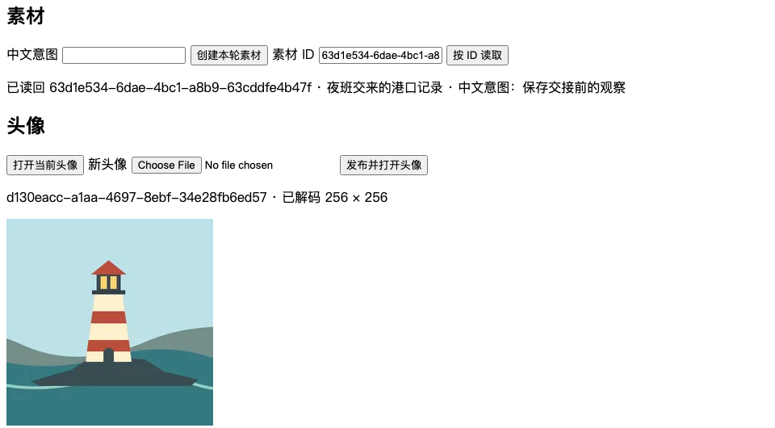

# 第 79 章　原主机失联以后，哪些业务能先恢复

接班时，用户说昨晚的素材打不开了。第 77 章留下了一份能恢复的库和桶，第 78 章留下了两份能运行的程序。现在有两个决定只能由接班人做：哪份程序能接这份数据？如果恢复库说一封信还没发，谁能证明它在停机前究竟有没有寄出？

这次演练用一个旧账号、两笔有先后关系的素材和一封注册邮件贯穿。**用户业务恢复**约定为旧用户从另一台设备登录，读到备份前的原文和原头像，再创建一条带中文意图的素材，按新 ID 读回。邮件、通知和对象清理分别交班。主线沿用 B 的发布代码和原有迁移。阅读约 25～35 分钟；已有第 77 章恢复目标和第 78 章制品时，双端准备、停机、恢复与核验另需约 55～85 分钟。估时包括操作和取证，事故计时另算。[本章沿用的配套分支](https://github.com/SamChowRock/epp-public/tree/part-09/chapter-78)

## 79.1 决定是否需要另起一台主机

**先给接班人留一道可以判分的题。** 在独立的演练部署上，把第 78 章最后一行交接记录带过来：B、`CAPTURE_INTENT_MODE=required`、新修订保护已启用、当前交付页能填写意图。第 78 章的**发布前**备份没有后来写入的素材，也没有最终启用的保护。本轮要新取一次**发布后**的共同恢复点。沿用现成数据时先确认旧账号仍可登录。首次搭双端的读者可从[环境准备](../../environment-setup.md#准备第-79-章的两端与独立收件箱)开始。

1. 安排演练的人在旧机停止邮件循环、通知消费者和清理调度，确认已有单笔作业结束。让 Mailpit 运行在旧机之外，邮箱仅用于这次练习。在原入口用 Postman 登录，沿第 78 章取得 CSRF，发带新 `Idempotency-Key` 的 `POST /captures`，正文填 `{"originalText":"夜班交来的港口记录","chineseIntent":"保存交接前的观察"}`。记下 201 的素材 ID、原请求和键。发布练习灯塔头像，按当前头像地址下载一次，记下头像 ID、对象键、媒体类型、实际字节数及 SHA-256。
2. 向 `POST /auth/register/request` 提交 `{"email":"本轮唯一练习地址"}`，换用自己控制的练习收件地址。HTTP 202 只说明接口接单。在源库 DBeaver 用 79.4 的查询确认确有一条本次申请，记下待办 ID，状态应为 pending、尝试数为 0。Mailpit 里此地址尚无来信。有别的申请或来信就换一个唯一地址重新取样。
3. 按[第 77 章](../chapter-77-backups/chapter.md#772-先取得库与桶的共同恢复点)封住所有写入、停妥存储，取库与桶的共同副本。记下停写生效时刻。把加密材料和清单移出旧机并核对摘要，解密授权单独保管。重新启动旧存储与 API，发送循环仍停。现在用**新键**创建第二笔素材“备份结束后才抵达”，记下成功响应里的 ID。这个响应留在模拟用户手里。
4. 在旧部署只发送步骤 2 的那笔。沿[第 70 章的单笔邮件入口](../chapter-70-service-runtime/chapter.md)，用实际邮件系统身份、邮件配置和预期库名运行 `send-one.js 预期库名 本次待办UUID`，最后一个参数要填完整。收到 accepted 后，在旧库读到同 ID 的 accepted、尝试数 1，在独立 Mailpit 核实恰有一封。保留外部记录。把清单交给接班人，收回旧机访问，后文只允许从接收端、用户设备、外部管理面和收件端取证。

真实报障通常只给你一句“打不开”。先保留浏览器网络面板的失败阶段和时间，在另一台信任原证书的设备打开**同一域名**。如果另一台能读出刚记下的素材，而第一台在证书校验处停止，先沿第 71 章查时间、信任链和域名。若两台都超时，再从独立监测查最后一次成功和第一次失败，到虚拟化或云平台查看实例、电源和网络事件。SSH 超时与浏览器超时可能共用一条链路，两次超时不能独立证明主机已停。若入口可连但返回 503，保留代理和上游各自的结果，沿第 74 章查故障范围。

把“再等旧机多久”落到时钟上。比如承诺中断后 30 分钟恢复，距离最后成功已有 12 分钟，最近一轮异机恢复需要 15 分钟，那么只剩约 3 分钟可用于等待旧机，且尚未留出波动余量。可以一边定位、一边在隔离网准备恢复。当控制面确认实例已停且无法按期恢复，记下决定和证据。若控制面也失联，接下来要找能独立挡住旧写入者的人，不能凭一次 ping 失败宣布切换。

## 79.2 先收住旧服务仍可能造成的影响

设想现在只改了 DNS。一台还缓存旧地址的客户端可能继续往旧库写；即使所有浏览器都去了新入口，旧机里的邮件 Worker 仍可能直接连 SMTP，清理任务仍可能拿着旧凭据删除头像。两台都认为自己可以写时，稍后选哪一份库都会丢另一边的历史。这就是切换前要**从故障机之外隔离旧写入者**的原因。[PostgreSQL 对故障切换与旧主机隔离的说明](https://www.postgresql.org/docs/18/warm-standby-failover.html)

在一次性虚拟机练习中，最短的证据是从宿主管理界面关闭**旧实例**，看到电源状态已停止，停用会让它自动重启的策略，并保持只有演练负责人能重新开机。记录实例标识和时间，从原入口复测。只有一个容器显示 Exited 时，数据库、清理 timer 和宿主上手动启动的发件人都可能还活着。最好让观察人指着控制面上的实例名和备份清单核对一次，尤其当两台机用了相同库名时。

在共用外部数据服务的部署，可以在负载均衡器撤下旧后端，在网络或供应商侧撤销旧机通往数据库、桶和 SMTP 的路径。用目标侧访问日志、活动连接和撤权结果逐项核对。数据库禁用旧登录后还要识别并排空既有会话；若两机共用身份，先给新机独立身份，别把仍有效的旧密码复制过去又指望它能区分来源。尚不能证实隔离的路径，写进交接单并保留限制。对仍能独自写本地磁盘的旧主机，还要阻止旧客户端访问，保全分叉数据供事后对账。

新机先只让操作端进入，数据库、对象服务、邮件出口和清理排期分别控制。整组恢复旧的开机配置可能立刻启动消费者。Compose 先只选 `api`，原生部署只启动 API 对应 unit；操作端登录本身就会写会话，所谓“入口受限”是限制谁能操作。若旧机去向未明，可以在与共享服务完全断开的副本做核验，继续向真实用户显示维护状态。以后找回旧机，先在隔离网络取证，旧数据有额外写入时逐笔核对，再决定重建；不要把它接回入口让两个副本自行追平。

## 79.3 在隔离目标重建可读的服务

在恢复机打开异地清单，按**业务时点**选择已校验的发布后副本，取对应的目标平台制品与当前交付页。先核对外层密文的独立摘要，取得授权后解密到新的私有目录，再核对库与桶的摘要。库和桶必须有同一次停写记录。若只有发布前副本可用，就从该副本实际拥有的迁移、保护状态和旧客户端开始，单列缺失的发布后写入；要晋级到 B，再走第 78 章的迁移与验收。

在目标机按[77.4 的空目标恢复步骤](../chapter-77-backups/chapter.md#774-在空目标恢复保留原权限边界)建立独立实例、空库和普通所有者，运行 `pg_restore --single-transaction --exit-on-error --no-owner --no-privileges`，指定恢复库。再按交接单重建基础角色、当前登录的继承关系和已生效的列授权。跳过归档 ACL 后，账号“能连库”并不代表通知有权写收件箱。相同库名也不能识别副本。在 DBeaver 给恢复连接单独取名，先看连接属性里的主机和端口，然后在该连接的 SQL 编辑器执行：

```sql
SELECT current_database(), current_user, inet_server_addr(), inet_server_port();
SELECT migration_name, finished_at, rolled_back_at
FROM public._prisma_migrations
WHERE migration_name = '20261119010000_revision_intent_guard';
SELECT tgname, tgenabled
FROM pg_trigger
WHERE tgrelid = 'public.capture_revisions'::regclass
  AND tgname = 'new_revision_intent_required' AND NOT tgisinternal;
```

本轮应有已完成且未回滚的迁移，最后一行是 O，表示普通写入会触发保护。若查到 D，迁移可能已安装而保护尚未启用；没有这一行则先查副本年代和查询目标。保留现场，与发布交接单对照。直接跑激活脚本能让结果变成 O，却会抹掉“选错副本”的线索。

再将停妥的整份单机 SeaweedFS mini 目录解入空目标，保留 Filer 元数据、Volume 字节和私有身份，使用匹配的二进制、工作目录和配置启动。原生 B 用适合新机系统及架构的已验产物；镜像路线从可信归档加载 Linux 镜像，核对运行容器的 `.Image`，按[73.3 的环境接线](../chapter-73-compose-deployment/chapter.md#733-让已有数据服务接受新位置的受限调用)创建新项目、外部网络和独立的角色配置。沿用第 73 章布局时，数据库与桶在宿主，Docker Desktop 的 Volumes 页不会列出这两份数据。若自己把数据容器化，应在 **Containers → 对应实例 → Inspect → Mounts** 核对真正的数据目录和卷，再用旧样本验收。换项目名自动建出的空卷也能让服务亮绿灯。

还原获准使用的签名密钥、私有桶身份和 B 的 required 配置，核对反向代理、可信代理来源、网页登录 Origin、证书域名、签名对象地址与客户端信任。第 71 章的 API 和对象下载各有一条 HTTPS 路径。在试验客户端临时把原域名指到新入口，保留域名验证；用 IP 直连或关闭证书校验会漏掉切换后的真实问题。在 Debian 的恢复部署目录采用 Compose 时，先检查 `compose.env` 和三个角色各自的私有配置所指目标。用与第 73 章相同的文件布局，在此目录的部署终端只启动 API：

```bash
sudo docker compose -p epp79 --env-file ./compose.env -f ./compose.yaml \
  up -d --no-deps --pull never --wait --wait-timeout 90 api
sudo docker compose -p epp79 --env-file ./compose.env -f ./compose.yaml ps -a
```

`-p` 将容器归入这次恢复项目，`--pull never` 使用已核摘要的本地镜像；要先准备好定义中引用的 external 网络、挂载路径和独立配置。如果出现 mail 或 cleanup 已启动，先查旧项目、重启策略及宿主 timer。原生路径则按第 70 章把 B 的生产入口装进 API unit，核对它加载的环境文件，单独启动 API。先让代理只接测试客户端，再按顺序操作：

1. 打开 B 的交付验收页，用旧账号**重新登录**。在“素材 ID”填备份前的 ID，点“按 ID 读取”，核对原文和中文意图。点“打开当前头像”，看相同 ID 是否解码成灯塔图。用本次新签的 URL 单独下载，核对 WebP、字节数和摘要。签名接口 200 只说明拿到了地址；这一轮恢复时它曾返回 200，紧接的对象请求却为 503。等存储监听就绪后，重新签发、下载，才读到原字节。
2. 在 Postman 用此账号和新会话的 CSRF，原样重放备份前的正文与键，应返回原 201 和原 ID。到 DBeaver 用 `capture_write_receipts.operation_id` 查这把键，对照所属用户、操作、`capture_id` 和 `status_code`。再用同一账号按第二笔 ID 读详情。对有源端成功响应的那笔，本轮得到 404；结合第一笔可见、归属一致、恢复点在两次创建之间，才可将缺失归入备份窗口。
3. 确认 79.2 的旧写路径已经隔离，并从独立记录复核恢复点后禁用的账号、已撤销的会话和待删除的数据。凡无法核清的账号或访问范围继续封住。完成这些核对后，先把新入口交给获准试用的用户。让独立设备登录、读旧素材、下载原头像，随后用新键或网页“创建本轮素材”写一条带意图的素材，记录新 ID 并重新读取。在统一入口放量时，再从实际用户网络按域名复验。把最后一次成功业务动作的时刻记下来。



图 79-1　原机已关机。素材 ID 以 `63d1e534` 开头，头像 ID 以 `d130eacc` 开头。浏览器读到 256 × 256 的图；独立 Linux 客户端通过校验证书的 HTTPS 下载 2,062 字节，SHA-256 为 `2a3fc9c0d558b43e9c1dbeee10e7b80951665f036a4c11e5b42b3aa93cc4cef1`。读者应比自己的基线，同一张图重新上传也会产生新的对象 ID。

## 79.4 给备份之后已经发生的投递对账

此时如果只看恢复机，会得到一个很有说服力的错误结论。在恢复库 DBeaver 用观察身份执行下面两条，把地址换成 79.1 单独使用的练习地址。这里返回申请、待办和通道事实，不需要读取令牌：

```sql
SELECT o.id AS job_id, o.intent_id, o.purpose, o.recipient,
       o.status, o.attempts, i.issued_at, i.expires_at, i.consumed_at
FROM public.verification_outbox o
JOIN public.verification_intents i ON i.id = o.intent_id
WHERE o.recipient = 'dr79-e2b8e927@example.test'
ORDER BY i.issued_at, o.id;

SELECT id, paused_by FROM public.verification_mail_control WHERE id = 1;
```

这轮待办 `04f912cc-7b38-404c-b7a5-e50742504106` 显示 pending、0 次，通道行存在且 paused_by 为空。恢复库忠实地回答了“备份时是什么状态”。打开**独立保留**的 Mailpit 网页，在收件列表搜这个地址，选择注册验证信，核对 To、Subject、到达时间和数量。只留信头作为交接依据，别把正文里的令牌贴进工单。若收件箱也随数据库回到了过去，这次搜索就失去了独立性。


图 79-2　同一申请的信在 02:35:37 UTC 已进入收件端，此时备份早已完成。这里能对应到那条待办，是因为整个实验只有这一次申请、唯一地址、一次按指定 ID 发送，收件箱从空变成一封。Mailpit 或邮件头的消息 ID 与 EPP 待办 ID 属于不同系统。真实地址可能短时间内收到多次申请，此时要找能关联**本次投递**的供应商回执、业务关联记录或发送审计；仅按地址与主题猜测，就保留“结果未明”。SMTP 接受也不能证明真人已阅读。

还有一处更隐蔽的分叉。正常发送者领取任务后才生成邮件令牌，在数据库事务里更新申请的令牌摘要与尝试数，然后才交给 SMTP。恢复覆盖了这次更新，外部收件箱却保留了已寄出的字节。这一轮只在内存比较邮件中令牌的摘要与恢复库的摘要，结果不相等。即使还在有效期内，用户手里这封信也无法凭该令牌完成原申请。给待办补一个 accepted，不会让原令牌重新有效。

因此把**已寄出、恢复库仍待发、旧令牌与恢复状态不匹配**记为同一笔处置，保留原行、时点和外部依据。向受影响用户说明需要走新的正常申请流程；先核清旧代次、允许的新申请与可定向发送的范围，再按原业务规则处理。调查范围要从共同恢复点一直看到**旧发送权真正截止**，备份后创建且已投递的申请甚至不会出现在恢复库里。逐笔核对到期、被替代、已消费及未决的申请。第 45 章解锁 unknown／attempting 的 SQL 处理不了这条 pending；空的 paused_by 也不会代接班人暂停。实际停用所有循环、watcher 和旧出站通道。对另有证据且获准的单笔，可以用指定 UUID 的入口；只要普通循环还可能捡到未决项，继续停用它。

**站内通知可以单独恢复。** 它把通知写进同一个数据库，任务 ID 同时是收件箱事件 ID。恢复端从通知连接核对下面的关联，检查收件人状态、到期时刻、同 ID 的归属和种类，据此决定哪些通知仍能入箱。可以用两笔合成任务验证这个决定。在仅供演练的恢复副本、通知仍停时，DBeaver 以所有者连接，先核对库名。下面把两个相同的占位 UUID 换成同一个**有效练习用户**，执行一次并保存返回的两个 ID。这两行是恢复后为验证消费新造的样本。提交后只启动原生 `epp72-notify` 或 Compose 的 `notify` 服务，按返回 ID 查结果，邮件仍暂停。

```sql
INSERT INTO public.notification_jobs (id, user_id, kind, created_at, expires_at)
VALUES
  (gen_random_uuid(), '练习用户UUID'::uuid, 'registered', now(), now() + interval '1 day'),
  (gen_random_uuid(), '练习用户UUID'::uuid, 'password-reset', now() - interval '2 days', now() - interval '1 day')
RETURNING id, kind, status;
```

本轮两笔起初都 pending；通知进程消费后查到：

| 通知任务 | 消费后的状态 | 收件箱有同 ID 事件 |
| --- | --- | --- |
| `496e924f…`，有效 | done | 有 |
| `3e8fe0e1…`，已过期 | obsolete | 无 |

```sql
SELECT j.id, j.kind, j.status, j.expires_at,
       n.id AS inbox_id, n.user_id = j.user_id AND n.kind = j.kind AS same_event
FROM public.notification_jobs j
LEFT JOIN public.notifications n ON n.id = j.id
ORDER BY j.created_at, j.id;
```

工作进程在一个事务里检查已有事件，必要时写入并完成任务。没有事件且已过期或收件人不再有效，就作 obsolete；同 ID 的事件归属或种类不符，要停下来查。此轮两条任务处理完，外部邮箱仍只有一封。若用户在备份后已经看过站内通知，恢复到更早的已读状态仍属于数据损失，要另行说明。

对象清理排在最后。用观察身份确认当前头像指针、所属用户和对象实读，再看第 75 章的到期积压与个别旧对象。在正确目标上用清理身份指定**仍为当前头像的 ID**，预期领取零笔，复读当前图；有获准的已替换样本时，再定向清理并验证旧键与当前键的结果，最后才恢复对应 timer。只有当前图、没有可处置样本时，可以交付头像读取，留清理排期待验。这轮在恢复库用另一个练习账号连续发布两版头像。单笔指定原账号的灯塔头像，清理返回零笔；待第二账号的旧版到期，以独立清理身份只处置旧版，返回一笔。观察端重新查旧键得到 404，第二账号的当前图可读，原账号的灯塔字节摘要也保持。交接时可以放行这个清理范围，邮件仍停。[第 75 章的单笔清理和排期](../chapter-75-maintenance-jobs/chapter.md)

## 79.5 按业务动作核对恢复时间

下面是小型副本这次交班用的 UTC 时间。源服务在 Debian 虚拟机，接替服务在 Mac 的独立实例，验收客户端在 Docker Desktop 的 Linux 环境。三者共用物理宿主，演练切断的是**源虚拟机**。要评估物理主机、可用区或机房故障，把恢复材料、密钥取用渠道和目标容量放到相应故障范围之外，再重测。

| UTC | 可独立说明的事实 |
| --- | --- |
| 02:34:51 | 全部练习写入者已停；库与桶共同恢复点 |
| 02:35:37 | 备份后的第二笔素材已写；独立收件端收到指定的注册信 |
| 02:36:38～02:36:43 | 旧 API 最后可达，随后控制面确认旧机已停；02:36:43 记为接报 |
| 02:38:34 | 独立客户端读回旧素材、下载原头像，再按刚创建的 ID 读回新内容 |

**用户业务中断约 111～116 秒**。中断只能夹在最后可达与已停之间，所以保留范围。接报到验收是 111 秒。对象路径第一次失败到重新就绪的时间也算在内。备份时点距中断约 107～112 秒；已知丢失的至少有第二笔素材，旧端回执里的 ID 为 `f686f288-c3ef-4d36-9b2d-11a2bcd75aa1`。没有完整源端流水就不能把“至少一笔”写成“恰好一笔”。独立客户端的新素材 `b8c08752-2fb8-4d20-bd44-d8bd207f510f` 已在新机读回，随后找回旧盘也要保护这笔新写入。

若约定素材与头像的 RTO 为 5 分钟、RPO 为 2 分钟，本轮两个上界都在目标内；若 RPO 为 1 分钟，这份备份就不够新。若承诺还包含“注册用户收到可用验证信”，目前不能报整项恢复。目标平台、兼容制品和练习信任材料在中断前已备好，副本很小，备份已移出源机；临时采购容量、下载镜像、取得密钥、公共 DNS 缓存或更大的库桶都可能改变结果。下一轮更换其中一个条件再计时，才能判断要投入在更频繁的恢复点、预置目标，还是更可靠的外部投递关联上。

交班单最后写明当前写主、可服务的入口、B 与保护状态、新旧素材 ID、旧机隔离证据、缺失区间和每项尚未放行的工作。账号在备份后若已禁用、撤销会话或要求删除，还需按独立处置记录复核后才能对相应用户开放；下部综合场景继续处理这类防止旧数据复活的门禁。下一章将 EPP 交给公网受邀使用者，以开发机关机后的外部读写验收交付。第 81 章会拿掉“已知是主机失联”这个条件，接班人先决定调查哪一层。

## 附录：本章必要技术点速查

| 现场问题 | 先看哪里 | 决策依据 |
| --- | --- | --- |
| 可以切写吗 | 宿主管理面、旧入口、数据库／桶／SMTP 的出口与活动连接 | 能从旧机之外证明旧写入者已隔离 |
| 该启动哪个版本 | 经验证的恢复点、制品摘要、迁移历史和触发器状态 | 本轮是 B、required、O，交付页也要能写中文意图 |
| 是否接上了正确的数据 | 原收据、原素材、当前头像的实际响应字节 | 健康检查与签名 URL 都不能代替对象下载 |
| 要不要补寄 | 恢复库待办、独立投递证据、申请当前有效性 | 分别判断是否已寄、原令牌是否可用、是否允许重新申请 |
| 何时停表 | 独立用户完成约定动作的时刻 | 分别计算中断区间、接报耗时、恢复点距中断的差值 |

恢复命令参数与信头检索可查 [PostgreSQL 18 pg_restore](https://www.postgresql.org/docs/18/app-pgrestore.html) 和 [Mailpit 消息查询接口](https://mailpit.axllent.org/docs/api-v1/)。

[上一章 · 发布、迁移与回退](../chapter-78-compatible-release/chapter.md) · [下一章 · 用 Northflank 部署 EPP，用 Cloudflare DNS 接入自有域名](../chapter-80-public-deployment/chapter.md) · [本篇导读](../README.md) · [全书目录](../../README.md)
