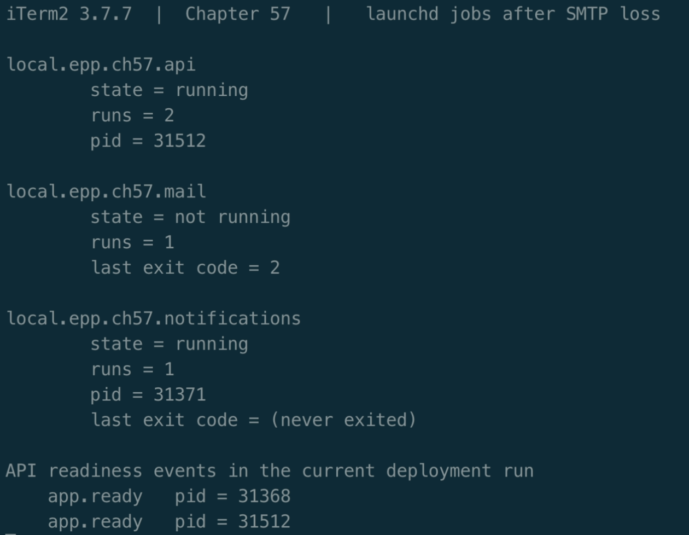
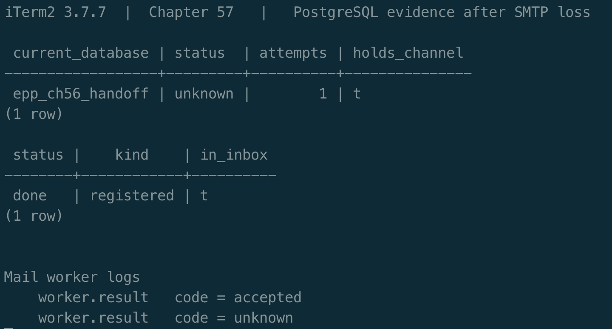

# 第 70 章　在本机直接部署服务

第 69 章结束时，API 在一扇终端里打出了 app.ready。另开一扇终端，原账号能登录，旧收据也能查。假如现在把这两扇窗口都关掉，明早是谁用哪份配置把服务开起来？那时登录成功的用户，读到的还是今晚这份数据吗？

先保留那个已经能工作的前台命令。我们要把它交给另一个启动者。中间只换一件事，就有办法定位失败：同一个程序、同一份数据，自己启动能用，交给系统却起不来，先比较两个启动者给进程的条件。如果自己启动都读不回旧数据，调整系统的重启策略只会把错误再做一遍。

业务与数据库结构沿用[第 66 章配套](https://github.com/SamChowRock/epp-public/tree/part-08/chapter-66)。在 Mac 的专用练习账号或单用户练习机用 iTerm2 跟做，需要 Node 24.22.1、PostgreSQL 18、配对的本机 SeaweedFS 和 Mailpit。本章配套在 API 和练习邮件的启动配置中开放两个地址选项。应用在前台运行，宿主负责启动和收尾。70.5 用 macOS 与 Linux 分别演示宿主如何接手。

## 70.1 用一张旧收据辨认部署目标

桌上有两份连接配置，都来自[上一章的交接](../../part-08-maintenance/chapter-69-review/chapter.md)。一份用空库引导，再放入固定用户，检查构建产物。另一份从旧环境恢复，账号曾被暂停，后来又已恢复。现在你知道那张暂停收据的 operationId，也知道当事人的 userId。假如挑错配置，查到用户、看到 web_enabled 为 true，甚至看到迁移全部完成，都有可能。要用哪个事实认出该接手的那一份？

若手头只有一份库，在该库按交接单查证，另一份的对照读数见下文。先在 DBeaver 给手头的练习连接各开一个 SQL 编辑器，分别选中下面第一条执行。窗口名可以自己改，查询结果由真正接受连接的 PostgreSQL 给出。把库名、地址和端口与建库记录对上；用 Unix socket 登录时地址、端口可以为空。第二条在有读取迁移历史权限的连接执行，它告诉你这个库记下了多少条已完成的迁移。仅凭条数，还不知道它们具体是哪几条。

```sql
SELECT current_database() AS db, current_user AS actor,
       inet_server_addr() AS address, inet_server_port() AS port;
SELECT count(*) AS finished_migrations
FROM public._prisma_migrations
WHERE finished_at IS NOT NULL AND rolled_back_at IS NULL;
```

回到交接单，取**同一个账号和同一笔暂停 ID**。在两扇窗口执行同一条查询，替换两个占位符。这里从用户表出发做 LEFT JOIN，特意留下“有这个人，却没有这次操作”的情况。

```sql
SELECT u.id, u.web_enabled AS web_now,
       r.operation_id, r.requested_enabled AS requested_then
FROM public.users u
LEFT JOIN public.web_access_receipts r
  ON r.user_id = u.id AND r.operation_id = '本轮暂停UUID'::uuid
WHERE u.id = '本轮账号UUID'::uuid;
```

用这两份练习库对照，双方都完成了 22 条迁移。交付检查库里，这个操作 ID 命中 0 笔；交接库里命中 1 笔。读最后两列时分清三种结果：没有用户则整条查询是零行；用户在而收据不在，右侧为 NULL；找到旧暂停，requested_then 为 false，再看 web_now 可以已经是 true。后一种组合正好把当时的决定和恢复后的现状放在一起。若从交接库再复制一份，两边都会命中这张收据。它能证明副本包含那次办理；要确定部署应指向哪一份，还得回到建库记录，用实例地址、端口和库名对照。

已有独立交接副本时直接沿用。从本章开始的读者，可按[第 63 章的账号与收据步骤](https://github.com/SamChowRock/epp-public/blob/part-09/chapter-70/database/chapter-53/README.md)在独立库办一次暂停再恢复。若还需复制原环境，先停止接受写入、排完在途操作和后台写入者，在同一停写窗口内按[非空库备份与恢复](https://github.com/SamChowRock/epp-public/blob/part-09/chapter-70/database/chapter-22/backup-restore.md)取数据库副本。停妥原存储后复制完整练习目录、身份配置与数据。这种整目录复制用于同平台、同版本的停机练习。第 83 章再验证逻辑备份。

数据库样本认出来了，为什么还要记一个头像键？第 62 章遇到过这样的事故：两个库共享一个桶，副本回收了一个它认定已退役的头像，原账号仍能拿到签名地址，浏览器取图却只得到 404。现在只执行 `SELECT id, avatar_id FROM public.users WHERE avatar_id IS NOT NULL;`，挑一个知道密码的主人并记下键。70.2 会启动配对的独占桶，用应用身份核对精确键；70.4 再让这个主人登录并实际取图。三次观察分别落在引用、对象和用户访问上，中途失败就知道该回哪一层。若原本没有头像，到 70.4 才在独占桶用集合 25 创建样本，保留“这次新建”的区别。

交接单记下库的连接目标、最后一条已完成迁移、收据 ID、对象键、构建来源以及接信工具的本机端口。秘密只记到哪里取得。邮件通道先看一眼，下面的查询也留给 70.6 使用。

```sql
SELECT current_database() AS db, c.paused_by, o.status, o.attempts, o.lease_until
FROM public.verification_mail_control c
LEFT JOIN public.verification_outbox o ON o.id = c.paused_by
WHERE c.id = 1;
```

有占用时先沿事故 ID 查。[第 53 章](../../part-06-background/chapter-53-retries/chapter.md)区分过租期内的发送者与应由人处理的未知结果。这样的副本仍可验证 API、旧收据和头像。要完整做 70.6 的故障对照，选一份已有业务资料、通道开放且允许投递到本地收件箱的独立副本，从 70.1 起对这份副本操作。

## 70.2 让运行账号只拿到这次部署需要的东西

### 从一次头像读取找出权限边界

用户登录后点头像。API 要先用本机账号读取配置文件，才能知道用哪个数据库角色连库。数据库根据该角色的权限返回当前的头像键，服务再用 S3 应用身份签出短期地址。现在沿同一条请求改一个条件：如果本机账号连 config 目录都进不去，Node 在打开配置时就失败，数据库看不到这次连接；如果配置读到了，表却不能 SELECT，错误来自 PostgreSQL；如果返回了地址，实际取图仍可能在对象存储处被拒。处理第三种故障时，给数据库角色加表权限帮不上忙。

先定部署范围。本章在一个练习用系统账号下运行三个角色。它们可以有不同的退出策略，但以相同用户身份运行的进程仍有能力读取对方的私有配置文件。若部署目标要求邮件进程即使失陷也拿不到签名密钥，就要分配不同的系统身份和目录权限。这里先解决操作失误、凭据分发和进程托管。

### 哪些文件跟着一版程序替换

想象下一班人准备替换 release。编译后的 server.js 和随构建复制的 service.json 必须一起换；账号连接配置、投递去向和游标签名密钥应当能交给新进程继续使用；刚才的事故日志还要留着。由这三个动作，可以画出四个目录：release 放可以整份替换的产物，config 留给运行时身份与配置，logs 存运行历史，work 给进程落临时文件。数据库与对象存储有各自的数据目录，换 release 时不会动到它们。

在专用练习账号的 iTerm2 中运行 `/bin/bash`，进入[本章配套](https://github.com/SamChowRock/epp-public/tree/part-09/chapter-70)根目录。若从第 66 章跟写，先从[第 70 章代码](https://github.com/SamChowRock/epp-public/tree/part-09/chapter-70/src)取 config.ts、serve.ts、mail-worker.module.ts 和 verification-delivery.ts，接入本节说明的地址选项，再从[本章部署工具](https://github.com/SamChowRock/epp-public/tree/part-09/chapter-70/examples/deployment)取 runtime-grants.sql、launch-agents.mjs 和同目录的 launch-plist.mjs，保留相对路径。

先让当前窗口记住三个位置及目标库。源码根有 .nvmrc，`nvm use` 从中选 Node 版本；`command -v node` 显示这个 Shell 实际会执行哪个 node。若 Bash 找不到 nvm，按安装时的路径加载 nvm.sh，默认位置可用 `. "$HOME/.nvm/nvm.sh"`。开头的点让定义在当前 Shell 生效。

```bash
umask 077
src=$(pwd -P)
deploy="$HOME/Library/Application Support/EPP/ch57"
db=epp_ch57_handoff  # 替换为建库记录中的名称
nvm use
node_bin=$(command -v node)
printf '源码：%s\n部署：%s\nNode：%s\n库：%s\n' "$src" "$deploy" "$node_bin" "$db"
```

`$(…)` 把命令的输出放进变量；`pwd -P` 给出解析符号链接后的当前目录。核对最后打印的四行，尤其是含空格的部署路径和 Node 的绝对路径。后续使用 `"$deploy"` 的双引号是为了把整个路径作为一个参数传递。另开 iTerm2 标签页时，回到同一源码根，重做上面这段即可恢复变量。下面的建目录与构建只在初次部署时做。

```bash
mkdir -p "$(dirname "$deploy")"
mkdir -m 700 "$deploy" && mkdir -m 700 "$deploy"/{release,config,work,logs}
```

`dirname` 取出上一级目录，`mkdir -p` 补齐缺少的父目录，已有的可以沿用。下一行刻意要求部署根是新的；`-m 700` 指定新目录的权限，花括号由 Bash 展开为四个子目录。若得到 File exists，右侧的 `&&` 会让建子目录这一步停下。先看这个目录是否属于要接手的部署；做第二份练习时改用新路径，避免把新产物混进旧版本。

从源码根依次完成下面三步，每步成功才执行下一步：

```bash
npm ci && npm run ci:check
cp -R dist package.json package-lock.json .npmrc "$deploy/release/"
(cd "$deploy/release" && npm ci --omit=dev)
```

第一次 `npm ci` 按锁文件安装构建所需依赖，ci:check 完成项目检查和构建。复制时 `-R` 让 cp 带上整个 dist 目录，另外三个文件让接手方能按同一清单、锁和 npm 配置安装。最后一行在括号里的子 Shell 切换目录，`--omit=dev` 只把生产所需依赖装进 release。它结束后，你仍在源码根。

为什么还要为 work 专门建一个目录？在同一份构建里，有两种看起来相似的相对路径。加载服务默认配置的代码从编译模块的位置找文件，接收头像的代码从进程的当前目录创建临时文件：

```js
// 配置加载处，import.meta.url 属于正在执行的模块
new URL('../config/service.json', import.meta.url)
// 头像接收处，resolve 用进程的 cwd 解析相对路径
resolve('.avatar-tmp')
```

即使从 work 启动，两者也分别落到 release/dist/config 和 work。假若把 release 当作 cwd 并交给服务账号只读，登录可能一直正常，第一笔上传才在创建临时目录时报错。把整个 release 改成可写也能让请求暂时成功，却把覆写应用程序的能力一并交给了运行进程。保留只读产物、只让服务账号写 work 和 logs，恰好满足两处代码各自的需要。单账号练习中，0700 保护拥有者以外的人；同一账号同时拥有程序和目录时，无法靠这个模式把部署者与运行者分开。

读权限时可以直接对着一行输出解码。在 iTerm2 执行 `ls -ld "$deploy/config"`。`-l` 显示权限和拥有者，`-d` 查看目录本身；少了 d，看到的是目录里面的文件。预期模式开头是 `drwx------`。开头的 d 表示目录，接下来的三组各管拥有者、同组和其他人。在目录上 r 允许列名字，w 配合 x 允许增删条目，x 允许按名字进入和查找。即使配置文件本身可读，任一级父目录缺少这个账号的 x，进程也打不开它。

八进制的一位用读 4、写 2、执行或遍历 1 相加。700 把三项都给目录拥有者；配置文件只需读写，对应 600。`umask 077` 是创建时的掩码，会屏蔽新文件给同组和其他人的权限，已经存在的文件则要用 chmod 调整。单账号练习可以用 ls 核对；分开部署与运行账号时，还应从真实运行身份尝试打开配置、在 work 创建暂存文件。

### 从一次暂停操作推导数据库授权

再回到那张收据。查原决定要 SELECT；办理新的暂停，要更新用户资格并 INSERT 新收据。假如运行业务所用的凭据还可以 UPDATE 昨天的收据，后天调查时就很难相信“当时请求停用”这一列。这给授权提供了可以检验的边界：在这两张收据表上允许查旧行和追加新行，改表结构的能力留在执行迁移的身份。表所有者拥有结构控制权，用它启动 API 会绕过这层分工。

角色属于整个 PostgreSQL 实例，表权限则落在某一个库的具体对象上，所以这里要连接两次。先在 iTerm2 的源码根填入建库记录，再用有创建角色权限的管理员连接练习实例的 postgres 库：

```bash
pg_port='替换为练习实例端口'
pg_admin='替换为该实例的管理员角色名'
pg_owner='替换为练习库的业务表所有者'
psql -X -h 127.0.0.1 -p "$pg_port" -U "$pg_admin" -d postgres
```

`-h`、`-p` 选择主机与端口，`-U` 选择数据库角色，`-d` 选择库。`-X` 跳过个人 psql 启动配置，保证练习不受自定义命令影响。进入 psql 后先输入 `\conninfo` 回车，与交接单核对。带分号的 SQL 由服务器执行，行首反斜杠是 psql 自己解释的命令，回车即执行。下列 SQL 创建能登录的普通角色，禁止超级用户、建库和建角色能力。第二行会提示交互输入新密码。已存在同名角色时先核对其归属、成员关系和对象所有权。

```text
CREATE ROLE epp57_run LOGIN NOSUPERUSER NOCREATEDB NOCREATEROLE;
\password epp57_run
```

在 psql 输入 `\q` 回到刚才的 Bash。这次连接业务表所有者及**目标库**，仍从配套源码根运行：

```bash
psql -X -h 127.0.0.1 -p "$pg_port" -U "$pg_owner" -d "$db"
```

进入 psql 后逐行执行，第二行的库名抄自独立建库记录：

```text
\conninfo
\set expected_db epp_ch57_handoff
\i examples/deployment/runtime-grants.sql
```

`\set` 只设置 psql 变量，不会切换连接。`\i` 从启动 psql 的当前目录读取脚本，按**当前连接身份**执行。若报找不到文件，用 `\! pwd` 查看 psql 的本地工作目录；若报 Wrong deployment database，重新核对主机、端口和库名，再连到正确的库。把 expected_db 改成眼前的错误库名会失去这次保护。[psql 的命令与选项](https://www.postgresql.org/docs/18/app-psql.html)

读[授权脚本](https://github.com/SamChowRock/epp-public/blob/part-09/chapter-70/examples/deployment/runtime-grants.sql)时，沿一条查收据的请求看三层授权。CONNECT 允许进入该库，USAGE 允许在 public 模式中按名找到对象，表上的 SELECT 才允许读行。脚本给两张收据表另授 INSERT，办理新操作可追加记录；它没有授 UPDATE。上述授权在同一事务中完成，预期输出以 BEGIN 开始，中间是各条 GRANT，最后是 COMMIT。看到 COMMIT 后再换运行角色验证。GRANT 会追加权限，角色以前从所有权、其他角色或 PUBLIC 得到的能力仍可能生效。

换成备份进程，权限应如何变化？它需要扫描运行角色看不到的迁移历史，但不必修改一条业务行。管理员可以单独创建登录角色 epp57_dump，用 psql 的 `\password epp57_dump` 设置密码；由所有者在本轮库授 CONNECT、对 public 授 USAGE，再授下面的读取权限。新表还需核对授权。这份凭据足以导出口令摘要和会话，和导出文件一起按秘密保管。恢复结构、还原角色和恢复桶还有各自的授权条件，留到第 83 章处理。

```sql
GRANT SELECT ON ALL TABLES IN SCHEMA public TO epp57_dump;
GRANT SELECT ON ALL SEQUENCES IN SCHEMA public TO epp57_dump;
```

如果只做本章部署，可以跳过备份角色的创建与授权。从所有者的 psql 用 `\q` 回到 Bash，再执行 `psql -X -h 127.0.0.1 -p "$pg_port" -U epp57_run -d "$db"`。先用 `\conninfo` 看清这次的角色，再执行下句。第一项应为 false，第二项为 true，第三项为 false。若 public 仍允许 PUBLIC 建对象，或旧角色继承了所有者权限，先在练习库清理旧授权再测。连接的数据库账号和操作系统登录账号可以不同。

```sql
SELECT has_schema_privilege(current_user,'public','CREATE') AS can_create,
       has_table_privilege(current_user,'public.web_access_receipts','INSERT') AS can_issue,
       has_table_privilege(current_user,'public.web_access_receipts','UPDATE') AS can_rewrite;
```

还可以在运行角色的连接里试一次没有匹配行的更新。请在自动提交的 SQL 编辑器里单独执行 `UPDATE public.web_access_receipts SET requested_enabled = false WHERE false;`。这里没有一行能被改动，数据库仍先检查 UPDATE 权限。本轮收到 `permission denied for table web_access_receipts`。如果自己的结果是“更新 0 行”，语句已经获得执行许可，应回查 current_user 及其继承权限。单靠观察数据有没有变，无法区分这两种结果。[PostgreSQL 的对象权限](https://www.postgresql.org/docs/18/ddl-priv.html)

输入 `\q` 退出 psql，回到 Bash。下节的路径和变量由 Shell 解释。

### 把配置交给真正要用的角色

当你给通知进程填配置时，试着从它领到一条任务之后的动作往回找：它在同一个库里读任务、写收件箱，最后标为 done，整个过程没有打开 SMTP 连接，也没有签发头像 URL。复制一整份 API 配置给它，既增加了可读取的秘密，也让排错时多出无关变量。邮件角色比它多一个投递目的地；API 负责 Cookie、写入来源和签名地址，才要知道 Origin 与相应密钥。

用编辑器新建三份权限为 0600 的文件。先执行下列准备命令，再在编辑器里填写值。第二和第三份以 api.env 的三条公共设置为起点，分别加入下文说明的角色配置。

```bash
for role in api mail notifications; do
  touch "$deploy/config/$role.env" && chmod 600 "$deploy/config/$role.env"
done
```

循环依次把 api、mail、notifications 放进 role。touch 创建缺少的文件，已有文件保留内容；chmod 600 明确设置现有文件的权限。填好后执行 `ls -l "$deploy/config"`，看三行文件名、拥有者与 `-rw-------`，不用打印文件里的密码。

每份含生产模式、带运行角色的 DATABASE_URL 和每进程连接上限 DB_POOL_MAX。数据库 URL 中有特殊字符的用户名或密码须按 URL 分量编码。API 另需 PORT、APP_ORIGIN、稳定的 CURSOR_HMAC_KEY，以及配对桶的 app.env 中四项 AVATAR_S3 配置。邮件使用 LOCAL_SMTP_PORT，可用 LOCAL_SMTP_HOST 选择私有练习收件端，默认 127.0.0.1。通知只用公共配置。下面是 **api.env 的填写结构**；把占位符替换为自己已验证的值。若以前已签发游标，沿用原密钥；首次部署才生成 32 个随机字节的十六进制值。

```dotenv
NODE_ENV=production
DATABASE_URL=postgresql://epp57_run:<编码后的密码>@127.0.0.1:<PG端口>/<副本库>
DB_POOL_MAX=2
PORT=3358
LISTEN_HOST=127.0.0.1
APP_ORIGIN=http://127.0.0.1:3358
CURSOR_HMAC_KEY=<64个十六进制字符>
AVATAR_S3_ENDPOINT=http://127.0.0.1:18633
AVATAR_S3_BUCKET=avatars
AVATAR_S3_ACCESS_KEY=<应用访问键>
AVATAR_S3_SECRET_KEY=<应用秘密>
```

### 一个端口到底向谁开放

API 报地址已被占用，先找出是谁在接连接。在 macOS，每个监听套接字都由某个进程打开，lsof 可以从端口反查进程。API 启动前在 iTerm2 运行一次，70.4 看到 app.ready 后，在另一个标签页原样再运行一次：

```bash
lsof -nP -iTCP:3358 -sTCP:LISTEN
```

从要找的对象读这条命令。`-iTCP:3358` 选 TCP 的 3358 端口，`-sTCP:LISTEN` 只看正在等待新连接的套接字。`-n` 保留数字 IP，`-P` 保留数字端口，便于同 api.env 逐字核对。选了其他端口就换掉 3358。

第一次没有输出，说明当前账号没查到匹配的监听；端口仍可能在下一刻被占用。下面是这份 API 在 iTerm2 中运行时的一行，省略了与本次判断无关的列：

```text
COMMAND  PID    NAME
node     71028  127.0.0.1:3358 (LISTEN)
```

先看 NAME：这个进程在本机回环地址的 3358 端口等连接。再看 PID：只有它与这次 app.ready 里的编号一致，才能把这行归给本次 API。你的 PID 会不同。若启动前就有这一行，核对占用者，或换一个空闲端口并同步 PORT、APP_ORIGIN 和客户端。若在别的服务上看到 `*:3358`，它监听多个接口；本机配置默认绑定回环，其他设备访问主机的局域网地址无法抵达这个监听。

按[第 60 章说明](https://github.com/SamChowRock/epp-public/blob/part-09/chapter-70/database/chapter-51/README.md)启动独占的副本存储，在其项目根用 listeners.sh 和本轮 weed PID 核对**所有**监听。包括 Master、Volume、Filer、S3、管理与对应 gRPC。本章在单用户练习机上将其绑定回环，PostgreSQL 同样限制在本机并要求 TCP 口令认证。macOS 防火墙的入站设置是又一层控制；绑定所有网卡后仅靠一次本机请求，无法证明外部访问被拒。多人共用主机时还需隔离这些内部入口或启用对应认证。管理端与 S3 的应用权限各自管辖不同路径。第 81 章再给客户端开放代理入口。

如果 70.1 找到了旧 avatar_id，现在可以验证存储这一段。用配套源码里的观察程序，显式带入新 API 配置里的应用身份：

```bash
avatar_id='替换为原账号的avatar_id'
(cd "$src" && /usr/bin/env -i "$node_bin" --env-file="$deploy/config/api.env" \
  database/chapter-51/head-avatar.mjs "$avatar_id")
```

看到 Present、原 ID、类型和长度，说明这个端点的这个桶有一个应用身份可查到的对象。HEAD 只读元数据；等主人通过 API 拿到地址，还要从客户端实际 GET。若 HEAD 就得到 403，先查应用身份和桶权限。若在已验证身份的练习桶得到 404，先核对端点、桶名与复制记录，保留原账号指针供比对。

## 70.3 这台机器还容得下哪些进程

第 66 章把实验 API 的池调小到两席，看到过第三个调用在池外排队。部署时每个进程各建自己的池。假设 API、两个 Worker 和一条短时 CLI 都配 2，最多可为这四个进程申请 8 条连接；从同一扇终端启动两个进程，它们也各有自己的池。现在再开一个 API 做版本切换，还可能多用 2 条。池按需取连接，闲时在 DBeaver 只看到两三行也很正常。未设置时，这个版本的程序每池默认上限是 5。

```sql
SHOW max_connections;
SHOW reserved_connections;
SHOW superuser_reserved_connections;
SELECT datname, application_name, state, count(*)
FROM pg_stat_activity WHERE backend_type='client backend'
GROUP BY datname, application_name, state ORDER BY datname, application_name, state;
```

这台练习实例的三个设置依次是 100、0、3。对普通角色，按实例上限先算出 97 席，还要扣掉其他库与其他程序的需求。一次安静时刻，结果网格中只看到一条 idle 的通知连接和正在查询的 psql。前一个数是天花板，后一个数是快照。idle 连接仍占一个库内席位；一个池还没建出来的第二条连接则没有出现在视图里。

现在做一次发布决定。**假设**其他调用方在同一时段会用 83 席，维护者要给观察和应急操作留 5 个普通席位。还剩几个席位可分给 EPP？如果新旧 API 要重叠一分钟，你会允许现在发布吗？先按自己预计同时运行的进程数算一遍。

<details>
<summary>展开一种算法，再和自己的发布条件比较</summary>

普通角色共 97 席，扣掉 83 和 5，EPP 可安排 9 席。平时 API、邮件、通知和短时 CLI 共四个池，按上限算是 8 席。旧 API 还在时再加一个就是 10 席。此刻即使快照里有空位，也无法保证峰值还拿得到连接。若这段维护窗口可以暂停 CLI，重叠期间是两个 API 加两个 Worker，仍为 8 席；若 CLI 必须随时可用、服务允许短暂停机，可以先排空旧 API 再起新版。若两项条件都不能放宽，就需要重算池配置并验证峰值表现，或增加可用容量。这里的 83 和 5 要换成自己环境的需求。

</details>

若本来等的是同一账号上的锁，加池只会允许更多连接进库等待。可用[第 66 章的池与锁对照](../../part-08-maintenance/chapter-66-performance/chapter.md)在释放前判断。

等到 70.4 的 API 打出 app.ready，再在“活动监视器”按其中的进程号找 API，分别看空闲与一次真实登录时的 CPU，以及“内存”页底部的内存压力。一次登录可能短于界面的刷新间隔。在观察窗口先输入 `api_pid=12345`，把示例数字换成**本次** app.ready 的 pid，再运行 `ps -p "$api_pid" -o pid,pcpu,rss,etime`。这里保留列名方便对读数：`-p` 只选这个进程，`-o` 规定输出哪些列及其顺序。依次读 PID、CPU 占用百分比、驻留物理内存（macOS 上的 RSS 单位是 KiB）和进程已运行的时长。若上一轮的 PID 没有数据行，从当前就绪日志和监听重新找 PID；单个瞬间的 CPU 或 RSS 都推不出一次登录的峰值。

登录有密码计算，上传有解码后的像素缓冲。举例说，一张 2000×1500 的图，若展开为每像素 4 字节的一份缓冲，单这一份约占 11.4 MiB。编码大小、解码库内部使用的缓冲数量和多个同时在途的请求，是三个不同的量。只用 2 MiB 请求上限乘并发数，会漏算图片展开和原生库内存。磁盘则要同时放得下在用与待切换的构建、PostgreSQL 数据和 WAL、对象字节、暂存与备份。用下面两句量自己的目录，数据库与桶若在另一卷也要在那里查。备份目标与生产数据在同一物理盘时，剩余空间再多，盘故障仍会一起丢失。

```bash
du -sh "$deploy/release" "$deploy/work" "$deploy/logs"
df -h "$deploy"
```

du 遍历给定的目录，`-s` 为每个参数只报一个合计，`-h` 将大小换成便于读的单位。df 查的是容纳这个路径的文件系统；看挂载点和 Avail 列，才知道新版本还能放在哪里。把数据库目录换作 df 的参数，就能看它与 release 是否共用同一卷。这一轮用 du 量到安装生产依赖后的 release 占 438 MiB。两份同平台构建并存时，按每份独立占用估算就接近 876 MiB，还没有计入安装临时文件。若平时一份构建能放下，切换时装不下两份，应先腾出可核实来源的构建缓存或选择另一卷；删除旧构建会失去快速回退的路径。长期运行还要为日志设轮转和保留期限；本章先分角色写私有目录，第 82 章继续做观测与告警。

## 70.4 先在前台证明配置对得上

假设旧终端还导出了 PORT=3999，文件里明明写着 3358，接班人该去哪个端口找 API？先用公开的端口号做一次无网络的小实验。下面两个进程只读取配置并打印端口，其他环境值不会输出。

```bash
PORT=3999 "$node_bin" --env-file="$deploy/config/api.env" -p 'process.env.PORT'
/usr/bin/env -i "$node_bin" --env-file="$deploy/config/api.env" -p 'process.env.PORT'
```

命令前的 `PORT=3999` 只给这一次启动传值；Node 的 `-p` 求值并打印后面的表达式，所以两行都不会启动监听。第一行得到 3999，第二行才得到文件里的值。同样的优先级也适用于 DATABASE_URL，只是连错库时程序依然可能成功启动。保留这个差别，就能读懂下面的 run_role：子 Shell 先进入 work，env -i 丢弃外层变量，Node 再读选定角色的配置；最后的参数原样交给 Node。子 Shell 结束后，操作者仍在原目录。[Node 的环境文件加载规则](https://nodejs.org/docs/latest-v24.x/api/cli.html#--env-filefile)

回到 Bash，填入交接单的两个 ID。node_bin 沿用 70.2 保存的绝对路径，清空 PATH 后仍能找到同一个解释器。

```bash
user_id='交接单里的账号UUID'
op_id='历史暂停操作的UUID'
run_role() {
  local role="$1"
  shift
  (cd "$deploy/work" && /usr/bin/env -i "$node_bin" \
    --env-file="$deploy/config/$role.env" "$@")
}
run_role api "$deploy/release/dist/src/account-admin.js" "$db" receipt "$user_id" "$op_id"
```

沿最后一行把参数送进函数：第一个 api 选中 api.env，`shift` 移走这个选择器，余下的脚本、预期库名、receipt、账号 ID 和操作 ID 由 `"$@"` 逐个原样转交。receipt 只查询指定账号的那次办理。下方启动 API 也用同一函数，但只传 server.js，所以 Node 会留在前台等请求。

先把 CLI 回读的操作 ID 和原决定与交接单逐项对上。若查无收据，回到 70.1 用同一连接目标查原 ID。核对成功后才启动 API：

```bash
run_role api "$deploy/release/dist/src/server.js"
```

等 API 的 app.ready 出现。CLI 有显式库名参数，API 从配置取库，因此用**同一份 api.env**做这次核对。本地 Postman 集合 baseUrl 指到新端口。在空 Cookie 的练习客户端发 20 应得 401（集合里按已登录断言会标红），这里的 401 已经回答一个问题：新端口确实有应用在处理受保护的请求。它还没有回答“谁能用”。用 05 登录原账号，20 应得 200 并返回该 userId。再用 26 取短时头像地址，在访客窗口立即打开核对图片。若旧环境没有头像，用 15 取得当前写令牌，在独占桶上按集合 25 发布练习图，再走 26；这验证了新上传的路径。本轮非空副本有 6 张旧收据，3 个当前头像键能读到字节；所选账号的旧图返回 200、2056 字节。自己的数量随历史变化，判断依据是原 ID 和原字节。

另外两扇终端分别设好 deploy、db、node_bin 及 run_role。先启动本轮的[本地 Mailpit](../../environment-setup.md#第-43-章用-mailpit-收信)，把 mail.env 的 LOCAL_SMTP_PORT 指向它的 SMTP 端口。核对通道开放、练习库允许消耗当前到期的待办，再单独启动角色：

```bash
# 通知终端
run_role notifications "$deploy/release/dist/src/mail-worker.js" "$db" notifications
# 邮件终端，核实收件目的地后运行
run_role mail "$deploy/release/dist/src/mail-worker.js" "$db"
```

看到 worker.ready 只说明该进程连库并完成启动检查。实际收件要看所发工作的身份与本地收件箱。注意运行命令会占住当前终端，第二条 Worker 命令在邮件终端单独执行。先让三扇终端都保持运行，另开 iTerm2 标签页按 70.3 的办法观察一次同账号登录的 CPU 和内存。再分别按 Ctrl-C，终端会向当前前台进程组发 SIGINT。观察 API 的 app.stopped、Worker 的 worker.closed，再查监听已释放。如果先前由 watcher 启动过另一份服务，也要查其 PID 与所用库，避免刚停完就被旧进程管理器拉回。到这里可以中断，下次从旧收据、端口和通道占用三处恢复上下文。

### 同一条前台命令怎样交给下一套环境

已经验证的三个角色都可以让 Node 直接运行。从 work 出发，API 的入口是 `node ../release/dist/src/server.js`。通知入口是 `node ../release/dist/src/mail-worker.js "$db" notifications`，邮件入口去掉末尾的 notifications。这里假定相应角色的配置已经注入进程。在本机也可以在脚本名之前加 `--env-file=../config/api.env` 等相应文件参数。70.4 的 env -i 用于清掉交互式终端遗留的开发变量；环境由容器传入时，直接启动 Node 就能收到它们。镜像须在目标 Linux 平台安装依赖和构建原生产物，保留相同的目录关系和可写 work。

假如让 API 和邮件接收端各住一台主机，原配置里的 127.0.0.1 分别指向谁？API 的 LISTEN_HOST 决定在哪个本地接口等连接，PORT 决定端口。默认回环只给同机客户端用；在私有容器网络内要让其他容器连接时，可显式设 LISTEN_HOST=0.0.0.0，再在宿主控制发布端口。APP_ORIGIN 填浏览器实际访问的来源。练习邮件的 LOCAL_SMTP_HOST 填 Worker 能解析的收件服务名，如 mailpit，端口填服务网络里的 SMTP 端口。这个投递器面向可信练习网络中的收件箱，使用明文 SMTP。DATABASE_URL 的主机由应用解析；头像签名地址最后还要由浏览器解析、连接并校验证书。把本机文件路径和环回地址照搬到容器会在不同位置失败。

配置进入程序后，serve 将 LISTEN_HOST 和 PORT 传给 app.listen。LISTEN_HOST 接受本机监听 IP。邮件 Worker 与单笔投递命令共用 SMTP 客户端，LOCAL_SMTP_HOST 接受 IP 或主机名，端口由 LOCAL_SMTP_PORT 单独提供。邮件角色将这两项交给 SMTP 客户端，通知角色只连数据库。由哪一个宿主启动都使用这几处入口，标准输出、错误和进程退出状态也从同一处取得。

## 70.5 关掉窗口以后由谁负责启动

上节每条命令都占住前台。部署方要为每个长期角色指定工作目录、启动参数、环境、日志去向和退出后的动作。API 和通知允许在意外退出后重新启动；邮件的退出码 2 意味着应当回到数据库核查发送事实。容器路线可以让 Node 直接作为主进程，用执行形式的入口接收停止信号，日志由运行平台从标准输出和错误收集；为邮件单独选择人工启动和恢复。自动重启策略只看到进程退出，无法替你识别已经投递到远端的邮件。[Docker 的执行形式入口](https://docs.docker.com/reference/dockerfile/#entrypoint) · [Docker 的重启策略](https://docs.docker.com/engine/containers/start-containers-automatically/)

下面的任务定义安装在管理进程的主机。选正在使用的平台跟做即可。镜像交付使用上节的程序入口，宿主上的 plist、Linux unit、个人 Node 安装路径都留给各自的主机。

<details>
<summary>在 macOS 用 launchd 托管前台进程（iTerm2 实操）</summary>

### 从刚才那条前台命令做出第一个任务

刚才按 Ctrl-C，API 就停了。如果只在命令末尾加一个 `&`，iTerm2 会立刻还你一个提示符。可进程退出以后，谁记得用哪个 Node、带哪份配置再跑一次？macOS 的 launchd 可以记住一份任务定义。先只把前台命令交给它，观察它究竟接手了什么。

展开刚才的 `run_role api …/server.js`：实际执行的是 /usr/bin/env；它收到 -i、Node 的绝对路径、环境文件参数、脚本路径这四个参数。函数中的 cd 做的是另一件事，设置进程的工作目录。把命令拆开，正好能填出任务的两个字段 ProgramArguments 和 WorkingDirectory。再给任务取一个跨进程仍能使用的名字 Label，把原来显示在窗口里的输出写到文件。

在 70.4 的 API 已退出、原端口已释放后，回到配套源码根（cd "$src"），在保有 deploy、node_bin 的 Bash 里运行下面这段。先用熟悉的 JavaScript 对象写出任务。ProgramArguments 里每一项都是一个完整参数，即使部署路径带空格，也能完整地交给进程。process.execPath 给出当前这份 Node 可执行文件的绝对路径，launchd 以后会用它启动 API。

```bash
"$node_bin" --input-type=module - "$deploy" <<'JS'
import { launchPlist } from './examples/deployment/launch-plist.mjs';
import { writeFileSync } from 'node:fs';
import { join } from 'node:path';

const root = process.argv[2];
const job = {
  Label: 'local.epp.ch57.first',
  ProgramArguments: [
    '/usr/bin/env', '-i', process.execPath,
    '--env-file=' + join(root, 'config', 'api.env'),
    join(root, 'release', 'dist', 'src', 'server.js'),
  ],
  WorkingDirectory: join(root, 'work'),
  StandardOutPath: join(root, 'logs', 'first.log'),
  StandardErrorPath: join(root, 'logs', 'first.err'),
};
const plist = launchPlist(job);
writeFileSync(join(root, 'first.plist'), plist, { flag: 'wx', mode: 0o600 });
JS
plutil -lint "$deploy/first.plist"
```

第一行的 `-` 让 Node 从标准输入读程序，`--input-type=module` 让这段程序可以使用 import。Bash 将 `<<'JS'` 与结尾 JS 之间的内容原样送入 Node，部署根路径作为单独的参数传给 process.argv[2]。

配套的 launchPlist 用 JavaScript 将字段写成 XML。路径作为字符串处理，遇到 & 等 XML 特殊字符时转义。Node 用 wx 新建文件。若报告 EEXIST，先用 macOS 的 `plutil -p "$deploy/first.plist"` 查看已有定义。这里的 `-lint` 供 Mac 操作者检查文件语法，程序启动时只执行 ProgramArguments 中的命令。

**文件路径**告诉 launchd 从哪里读定义。**域和标签**一起定位一项已登记任务。**PID** 只标识某一次正在运行的进程。先单独运行 `id -u`，它打印当前系统账号的数字编号。假设得到 501，下面的 domain 就是 gui/501；再拼上 local.epp.ch57.first，就精确指向这个登录会话中的练习任务。后文沿用变量，所以无需抄示例编号。先运行 `launchctl print "gui/$(id -u)/local.epp.ch57.first"`；首次练习应当查无这个标签。若已存在，先按输出里的 path 核对来源。

```bash
domain="gui/$(id -u)"
first="$domain/local.epp.ch57.first"
show_job() {
  launchctl print "$1" | grep -E $'^\t(state|pid|runs|last exit code|last terminating signal) ='
}
launchctl bootstrap "$domain" "$deploy/first.plist"
show_job "$first"
```

bootstrap 的两个参数分别回答“登记到哪个域”和“从哪个文件读定义”。随后 show_job 收到的参数是**域加标签**。函数里的竖线把 print 的标准输出交给 grep，`-E` 启用含多选项的表达式，开头的 `^\t` 在这段 Bash 写法里匹配行首一个制表符，只留下任务本层的那几项。grep 只改变显示。不同 macOS 版本若缩进有别、筛选为空，先原样运行 `launchctl print "$first"` 看返回的任务或错误。

这时能查到标签，读数却是 `state = not running`、`runs = 0`。任务已经登记，文件里还没有指定什么事件应当启动它。执行 `launchctl kickstart "$first"`，明确要求已登记的这项任务启动一次。再执行 `show_job "$first"`。看到 runs 从 0 变 1，只能说明启动过；PID 告诉你这次在观察哪个进程。用下面两步把这个 PID 与就绪日志、HTTP 请求对起来。示例端口换成 api.env 中的 PORT。

```bash
tail -n 8 "$deploy/logs/first.log"
curl -sS -o /dev/null -w '%{http_code}\n' http://127.0.0.1:3358/profile/me
```

`tail -n 8` 取文件最后八行，找带**本次 PID** 的 app.ready。若几条 HTTP 日志已经把就绪行挤出了末尾八行，运行 `grep -F '"event":"app.ready"' "$deploy/logs/first.log"` 按固定文本查就绪事件，再对 PID。若未找到本次 PID，重新用 show_job 查它是否还在启动；若任务已退出，再看 `tail -n 8 "$deploy/logs/first.err"`。这两个路径来自 plist 中的标准输出和标准错误字段。想边启动边看，可在观察窗口用 `tail -f "$deploy/logs/first.log"` 等新行；在这扇窗口按 Ctrl-C，只会结束跟读日志的 tail。

curl 默认发 GET。这里 `-sS` 隐藏进度条并保留连接错误，`-o /dev/null` 丢弃响应体，`-w` 单独打印 HTTP 状态码。没有带 Cookie，本轮得到 401，表示受保护接口已返回响应。若看到连接失败和 **000**，客户端还没收到 HTTP 状态码，这时先回到 lsof 查监听，再看进程与日志。在 Bash 紧接着运行 `echo $?` 可看上一条命令的退出码；本例未用 curl 的 `--fail`，收到 401 时退出码仍为 0，连接被拒时为 7。HTTP 状态码与工具退出码回答的是两个问题。

现在停止向这份副本发请求，单独执行 `launchctl kill SIGKILL "$first"`。kill 的参数是**信号名和任务目标**，由 launchd 找到此刻的进程并发信号。SIGKILL 立即终止进程，应用没有清理机会。等十余秒再查 `show_job "$first"`：本轮仍能找到任务，runs 仍是 1，最后信号是 Killed: 9，lsof 已看不到原监听。**没有 PID 与没有任务，在这里会得到不同的输出。**

最后执行 `launchctl bootout "$first"`，从该域卸载本轮任务；它仍在运行时，卸载也会请求它停止。再用 `launchctl print "$first"`，这回才会报告找不到服务。磁盘上的 first.plist 仍在，需要重做时可用同一文件 bootstrap。此时原样重发刚才的 curl：本轮显示连接失败、000，退出码为 7。与启动时的 401 对照，同一条命令已经能区分“服务拒绝匿名访问”和“这个端口无人接连接”。正式 API 现在可以接管原端口。

### 三个角色各自需要怎样的重启策略

先给 API 加上两项决定。第一，用户域加载任务时就需要有服务可用，打开 RunAtLoad。第二，像刚才那样意外退出要有人接手，但计划排空并正常退出后，希望它等下一次明确启动。用 KeepAlive 的 SuccessfulExit=false 表示后一个条件。反过来想，如果无论结果如何都重启，维护者刚做完的正常停机会被管理器撤销。系统还为频繁启动留间隔；这只能降低反复失败的频率，修复配置仍得读第一次错误。

通知 Worker 可以沿用这个选择：重启后从库里找该做的工作。邮件 Worker 多了一方，SMTP 对端。进程退出时，远端可能已收完信，数据库里却还没有最终应答。当前实现会保留发送占用并退出，重新运行也不能替对端补出一份回执。本章允许先恢复 API 和站内通知，让维护者查过通道再明确开邮件。代价是普通配置错误导致的邮件退出也要人来处理。一次办完就退出的管理 CLI 继续按需运行。

现在用[配套生成器](https://github.com/SamChowRock/epp-public/blob/part-09/chapter-70/examples/deployment/launch-agents.mjs)把刚才的决定写到三份文件里。先只生成和查看，特别比较 api 与 mail 的 RunAtLoad 和 KeepAlive。生成器只写新目录；重做时可查看已有 agents，或在核对已注册任务的路径后归档旧目录再生成。

```bash
cd "$src"
"$node_bin" examples/deployment/launch-agents.mjs "$deploy" "$db"
for f in "$deploy"/agents/*.plist; do plutil -lint "$f"; done
plutil -p "$deploy/agents/local.epp.ch57.api.plist"
plutil -p "$deploy/agents/local.epp.ch57.mail.plist"
```

用选好的 Node 运行生成器，两个位置参数依次是部署根、独立记下的预期库名。三个任务都从 process.execPath 取得同一份 Node 的绝对路径。循环中的 `*.plist` 由 Shell 展开为实际文件名，plutil 逐份检查语法。打开两份配置后看 Label、ProgramArguments 和 KeepAlive。两者都把环境、工作目录和日志写明，给正常退出预留 40 秒。通知与邮件使用同一个 mail-worker.js，只有通知在预期库名后多传一个 notifications 参数。launchd 按数组逐项传参；如果把整条 Shell 命令写进数组的一项，系统会把连空格在内的整串文字当成文件名。

先用 show_job 分别查三个标签，确认没有其他部署占用，再逐个注册。循环会把 role 依次换成 api、notifications、mail。`|| break` 表示某一次登记失败就停止继续登记，之前已成功的任务仍在。先用下一段的 print 结果查清哪个已经存在；若报加载失败，先查完整目标的 path，再用 plutil 核对文件及参数，修好后只 bootstrap 缺的角色。

```bash
for role in api notifications mail; do
  launchctl bootstrap "$domain" "$deploy/agents/local.epp.ch57.$role.plist" || break
done
for role in api notifications mail; do
  show_job "$domain/local.epp.ch57.$role"
done
```

预期 API 和通知各有 PID，邮件 runs 为 0。一个没有 PID 的邮件任务，此刻符合配置。先保留这个读数。用 70.1 的 SQL 核对练习库的通道开放，并确认 Mailpit 正在指定端口接信，再执行 `launchctl kickstart "$domain/local.epp.ch57.mail"`，从 mail.log 核对 worker.ready。

### 关窗、注销和开机分别改变了什么

记下 API 的 PID 和 runs，关闭发出 bootstrap 的 iTerm2 标签页。新开一个标签页，重新设 `domain="gui/$(id -u)"`，执行 `launchctl print "$domain/local.epp.ch57.api"`，用原 Cookie 再发 20。只要用户仍然登录，关闭终端没有销毁这个域。读回同一 PID 和账号资料，说明原进程在这个已登录的用户域继续服务。

如果要求改成“明早登录后自动恢复”，问题变成**谁在新用户域中登记任务**。只在部署目录保存 plist，新登录时系统不会到这个自选目录里找它。可在专用练习账号先 bootout 三项，把三份 plist 安装到该账号的 `~/Library/LaunchAgents/`，由该账号拥有，模式 0644。保留 plist 中的绝对路径并安排依赖也能在新登录时就绪。退出账号、重新登录后查 API 标签和新的 app.ready，用原账号验证资料。runs 随重新注册而重置；邮件仍等维护者决定是否启动。只做本章主实验时可保持当前登录，直接进入 70.6。

“凌晨重启，停在登录页也得服务”又多了一个约束：此时用户的图形会话还不存在。在可独立重启的练习机上，由管理员将任务置于系统域，plist 安装到 `/Library/LaunchDaemons/`，由 root 拥有且普通用户不能改写，UserName 指向非特权运行账号。Node、配置、产物以及每一级父目录须对该身份可达。数据库、存储和 SMTP 也要能在这个阶段启动，加密卷需要解锁时还要考虑解锁时点。先停掉同端口、同库的用户任务，避免两个角色抢同一端口或同时消费待办。

怎样证明是开机时就恢复的？用独立管理通道在图形登录前查看 `sysctl -n kern.boottime`（读取内核记录的开机时间，-n 只打印值）、`launchctl print system/local.epp.ch57.api`，在主机本地请求回环端口，与重启前的时间和旧数据对照。先登录桌面再请求，已经错过了区分两者的时刻。登录和开机这两项是另机验证路径，本章两图来自用户仍登录时的实验。结束持久安装练习后，卸载任务并移走本轮安装的 plist。[Apple 对系统守护进程与登录代理的说明](https://developer.apple.com/library/archive/documentation/MacOSX/Conceptual/BPSystemStartup/Chapters/CreatingLaunchdJobs.html)

</details>

<details>
<summary>在 Linux 主机用 systemd 托管同一组进程</summary>

### 换到 Linux，哪些决定可以带过去

在 Linux，对应的系统服务放在 /etc/systemd/system。以通知为例，服务账号为 epp，应用安装在 /srv/epp，示例的 /opt/node/bin/node 要换为本机固定版本。EnvironmentFile 使用 systemd 的语法；这里仅用简单的单行 NAME=value，URL 特殊字符按 URL 编码。Node 的 `--env-file` 也可用，但只选一个配置入口。

```ini
[Unit]
Description=EPP notification worker
After=network.target

[Service]
User=epp
Group=epp
WorkingDirectory=/srv/epp/work
EnvironmentFile=/srv/epp/config/notifications.env
ExecStart=/opt/node/bin/node /srv/epp/release/dist/src/mail-worker.js epp_ch57_handoff notifications
Restart=on-failure
RestartSec=10s
TimeoutStopSec=40s
UMask=0077

[Install]
WantedBy=multi-user.target
```

将上面的内容保存到 Linux 练习机的 `/etc/systemd/system/epp-notifications.service`，由有系统服务管理权限的账号在该机终端操作。把示例库名、Node 路径换成实际值，确认 epp 账号能遍历父目录、读取程序并写入 work。这里接手的是系统级服务，所以各条命令都指向系统管理器。

```bash
unit=epp-notifications.service
systemd-analyze verify "/etc/systemd/system/$unit"
systemctl daemon-reload
systemctl start "$unit"
systemctl status "$unit" --no-pager
journalctl -u "$unit" -b -n 30 --no-pager
```

逐行观察。verify 读取路径并检查单元定义，遇到错误先按报出的文件和项修正。daemon-reload 让管理器重新读取磁盘上的单元定义；已有进程会继续运行。start 才请求启动这一个 unit。status 里先读 Loaded 所指的文件，再读 Active 与 Main PID。若 Loaded 正常、Active 却为 failed，重读定义本身不会修好启动错误。去看下一条的日志，`-u` 限这个服务，`-b` 限本次开机，`-n 30` 取最近三十行，`--no-pager` 直接打印后回到提示符。从本次启动的第一处错误区分是找不到 ExecStart 的程序、工作目录不可达，还是 Worker 已启动却拒绝了库名。需要追溯更早的行时去掉 `-n 30`。[systemctl 手册](https://www.freedesktop.org/software/systemd/man/latest/systemctl.html) · [journalctl 手册](https://www.freedesktop.org/software/systemd/man/latest/journalctl.html)

若这次已经运行正常，且要求下次开机也启动，用 `systemctl enable "$unit"`，它按 WantedBy 为开机目标建立启用关系。可以分别运行 `systemctl is-active "$unit"` 和 `systemctl is-enabled "$unit"`：前者查现在，后者查启用配置。仅 start 一个原先未启用的服务，完全可能看到 active 和 disabled。若从一开始就需要两者，用 `systemctl enable --now "$unit"`。结束专用练习且要同时清除开机启用时，用 `systemctl disable --now "$unit"`，再复查这两个状态。

API 换相应的配置和程序入口；邮件使用 mail.env 并去掉 ExecStart 末尾的 notifications。需要人工决定何时首次发信时，只在核对通道后 start 邮件。若任何退出都交给人处理，设 Restart=no；若普通故障要自动重试、主动停发要保留现场，设 Restart=on-failure 并加 RestartPreventExitStatus=2。After=network.target 只规定同一次启动事务内的顺序，数据库和 SMTP 是否可用，还要用实际连接和处理记录验证。[systemd 服务重启与退出状态](https://www.freedesktop.org/software/systemd/man/latest/systemd.service.html)

</details>

### 切换日志文件以后还能找到哪一笔请求

先用本章最小 API 任务的 first.log 做一次人工轮转。在它仍监听时向练习 API 发一笔匿名资料请求，记下响应的 X-Request-Id。在日志中按固定字符串查到这笔请求后，记录 `ls -li "$deploy/logs/first.log"` 第一列的文件编号。把日志改名并不会让已经打开它的进程自动改写新路径；原进程持有打开的文件。练习中选择可控制的短暂停机，使新旧日志边界清晰。

在卸载最小任务后、启动正式三角色之前运行以下命令。若此前已结束该实验，用同一份 first.plist 重做一轮并保存请求 ID。先确认旧进程和监听已经退出。

```bash
archive=$(mktemp -d "$deploy/logs/rotation.XXXXXX")
mv "$deploy/logs/first.log" "$archive/first.log"
launchctl bootstrap "$domain" "$deploy/first.plist"
launchctl kickstart "$first"
```

mktemp 创建本次专用目录，避免覆盖上一轮。等新的 app.ready 出现，再发同一请求并记下新 ID。用 `ls -li "$archive/first.log" "$deploy/logs/first.log"` 核对两个文件编号，用两次请求的 ID 分别检查旧、新文件。保留归档的访问权限，把标准错误文件纳入同一保留范围。最后卸载这次任务，确认端口释放再继续部署。若旧 PID 仍在，先查看它打开的日志路径，不能只根据目录里出现新文件就宣告轮转成功。

给练习日志约定一个保留期限和空间上限，例如保留七天并每天检查剩余空间。用 `du -sk "$deploy/logs"` 读取 KiB，记录一天内增长量；用 `find "$deploy/logs" -type f -mtime +7 -print` 预览超过七个完整日龄的文件（按该平台 find 的日龄取整），核对归档才能决定清理。Linux 若把标准输出交给 journal，用 journalctl -u 加本机的实际 unit 名和 --since 查看这两次启动的证据，再用 journalctl --disk-usage 核对整个 journal 的容量。系统日志共用配额时，这个总量包含其他服务。

## 70.6 同样少了一个进程，下一步可以相反

接班时看到两个角色各少了一个 PID。同事建议一起重启。你会先要什么证据？下面先做熟悉的 API，再把同样的办法拿去处理邮件，看看哪一步开始需要额外的事实。

**API 消失时，原会话还能认出原用户吗？** 在 Postman 保留已登录的 Cookie，用 20 记下 userId。记录通知 PID。在这份空闲的专用副本上，先确认 API 的运行身份，随后只终止这次 API 进程。使用前节 macOS 任务时，在 iTerm2 运行下面两句。

```bash
domain="gui/$(id -u)"
launchctl print "$domain/local.epp.ch57.api" | grep -E '^[[:space:]]*(pid|runs) ='
launchctl kill SIGKILL "$domain/local.epp.ch57.api"
```

Linux 主机若将 API 注册为 epp-api.service，可用 `systemctl show epp-api.service -p MainPID -p NRestarts` 取主进程号和自动重启次数。确认 MainPID 对应本轮 API 且大于 1，由有权管理它的账号向这个具体 PID 发 SIGKILL，再重查同一服务。若在前台手动启动，则从 app.ready 取 PID，进程退出后用原命令重新启动；这种做法只检验新进程能否接手旧会话。

在 Mac 重复上面的 print 命令。竖线后的 grep 只保留 PID 和启动次数，去掉筛选可以看全字段。再看新的 app.ready，最后用原 Cookie 再发 20。跟 70.5 的第一个任务比较，两次都以同一个信号结束，正式配置这次给出了新 PID。我们这轮是 31368 换成 31512，通知 PID 31371 保持；同一用户仍得到 200。更换的是提供服务的进程，仍认得会话的原因可以沿数据库中的会话记录解释。倘若被中断的是一笔写入，新 PID 与 200 都不能告诉你旧请求是否已提交；那要沿那笔操作的 ID 回查。

**邮件消失时，对端已经收到了什么？**

保持通知 Worker 运行。准备两个从未申请过的虚构地址 A、B，先让 Mailpit 占用 mail.env 中的回环 SMTP 端口，确认邮件任务已明确启动。用集合 01 为 A 申请注册，等邮件出现在 Mailpit，把本轮令牌留在本地环境，**先不发 02**。用库内 A 的消息 ID 核对 accepted。现在已经准备好一个无需再发信就能产生站内通知的动作。

只停止这次 Mailpit，确认端口已释放。把下面的 19557 换成同一个 SMTP 端口，在另一扇 iTerm2 标签页进入配套源码根、用 nvm use 选好 Node，再启动第 53 章的回环故障端。它收完正文后断开连接，客户端得不到最终应答。

```bash
node database/chapter-45/smtp-lab.mjs drop 19557
```

另用请求 01 的副本为 B 申请注册，等故障端打印 end of DATA。用当前宿主的管理工具查三个角色，先只看进程证据。在 Mac 查 launchctl print，在 Linux 查对应 unit 的 status 和 journal。自己的 PID、runs 会随练习次数变化，和刚才自己记下的值比。



图 70-1　iTerm2 中同一轮的 launchctl 输出与 API 就绪日志。API 启动过两次，通知仍在第一次运行。邮件从“尚未启动”变成“启动过一次，最后退出码为 2”。

此刻该再发 B，还是先让 A 完成注册？只看图 70-1 无法知道哪封信停在哪儿。回 DBeaver，先把下面的占位符换为刚才两个不同的练习地址，在本轮库找出对应消息的 ID。本轮用两个从未申请过的地址，每个地址都能唯一认出一条记录。若复用了旧地址，先对照申请前已存在的 ID；并列了几条历史时，日志里的 accepted 或 unknown 本身不能识别某一封。随后运行 70.1 的通道查询，把 paused_by 和 B 的消息 ID 对在一起。

```sql
SELECT id, recipient, status, attempts
FROM public.verification_outbox
WHERE recipient IN ('替换为A的练习邮箱', '替换为B的练习邮箱');
```

A 已 accepted，B 的状态是 unknown，尝试次数 1，通道指着 B。这几项各回答一个问题。对方已经收到了 B 的正文，连接却在最终应答前断开，发件端缺少判定投递结果所需的应答。再发可能让收件人收到两份。启动次数只能解释邮件进程有没有被拉起；防止下一班人盲目再发的是留在库中的通道占用。即使再开一个邮件进程，程序也要先检查这份状态。保留 B 的事故 ID，按[第 53 章](../../part-06-background/chapter-53-retries/chapter.md)核对后决定是否放行。

现在留下 B 的占用，做一件不需要 SMTP 的事。A 的令牌已经在 Mailpit。B 的申请可能换掉集合里的 email，先切回 A，给请求 02 填 A 的令牌和新密码，在有效期内确认注册，记下返回的 userId。若站内通知真有自己的消费进程，A 的事件应能进入 A 的收件箱。用这笔 userId 查：

```sql
SELECT j.id, j.kind, j.status, n.id = j.id AS in_inbox
FROM public.notification_jobs j LEFT JOIN public.notifications n ON n.id = j.id
WHERE j.user_id = '替换为本轮A的userId'::uuid AND j.kind = 'registered';
```



图 70-2　同一轮 iTerm2 查询与邮件日志。B 的 unknown 和一次尝试保留着，A 的注册事件已 done，in_inbox 为真。如果只看图 70-1 的通知 PID，进程活着却没领到任务也会有相同读数。这张图多确认了具体用户的一条事件已被消费。

**维护者主动停 API 时，正在上传的用户会遇到什么？** SIGKILL 没给程序留下清理时间。计划停机可以发 SIGTERM，让 API 拒绝继续处理在途预览、释放暂存文件，再主动退出。沿[第 59 章的分块客户端](../../part-07-profiles/chapter-59-avatar/chapter.md)用 hold、当前 baseUrl 和练习账号开始预览。在另一终端看到 work/.avatar-tmp 里本次 input 已写入 32 字节，执行 `launchctl kill SIGTERM "$domain/local.epp.ch57.api"`。在 Linux 主机可向已核对的本次 API PID 发 `kill -TERM "$api_pid"`，观察同一在途请求；api_pid 需取刚才重启后的值。在 Mac，这里的 kill 与崩溃实验是同一个子命令，改变的是信号。SIGTERM 允许该 API 已注册的停机处理函数接手，等已有工作收尾；命令成功返回表示管理器接受了发送信号的请求，停妥要从日志、PID 和端口确认。

本轮客户端得到 503 SERVICE_DRAINING，暂存文件消失，日志出现 app.stopped，退出码 0。再查任务时 runs 没有增加，这回可以在原端口做维护。如果得到 408，先看发送信号前是否已经等过 10 秒上传期限；重新启动 API，用新请求再做一轮。上传期限管一次请求，plist 的 ExitTimeOut 则管管理器发出停止信号后给整个进程多久退出。若进程在应用自己的停机期限内无法收尾，应用也可能以失败状态退出；这时回看 app.stopped 有没有出现，再按业务 ID 确认在途写入。

离开练习时，在 Linux 主机逐项 stop 或按本次安装方式 disable --now，并重新核对状态。在 Mac 用加载任务的账号逐一 bootout。先确认标签的配置路径属于本轮，再运行下列命令。这个循环逐个卸载完整标签。结束后再对 API 标签执行 print，并用 70.2 的 lsof 核对端口。随后在故障端窗口按 Ctrl-C，关闭本轮的依赖，保留库、桶、构建、配置与交接记录。下次从 70.1 的已知收据、头像和邮件占用开始。带上这份交接记录，进入[第 71 章](../chapter-71-remote-host/outline.md)，从 iTerm2 经 SSH 接手另一台主机。

```bash
for role in mail notifications api; do
  launchctl bootout "$domain/local.epp.ch57.$role"
done
```

## 附录：本章必要技术点速查

| 手上要判断的事 | 先看哪里 | 读数怎样决定下一步 |
| --- | --- | --- |
| 正在给谁授权 | psql 中的 `\conninfo`；运行身份下的 `has_table_privilege` | 先对实例、库、角色，再判断收据是否可追加、能否被改写。 |
| API 能否打开配置 | `ls -ld "$deploy/config"`，再看配置文件的 `ls -l` | 先确认拥有者与父目录的遍历权，再看文件读权限。 |
| 端口属于哪个进程 | `lsof -nP -iTCP:3358 -sTCP:LISTEN` | 用监听行的地址和 PID 对照当前就绪日志，再用 curl 验证响应。 |
| 新版还有没有空间 | `du -sh "$deploy/release"` 与 `df -h "$deploy"` | 将两份构建及临时文件所需的空间，与目标卷的 Avail 比。 |
| 任务登记、启动还是已退出 | `launchctl print "$first"` | 查不到标签时核对域和定义；有标签看 runs、PID、最后退出状态，再翻对应角色日志。 |
| 邮件还该不该发 | 邮件日志、通道的 paused_by 和原消息 ID | 先核对租期、原尝试及结果，按事故判断能否放行。 |
| Linux 下次开机会怎样 | `systemctl is-enabled "$unit"`；本轮用 `is-active` | 现在已运行仍可尚未启用；从日志中的事件与业务结果确认实际就绪。 |

要查看自己这台 Mac 支持的用法，在 iTerm2 输入 `man launchctl` 或 `man lsof`；查 plist 字段可用 `man 5 launchd.plist`（5 是文件格式手册）。阅读时用 `/bootstrap` 这样的搜索跳到子命令，按 q 返回终端。

阅读约 50～65 分钟。已有交接副本、配对桶和旧账号时，本机配置、托管与两种退出实验另加 75～105 分钟。首次安装、完整复制数据及另机的开机验证另计。

[本章配套](https://github.com/SamChowRock/epp-public/tree/part-09/chapter-70) · [上一章：第八篇回顾：从维护动作到可交付产物](../../part-08-maintenance/chapter-69-review/chapter.md) · [第九篇导读](../README.md) · [全书目录](../../README.md)

[下一章：用 iTerm2 经 SSH 接手另一台主机上的服务](../chapter-71-remote-host/outline.md)
