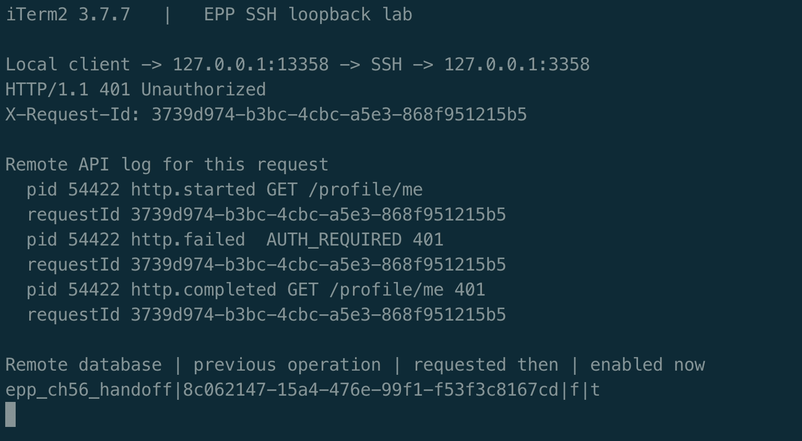
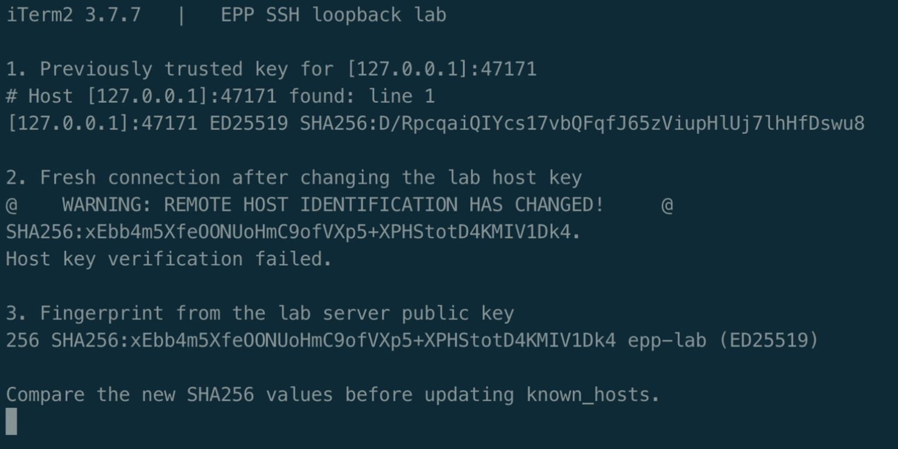

# 第 71 章　用 iTerm2 经 SSH 接手另一台主机上的服务

同事把练习机交给你，说：“API 已经在跑，端口是 3358。”你在自己的 Mac 上打开 `http://127.0.0.1:3358/profile/me`，得到了 401。这个结果能写进交接单吗？假如昨晚你在自己的 Mac 上也留下了一份 EPP，这个 401 完全可能来自它。我们要给这次请求找到两件证据：究竟哪一个进程接了它，那份部署能否查回交接单上的旧收据。

本章沿用[第 70 章配套](https://github.com/SamChowRock/epp-public/tree/part-09/chapter-70)。桌上这台 Mac 是操作端，iTerm2 和 Postman 都在这里。另一台自己的 Mac 或 Linux 练习机（也可以是有独立系统的虚拟机）是部署端。先在部署端按[上一章](../chapter-70-native-deployment/chapter.md)恢复练习依赖、核对旧收据、让托管器启动 API。上次若已卸载任务，要先重新登记。只需让 API 和它的依赖就绪，邮件按交接时的通道状态处理。保留一个能直接看到部署端的控制台，例如虚拟机的显示窗口；最后一节靠它解决 SSH 自己无法回答的问题。

## 71.1 先识别将要接手的主机

SSH（Secure Shell）让本机客户端通过加密连接在另一台机器上登录、执行命令。iTerm2 里的标签页负责显示输入输出，本机的 ssh 发起连接，远端的 sshd 在指定端口接入。先从部署端控制台或交接人处取四项资料：能从操作端到达的地址、SSH 服务监听的端口、获准登录的系统账号，以及 SSH 服务端使用的主机公钥指纹。假定这台主机用 Ed25519 密钥，在控制台执行：

```bash
hostname
id -un
ssh-keygen -lf /etc/ssh/ssh_host_ed25519_key.pub
```

`hostname` 显示系统给自己起的名字，后面要用它辨认窗口；id -un 打印当前控制台用户，获准远程登录的账号要与交接人另行确认。第三行对一个**公钥文件**计算短得多的摘要；记下 `SHA256:` 开头的整段和末尾的算法名。若管理员给 sshd 指定过 HostKey 路径，让管理员从实际启用的公钥取指纹。你可以通过已经确认身份的渠道收到这项资料。第一次连接时，屏幕上的指纹是对方出示的；只把它抄回去和它自己比较，地址即便指向了别人也会“吻合”。

还有一把钥匙，方向相反。主机密钥让你认出机器；你的登录私钥用来向机器证明你可以用交接的账号登录。先确认该账号已有可用的登录方式。第一次做密钥登录，可在本机运行 `ssh-keygen -t ed25519 -f ~/.ssh/epp71_login`，选择一个尚未使用的文件名，交互设置口令（若还没有 .ssh，先执行 `mkdir -p -m 700 ~/.ssh`）。把生成的 **.pub** 文件交给有权限的管理员，将完整一行追加到部署端该账号的 `~/.ssh/authorized_keys`，保留原条目；目录和文件归该账号所有，权限分别用 700、600。私钥留在本机。部署端要已启用 SSH 服务并允许这个账号及本地端口转发；Mac 可从“系统设置 → 通用 → 共享 → 远程登录”核对获准用户，Linux 从控制台确认 sshd 在交接端口监听。

在 iTerm2 保留一页本地 Shell。为了让这次换钥练习有自己的一份主机记录，在本机新建专用配置文件 `~/.ssh/epp71.conf`。下面的地址为文档示例，把地址、端口、账号、私钥路径都换成你的值；假定交接的是 Ed25519 主机公钥。

```sshconfig
Host epp-lab
    HostName 192.0.2.71
    Port 2222
    User operator
    IdentityFile ~/.ssh/epp71_login
    IdentitiesOnly yes
    HostKeyAlgorithms ssh-ed25519
    UserKnownHostsFile ~/.ssh/epp71_hosts
    StrictHostKeyChecking ask
    UpdateHostKeys no
    ControlMaster no
    ControlPath none
```

若虚拟机用 NAT 并将宿主的 2222 转到来宾的 22，HostName 和 Port 填操作端实际拨到的宿主地址和 2222，主机指纹仍从来宾的 sshd 取得。本章后面的 API 转发以这个已登录的来宾为起点。

Host 给本机操作起一个短名。IdentityFile 选择你自己的登录钥匙；HostKeyAlgorithms 让本次握手展示交接单上那一种主机钥匙。UserKnownHostsFile 是本次练习的记忆，下次连接时用这里保存的公钥识别对端。UpdateHostKeys no 让练习只采用你核实过的钥匙。最后两行让各次连接独立握手，断开其中一个窗口时，其他窗口仍可单独验证。先从本机看一下配置如何生效：

```bash
ssh -F ~/.ssh/epp71.conf -G epp-lab | grep -E '^(hostname|port|user|identityfile) '
```

`-F` 指向刚写的文件，`-G` 展开配置就退出，还没有登录。核对四项输出，再按 ⌘T 新开一页（如果新页沿用了远端会话，先回到操作端），执行 `ssh -F ~/.ssh/epp71.conf epp-lab`。遇到首次询问，逐字比对算法和 SHA256 指纹，若提示末尾是 yes/no/[fingerprint]，可以直接粘贴从控制台取得的完整 SHA256 指纹，客户端会检查是否一致。随后若出现私钥口令提示，是本机需要解开你的私钥；若出现 Permission denied (publickey)，连接已走到用户认证，回查 User、IdentityFile 和远端该用户的 authorized_keys。连接超时则应先从独立控制台查地址、端口、网络和监听。

现在在新页执行：

```bash
hostname
id
pwd
uname -s
```

与本地页分别对照。id 给出当前系统账号和组；pwd 是这一页的工作目录；uname 的 Darwin 或 Linux 决定接下来去哪里找托管器。两台 Mac 完全可以有同样的用户名，甚至同样的主机名。指纹负责认证，以上读数帮助你在认证以后认出操作位置。可以双击 iTerm2 标签标题给两页分别标上“本地”和“远端”。断开 SSH 后，这一页会回到本地提示符；标签名不会替你判断命令在哪儿执行。

在远端查交接单中的 API **任务**。Mac 第 70 章用的是图形登录用户的 LaunchAgent，SSH 用户须有权查看该域，图形用户仍须登录。若正是同一账号，运行：

```bash
job="gui/$(id -u)/local.epp.ch57.api"
launchctl print "$job" | grep -E '^[[:space:]]*(path|state|runs|pid) ='
```

用 path 找到实际登记的任务定义，按上章用 `plutil -p` 阅读那份 plist，核对 ProgramArguments 的程序、配置路径、WorkingDirectory 和 StandardOutPath。若经过管道筛选没有输出，单独执行 `launchctl print "$job"`。完整的 print 若报告找不到任务，先核对 GUI 域、用户和标签。Linux 若交接的是系统级 epp-api.service，则在远端运行：

```bash
systemctl show epp-api.service -p FragmentPath -p WorkingDirectory -p MainPID -p ActiveState
systemctl cat epp-api.service
```

第一行把服务文件、目录和主进程关联起来；第二行还能看到覆盖配置。对照交接单上的实际单元名和发布目录，现场查看即可，避免把带环境值的完整输出复制到交接单。记下 API 的 PID，再用 `ps -p 实际PID -o pid=,lstart=,comm=` 取启动时刻和程序名。稍后要区分“还是这一个进程”和“同一任务已经拉起另一个进程”。

## 71.2 通过隧道核对只监听回环的 API

先在**远端页**查监听。Mac 用 `lsof -nP -iTCP:3358 -sTCP:LISTEN`，Linux 用 `ss -ltn 'sport = :3358'`。看本地地址列，交接的监听应是远端的 127.0.0.1:3358；端口若改过，下面各处随之替换。在这页试一次：

```bash
curl -sS -o /dev/null -D - http://127.0.0.1:3358/profile/me
```

这里访问回环能打到部署端，因为运行 curl 的进程就在部署端。`-o /dev/null` 丢弃正文，`-D -` 把响应头留在终端。匿名读本人资料应得到 401 和 X-Request-Id。若此处已经连接失败，先查部署；现在改本机 Postman 的地址没有用。

回到**本地页**。让本地应用能接近这个只对远端本机开放的入口，需要有人接住本机连接，把字节送过已经认证的 SSH 连接，再由远端发起最后一次 TCP 连接。给本地入口另取端口 13358，保留本机原来的 3358。先运行 `lsof -nP -iTCP:13358 -sTCP:LISTEN`；有输出就换一个空闲端口并同步改下面的 URL。另开一张本地标签页，专门运行：

```bash
ssh -F ~/.ssh/epp71.conf -N -o ExitOnForwardFailure=yes \
  -L 127.0.0.1:13358:127.0.0.1:3358 epp-lab
```

从左到右读 `-L` 的四段：本机绑定哪个地址、本机接哪个端口、从 SSH 服务器看要去哪个地址、最后接哪个端口。两个 127.0.0.1 分属两端。左边绑定回环，附近其他电脑不能通过你的网卡使用这条转发。`-N` 让 SSH 专心转发，不打开远端 Shell；认证后窗口安静地停住是预期表现。

到本地 Postman 桌面端新建一次 GET，地址填 `http://127.0.0.1:13358/profile/me`，选 No Auth，**在这条请求的 Settings 中禁用 cookie jar**。Cookie 的主机匹配跨端口，本机此前登录 3358 留下的 Cookie 可能被带到 13358。发送，在响应 Headers 里复制 X-Request-Id。终端等效操作就是将前面的 curl 命令改为端口 13358，不加任何 Cookie。每次发送都会产生新 ID，下面要抄刚收到的那一个。[Postman 的 Cookie 设置](https://learning.postman.com/docs/use/send-requests/response-data/cookies/)

在远端 Mac 页按任务定义填日志路径，在 Shell 运行：

```bash
api_log='替换为任务定义的 StandardOutPath'
rid='替换为本地客户端刚收到的 X-Request-Id'
grep -F "$rid" "$api_log"
```

Linux 若标准输出归 journal，设置同一个 rid 后用 `journalctl -u epp-api.service -b --no-pager | grep -F "$rid"`。在 http.completed 行读 route、status 与 PID。找到同一 ID 的 /profile/me、401 和刚才的 PID，才把**这一笔**本地请求与远端进程连了起来。若只看到远端页先前请求的 ID，检查 Postman 的端口，核对日志文件是否轮转，以及本地是否正走代理。

接下来检查部署的数据身份。沿 71.1 查到的运行配置，在远端按第 70 章的连接方法打开同一实例与库的 psql，用有权读取这两张表的角色；凭据从原配置的保管位置取得。例如按交接单替换各项后运行 `psql -X -h 数据库主机 -p 数据库端口 -U 数据库角色 -d 交接库名`。这里的 -p 指 PostgreSQL 端口。先用 `\conninfo` 对照交接单，再查已知的一笔暂停。两个 UUID 抄自交接单：

```sql
SELECT current_database() AS db, r.operation_id,
       r.requested_enabled AS requested_then, u.web_enabled AS enabled_now
FROM public.web_access_receipts r
JOIN public.users u ON u.id = r.user_id
WHERE r.operation_id = '本轮暂停UUID'::uuid
  AND r.user_id = '本轮账号UUID'::uuid;
```

若这笔暂停之后已经恢复，预期同一行里左边 false、右边 true。查询零行时先比对库和两项 ID。另一个空库里也能运行同样的 API，也会对匿名请求返回 401。反过来，克隆库能保留整张收据，所以还要对齐服务器和库名。用 `\q` 回到远端 Shell。此刻可以中断练习，只记端口、任务、PID、启动时刻、请求 ID 和旧收据身份，重开时据此认路。



图 71-1　在同机隔离的回环练习中，沿 13358 转到 3358。先用响应头里的 ID 找同一次 http.completed，再读最后一行。末尾的 f 与 t 分别是旧暂停收据上的决定和账号当前的资格。换到两台机器时，左侧端口要在操作端查，右侧端口要登录部署端查。

**让最后一跳失败一次。** 在隧道页按 Ctrl-C。确认远端 3359 没有监听，把转发命令的最后一段 3358 改为 3359，再从本机请求原来的 13358。若服务端准许这个转发目标，SSH 可以照常启动，本地也有监听；直到 curl 发来数据，隧道页才会显示 `connect failed: Connection refused`，客户端收不到 HTTP 状态。若服务端按目标限制转发，可能会先看到 `administratively prohibited`。两种情况分别检查目的端口与服务器的转发授权。恢复 3358 再发一次。若在已有隧道时又原样启动第二条，第二条会因本地地址已占用而退出。ExitOnForwardFailure 能及时报告本地绑定失败，目标程序是否接受连接则要发请求才能知道。[OpenSSH 转发选项](https://man.openbsd.org/ssh.1)

## 71.3 断开终端以后由谁维持服务

先从远端日志找到与当前 PID 对应的 app.ready，连同启动时刻记下来。Mac 可用 `grep -F '"event":"app.ready"' "$api_log" | tail -n 3`。Linux 在上一节的 journal 命令中把查找内容改成该事件。看时间字段和 PID，若最近三次都不匹配，扩大日志范围；文件有轮转时按第 70 章找对应归档。

有三件可以分别停止的东西。先在**隧道页**按 Ctrl-C，本机重发 13358 会连接失败。此时保留着的远端页依然可以 curl 自己的 3358。再在**远端页**输入 `exit`，回到本机后运行 `hostname` 确认位置。最后重新用 ssh 登录，重复 71.1 的托管器查询和 ps，比较 PID、启动时刻与 app.ready；重新开启转发，核对一次全新的请求 ID。只要没有其他重启原因，两次读到的是同一个 API 进程。若 PID 或启动时刻变了，读两者之间的退出及就绪事件，把“服务恢复可用”和“原进程一直在”分开记录。

再借一件不会写业务数据的工作做对照。在一张新的本地页运行以下命令，远端账号使用 Bash 或 zsh：

```bash
ssh -F ~/.ssh/epp71.conf -t epp-lab 'echo "sleep PID=$$"; exec sleep 300'
```

外层单引号让美元符号原样到达远端。远端 Shell 用 `$$` 取自己的进程号，再用 exec 让 sleep 接替它，因此打印出来的 PID 仍然有效。`-t` 要求分配伪终端（PTY），让远端前台命令拥有一个与 SSH 会话相连的终端。保留这页，从另一远端连接用 `ps -p 实际PID -o pid=,tty=,comm=` 查到 sleep 和它的终端。回到 sleep 页，按一次回车，在新行开头输入 `~.`（波浪号和句点）。这是 OpenSSH 客户端的断开键，能在没有远端提示符时结束连接。立即在另一页再查同一 PID 和 API。普通前台 sleep 随终端挂断退出；API 的启动者是托管器，它继续服务。若进程特意忽略挂断信号或另建会话，表现会不同。把命令放到后台的 `&` 也没有为它安排下次启动、工作目录或日志去向。

交接方还想带走这次请求的一行日志。先从本机再发一次匿名请求，确认在当前日志找得到新的 ID。重新登录后，先按 71.1 从任务定义恢复 api_log 变量。在远端 Mac 页执行（Linux 把第一条 grep 的文件输入换成上一节的 journal 输出）：

```bash
handoff=$(mktemp -d)
rid='替换为这次响应的完整 ID'
grep -F "$rid" "$api_log" | grep -F '"event":"http.completed"' > "$handoff/request.json"
wc -l "$handoff/request.json"
printf '%s\n' "$handoff/request.json"
shasum -a 256 "$handoff/request.json"
```

mktemp 为本次交换单独建目录；在同一 Shell 保存 handoff。看到恰好一行，打开核对只有这次请求的结构化记录，再记下打印的远端路径与摘要。零行也会产生文件和摘要，这时要回查请求，不能把摘要当成内容合格。Linux 若只有 sha256sum，用 `sha256sum "$handoff/request.json"`。在本机页取回：

```bash
received=$(mktemp -d)
remote_file='替换为远端刚打印的绝对路径'
scp -F ~/.ssh/epp71.conf "epp-lab:$remote_file" "$received/request.json"
shasum -a 256 "$received/request.json"
```

带冒号的一侧是远端文件，没有冒号的一侧在本机。两端文件名可以不同，摘要应逐字相同。SSH 负责认证与传输；核对已选记录、行数和摘要，还能发现挑错了日志或拿了上次的文件。练习只转移这行记录，数据库、对象存储和配置都留在部署端。

## 71.4 在主机身份改变时恢复接手

考虑第二天的交接。你还记得这台机器的名字和端口，昨天留下的账号也还在。今天连接却出现 `REMOTE HOST IDENTIFICATION HAS CHANGED`。正常换钥、地址重新分给另一台主机、有人截走连接，都可能产生同一种现象。昨天的 known_hosts 是你手里还能用来发现变化的证据。

在自己的一次性练习目标上做一次可控制的换钥。若来宾使用 NAT，第二个练习端口也要有从操作端可达的私网路径，或单独建立宿主回环端口到来宾练习端口的映射。以下客户端命令中的 22271 均指操作端实际连接的 SSH 端口。下面给出一条保留原登录服务的办法。在目标的**独立控制台**，选择该机仅操作端可访问的练习地址，选一个未占用的高端口（例如 22271）。启动第二个前台 sshd，它与正常登录服务各用各的监听和主机钥匙。以下使用获准登录的普通练习账号，系统须支持该账号运行独立 sshd；若系统把服务启动交给管理员，由管理员在一次性目标的控制台完成这一步。

```bash
umask 077
keydir=$(mktemp -d)
ssh-keygen -q -t ed25519 -N '' -f "$keydir/first"
ssh-keygen -q -t ed25519 -N '' -f "$keydir/second"
ssh-keygen -lf "$keydir/first.pub"
```

空口令用于这两把临时**主机**钥匙，使前台服务能读入它们；目录只对练习账号可读。在同一控制台设好地址、账号并定义启动命令。两轮只换 -h 指定的钥匙文件：

```bash
lab_ip='替换为目标机的私有练习地址'
lab_user=$(id -un)
start_lab_sshd() {
  /usr/sbin/sshd -D -e -f /dev/null -h "$1" -p 22271 \
    -o "ListenAddress=$lab_ip" -o "AllowUsers=$lab_user" \
    -o "PidFile=$keydir/sshd.pid" -o PasswordAuthentication=no \
    -o KbdInteractiveAuthentication=no -o AuthenticationMethods=publickey \
    -o AllowAgentForwarding=no -o X11Forwarding=no
}
start_lab_sshd "$keydir/first"
```

-D 留在前台，-e 把错误送到控制台，-f /dev/null 让这个临时监听使用单独给定的配置及程序默认值。账号需已按 71.1 在默认 authorized_keys 登记练习公钥。读端口监听成功的输出；若使用管理员代为启动，AllowUsers 填入已配置公钥的普通练习账号。若账号、密钥目录权限或系统对独立 sshd 的限制导致拒绝，从控制台查原因，保留原服务供管理。

在本机用 `ssh -F ~/.ssh/epp71.conf -p 22271 epp-lab` 连接**同一地址的新端口**，按控制台提供的 first.pub 指纹首次登记，再用 exit 退回本机。若地址也换了，可加 `-o HostName=实际私有地址`，后面每次都用相同地址。回控制台 Ctrl-C 停掉刚才的练习监听，运行 `ssh-keygen -lf "$keydir/second.pub"` 记录新指纹，再运行 `start_lab_sshd "$keydir/second"`。这期间不必重启 API 或搬库。

本机再次连接该端口，应被拒绝。保留报错中的目标、端口、旧条目所在文件和新指纹。先在控制台核实该地址仍分给预期主机、练习监听确实加载了 second，对照新指纹。遇到未经安排的变化，就在此停止登录，用同样的独立渠道查明原因；从同一个可疑地址再抓一次公钥，仍然只知道“它这次给了我什么”。



图 71-2　回环演练的 SSH 端口为 47171。第一段是客户端原先信任的记录，第二段是被拒绝的连接，第三段直接取自练习服务的公钥文件。比较第二、三段的完整指纹；在双机练习中，第三段要在独立控制台取得。

确认是本轮更换后，在本机定位旧记录。下面 target 中的地址换成生效的 HostName；非默认端口要连同方括号和端口一起传，默认 22 则只用主机名或地址。

```bash
known=~/.ssh/epp71_hosts
target='[192.0.2.71]:22271'
ssh-keygen -F "$target" -f "$known"
ssh-keygen -R "$target" -f "$known"
```

-F 会打印已保存条目（包括可匹配的散列主机名）。在 `ssh-keygen -F "$target" -f "$known"` 末尾再加 `-l`，只看指纹更方便。先核对命中的条目，匹配本轮目标才执行 -R。它会从指定文件移除属于这个主机与端口的记录，通常留下 .old 备份；正常登录端口的记录应仍在。重新连接 **22271**，在新的首次提示里再比一次 second.pub 的完整指纹，再接受。进入后运行 hostname、id，重查服务的 PID、启动时刻、旧收据和 API 日志。先在旧隧道页按 Ctrl-C 释放 13358，再从本机执行下面的命令。保持这个窗口，从本机客户端发一次请求并去远端按 ID 找到它。

```bash
ssh -F ~/.ssh/epp71.conf -p 22271 -N -o ExitOnForwardFailure=yes \
  -L 127.0.0.1:13358:127.0.0.1:3358 epp-lab
```

钥匙变了而原收据、原进程都在，才符合这次只换 SSH 主机身份的实验条件。若实际发生的是重装恢复，新的 PID 合理，数据却仍须与交接目标核对。

退出练习连接、关掉练习隧道，在控制台 Ctrl-C 停掉这一个临时 sshd，并确认 22271 已释放。保留正常端口与第 70 章约定的托管状态。把本地入口、SSH 目的地址和端口、远端监听、断线前后的进程读数、一次请求的两端记录、旧收据和已核对的主机指纹交给下一位维护者。下一章要沿这个入口查清 API、邮件和通知进程各自能动哪些资源。

## 附录：本章必要技术点速查

| 眼前的问题 | 查什么 | 能判断什么 |
| --- | --- | --- |
| 别名到底连哪里 | 本机 ssh -F 配置 -G 别名 | 生效的地址、端口、登录账号、私钥路径 |
| 第一次见到这把主机钥匙 | 控制台 ssh-keygen -lf 主机公钥 | 算法与 SHA256 指纹，供首次连接独立核对 |
| 13358 有监听却访问失败 | 隧道页的错误和远端对 3358 的 curl | 本地绑定、转发授权、最后一跳或应用响应落在哪一步 |
| 一笔 HTTP 是哪台 API 处理的 | 响应头 X-Request-Id 与远端 http.completed | 关联该笔请求的 PID、路由和状态 |
| 断线后进程是否换过 | 托管器 PID、ps 启动时刻和 app.ready | 区分同一进程、重新拉起和失去访问通道 |
| 换钥后该修哪一项 | ssh-keygen -F 与 -R，显式指定 known_hosts | 按实际主机及端口查询、移除已独立核实的旧记录 |

本机用 `ssh -V` 看 OpenSSH 版本，`man ssh`、`man ssh_config` 和 `man ssh-keygen` 对应本机安装版本。[SSH 客户端](https://man.openbsd.org/ssh.1) · [客户端配置](https://man.openbsd.org/ssh_config.5) · [主机记录与指纹](https://man.openbsd.org/ssh-keygen.1) · [sshd 启动参数](https://man.openbsd.org/sshd.8)

阅读约 25～35 分钟。已准备好可登录的练习目标、第 70 章部署与旧收据时，跟做另加 40～60 分钟。首次准备第二台系统、恢复数据及网络接入另计。

[沿用配套](https://github.com/SamChowRock/epp-public/tree/part-09/chapter-70) · [上一章 · 在本机直接部署服务](../chapter-70-native-deployment/chapter.md) · [下一章 · 为 API、邮件和通知进程分别分配运行权限](../chapter-72-service-roles/chapter.md) · [本篇导读](../README.md) · [全书目录](../../README.md)
