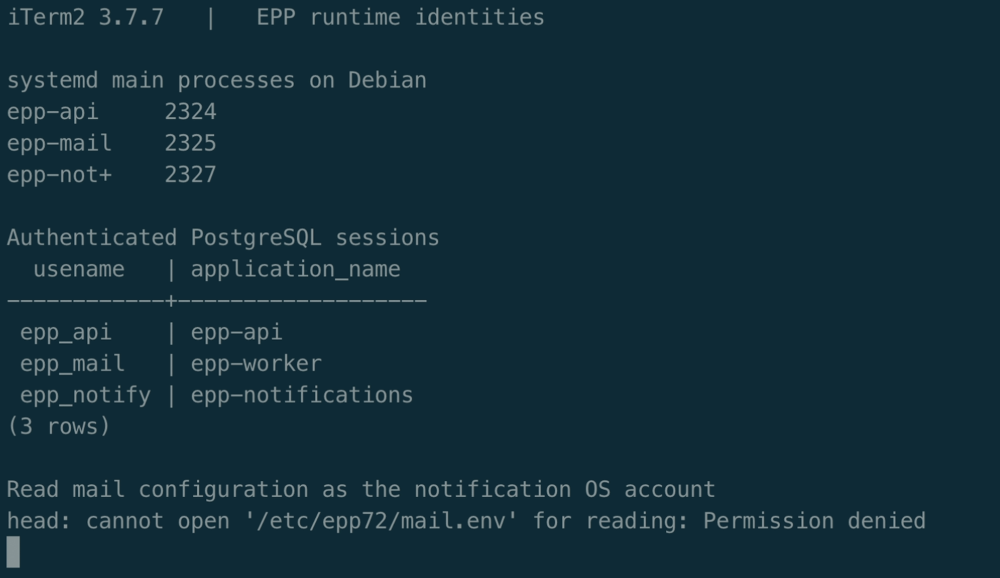
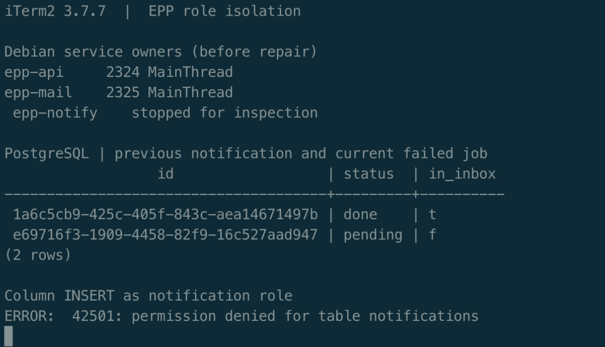

# 第 72 章　为 API、邮件和通知进程分别分配运行权限

站内通知进程收到一笔“注册成功”的任务。它要查账号是否仍然有效，再往收件箱写一行。如果它拿自己的数据库连接去改这个人的昵称，会发生什么？第 70 章部署了三个进程，也给了它们三个日志文件，但三个连接串里仍是同一个 epp57_run。对数据库来说，改昵称的请求有足够的权限。换个进程名解决不了这个问题。

沿用[第 70 章配套](https://github.com/SamChowRock/epp-public/tree/part-09/chapter-70)和[第 71 章交接的服务](../chapter-71-remote-host/chapter.md)。这一章要在旧账号仍能登录、原收据仍能查回的条件下，让数据库和操作系统分别拒绝一次越权。以下在一台由你管理的 Debian 13 练习机上使用系统级 systemd。操作端仍可用 Mac 上的 iTerm2 和 Postman；数据库使用 PostgreSQL 18，邮件只投到自己的 Mailpit。需要安装服务和设定文件属主的权限。单用户 Mac 的 LaunchAgent 继承登录用户身份，在 plist 里给三个任务起三个标签，得不到本章要观察的三个系统用户。

## 72.1 从三笔工作推导各自的权限

先留一份能回去比对的现场。DBeaver 沿用已有的独立观察连接；数据库只允许远端回环且操作端尚无此连接时，可以在 SSH 远端页运行 psql，或按第 71 章的方法把另一个空闲本地端口转发到远端 PostgreSQL 端口，再让 DBeaver 连本地入口。在原部署记录 API 的程序、工作目录、当前库与端口，按第 71 章用一个**已开通**的旧账号登录并读取本人资料，记下 userId。取一张已有的账号处置收据，按 operationId 查出当时的决定。用 DBeaver 的独立观察连接执行下面的查询，发送一次请求后刷新结果。闲置连接会释放，暂时缺一行时，要在对应进程做事时再看。

```sql
SELECT usename, application_name, count(*) AS connections
FROM pg_stat_activity
WHERE datname = current_database()
  AND application_name IN ('epp-api','epp-worker','epp-notifications')
GROUP BY usename, application_name ORDER BY application_name;
```

application_name 是程序给连接填的标签，usename 是 PostgreSQL 实际认证的身份。旧部署中，即使三行的标签各不相同，左列也可能全是 epp57_run。现在分别沿一笔工作看谁真的要碰什么。

| 从哪里发起 | 接下来由谁做什么 | 由什么结果认出这笔工作 |
| --- | --- | --- |
| 旧账号登录，再读自己的资料 | API 核验密码，锁住账号检查准入，创建会话，再凭会话读本人资料。预览头像还要在自己的工作目录写暂存文件 | 请求 05、20 返回同一个旧 userId；请求 24 返回 WebP |
| 新邮箱请求注册验证 | API 写验证意图和待发消息；邮件进程锁通道、认领消息、更新令牌摘要、联系 SMTP，再记录投递结果 | Mailpit 收到寄给本轮地址的邮件，数据库同一 recipient 的消息为 accepted |
| 用信里的令牌确认注册 | API 在一笔事务里建立用户、凭据、已验证邮箱和通知任务；通知进程锁定任务、核对账号、插入通知并将任务置为 done | 响应返回新 userId；按这个人找到任务，收件箱的通知与任务同 ID |

这里有四类身份。启动 Linux 服务时提供的 User 决定内核准许它打开哪些文件。DATABASE_URL 里的登录角色决定 PostgreSQL 接受哪些读写。对象存储使用 API 配置里的应用访问密钥。练习 SMTP 使用回环或隔离网络中的免认证 Mailpit，只有邮件进程需要配置其端点；若以后改成认证 SMTP，凭据也应只交给发送者。**文件权限管谁能读文件，免认证的网络监听仍由能到达它的进程使用。** 仅把端口号从通知配置中拿掉，无法阻止它主动连接一个已知端口。

### 一笔只读业务为什么会要 UPDATE

打开配套的 `src/notification-job.ts`。Worker 取任务时有 `FOR UPDATE SKIP LOCKED`，之后确实要改任务状态，给任务表有限的 UPDATE 说得通。到了 users，它只想读取 status，原查询却在行尾写了 `FOR SHARE`。设想它刚读到 active，另一个事务就把账号停用，然后它才投放通知。这个锁让两件事有明确先后；删掉锁会把早已处理过的并发问题带回来。可 PostgreSQL 对直接在表上使用锁定子句的调用者要求至少一列 UPDATE 权限。即使只授权它改一列，拿着这份密码的人也能真的去改那一列。[PostgreSQL 18 的 SELECT 与锁定子句](https://www.postgresql.org/docs/18/sql-select.html)

让表的所有者预先定义这一次带锁的读取，通知角色只读这个入口。新建迁移 `prisma/migrations/20261112010000_notification_recipient_lock/migration.sql`，内容只有：

```sql
CREATE VIEW public.notification_recipients AS
SELECT id, status FROM public.users FOR SHARE;
```

视图保存查询定义，里面没有另一份账号数据。使用默认的视图权限规则，调用者须有视图上的 SELECT，对底层关系的权限按视图所有者检查。让受信任、能对 users 加该锁的迁移所有者创建它，避免把视图交由运行账号拥有。在原事务里只替换读账号的语句，保留取任务、到期检查和完成写回。按 ID 查询将锁缩到这次的账号，事务结束才释放。[PostgreSQL 18 的视图权限](https://www.postgresql.org/docs/18/sql-createview.html)

```ts
const [user] = await tx.$queryRaw<{ status: string }[]>`SELECT status
  FROM public.notification_recipients WHERE id=${job.user_id}::uuid`;
```

在 `src/database.service.ts` 的 onModuleInit 中，找到专供 epp-notifications 的提前返回分支，在 database.ready 日志之前加一条探针：

```ts
await this.client.$queryRaw`SELECT id, status FROM public.notification_recipients LIMIT 0`;
```

这次读零行也会检查视图及权限，新消费者在空队列上同样能发现漏迁移。视图依然允许通知身份读取多个用户的状态并持锁，访问范围缩在两列和事务时长上。把 WHERE 条件删掉再在事务里遍历结果，会让无关账号也等锁，所以保留调用方按任务用户 ID 的筛选。

另一个容易漏掉的写入来自 ORM。去看 `src/recovery.service.ts` 的注册确认：即使代码里给新用户只填 id，原来的嵌套 create 发出的 INSERT 也列出了 status、web_enabled 等默认字段。只给 API 用户表的 `INSERT (id)` 时，这笔注册会返回 500。打开更多列就能消掉报错，却也允许注册入口的数据库身份自选新账号的初始资格。保留窄授权，把原来的 `tx.user.create(...)` 换成下列三行，放在**原有注册确认事务内部**，仍在消费令牌、插通知任务之前：

```ts
await tx.$executeRaw`INSERT INTO public.users (id) VALUES (${userId}::uuid)`;
await tx.passwordCredential.create({ data: { userId, passwordHash } });
await tx.verifiedEmail.create({ data: { userId, email: intent.email } });
```

这样由表的 DEFAULT 产生 active 和 web_enabled=false。中间任何一行失败，整个注册事务回滚；确认响应与原客户端兼容。API 更新资料时只会得到昵称、头像及各自可见性的列更新权，账号资格仍由原管理入口办理。

同样的区别也出现在排队时。若 API 可以在 INSERT 时指定消息初态，它就能新建一笔声称已经 accepted 的消息。让数据库给新消息和新任务填写 pending。仍在 recovery.service.ts，把请求验证事务中 `if (issued)` 内的 verificationOutbox.create 替换为：

```ts
await tx.$executeRaw`INSERT INTO public.verification_outbox
  (id, intent_id, generation, purpose, recipient)
  VALUES (${randomUUID()}::uuid, ${issued.id}::uuid, ${generation}, ${purpose}, ${email})`;
```

注册成功分支中的 notificationJob.create 换成下列 INSERT，重置成功分支用同样三列，把 userId 换成 observed.userId、kind 字面值换成 password-reset。两处都要留在原事务内。数据库完成时间与状态的默认赋值，API 只能指定这次工作是谁的、为什么做。

```ts
await tx.$executeRaw`INSERT INTO public.notification_jobs (id, user_id, kind)
  VALUES (${randomUUID()}::uuid, ${userId}::uuid, 'registered')`;
```

### 让寄一封信的工具也用邮件配置

通知进程选 `notifications` 分支时本就不会创建 SMTP 传输器。反倒是事故处理时经常用的 `src/send-one.ts`：旧程序先执行 API 的 loadConfig，生产模式下缺 APP_ORIGIN 或 CURSOR_HMAC_KEY 就退出。给单笔命令复制 API 配置，会把刚分开的秘密又合到一起。

在 `src/config.ts` 将现有 SMTP 两项的校验封成函数，并把现有 LOG_LEVEL 枚举提为共享常量；API 的 EnvironmentSchema 中写 `LOG_LEVEL: logLevelSchema`。保留原有端口范围、回环默认值以及 API 的生产校验。

```ts
export function parseMailEndpoint(env: NodeJS.ProcessEnv) {
  const host = mailHostSchema.safeParse(env.LOCAL_SMTP_HOST);
  if (!host.success) throw new ConfigError('LOCAL_SMTP_HOST');
  const port = mailPortSchema.safeParse(env.LOCAL_SMTP_PORT);
  if (!port.success) throw new ConfigError('LOCAL_SMTP_PORT');
  return { localSmtpHost: host.data, localSmtpPort: port.data };
}
export const logLevelSchema = z.enum(['debug', 'info', 'warn', 'error']).default('info');
```

在 `src/mail-worker.module.ts` 导入 ConfigError、logLevelSchema、parseMailEndpoint，移除原来的 workerEnvironment 和仅用来声明它的 z 导入。register 开头用 `const level = logLevelSchema.safeParse(env.LOG_LEVEL)`；失败时抛 `new ConfigError('LOG_LEVEL')`，AppLogger 使用 level.data。只在原来的 `if (!notifications)` 内求 `const endpoint = parseMailEndpoint(env)`，再将 LocalMailDelivery 的工厂改成 `() => new LocalMailDelivery(endpoint)`。通知身份依然无需通过邮件配置校验。

在 `src/send-one.ts` 用下列初始化替换 loadConfig 及数据库构造，将两个配置函数从 config.js 导入。原先调用 sendOne 时改传 `new LocalMailDelivery(endpoint)`；保留预期库名比对、可选消息 ID、原结果及退出码，保留 finally 里的数据库关闭。

```ts
const endpoint = parseMailEndpoint(process.env);
const database = new DatabaseService(
  parseDatabaseConfig(process.env),
  new AppLogger(logLevelSchema.parse(process.env.LOG_LEVEL)),
  'epp-worker',
);
```

可以先在构建目录 `nvm use`、`npm ci`、`npm run ci:check`。到这里得到新程序，但旧库还没有视图。下一节先升级练习副本，再启动新版消费者。

## 72.2 给每个进程独立的启动身份

在第 71 章的停写副本上工作，或按[既有备份恢复步骤](https://github.com/SamChowRock/epp-public/blob/part-09/chapter-70/database/chapter-22/backup-restore.md)另取带旧账号和收据的独立库、配对桶。下文示例库名 epp_ch72_handoff 来自建库记录。保存旧收据、头像引用、邮件通道的 paused_by 和现有 pending 队列。若交接时有 unknown 占用，沿[第 53 章人工放行步骤](https://github.com/SamChowRock/epp-public/blob/part-09/chapter-70/database/chapter-45/README.md)在练习副本内先查明原消息、停止所有发送者、确认本轮允许继续哪些待办。保留原行、尝试次数和结果。仍无依据放行时可先部署 API 与通知，推迟寄信实验。

在有开发依赖的源码根，把 `.env.database-verify` 指向本轮副本的迁移所有者。清除外层同名配置，传入单独记录的库名：

```bash
db=epp_ch72_handoff
env -u DATABASE_URL node --env-file=.env.database-verify scripts/deploy-verify.mjs deploy "$db"
```

有历史的副本只追加一个视图，不回填用户、邮件或收据。回到 DBeaver 按原 operationId 核对旧值。若只有空练习库，上面的 deploy 换成 bootstrap，再按第 63、70 章准备一个已开通账号和一张已知收据；这样能验证操作，不能用来判断旧库升级。新旧通知程序切换前停妥旧消费者，避免它抢先办完你要观察的任务。

### 建立三个数据库登录角色

在独立实例中，使用有建角色权限的管理员登录 psql，先用 `\conninfo` 对上实例，连接本次库。角色名属于整个实例；先用 `\du` 确认以下三个名字尚未占用。用事务一次建立三名普通登录者，再用 psql 的口令提示各设不同口令。若重做已完成的安装，先核对角色属性、成员关系与对象所有权，不重复建角色。

```sql
BEGIN;
CREATE ROLE epp_api LOGIN;
CREATE ROLE epp_mail LOGIN;
CREATE ROLE epp_notify LOGIN;
COMMIT;
```

```text
\password epp_api
\password epp_mail
\password epp_notify
```

三个角色均不拥有业务表、不能建角色，也不继承旧的 epp57_run、表所有者或预定义的全库读写角色。连接规则应要求这些服务登录者独立认证，例如 PostgreSQL TCP 的 scram-sha-256；若一个本地服务账号能借 trust 规则冒充任意库角色，就能绕过下面的分工。先按本章实际连接地址核对 pg_hba.conf；涉及 Unix socket 时也要核对 local 规则。管理员、迁移与备份继续使用各自入口。可先在观察连接查下列三行，预期四项均为 false。schema_create 为 true 时先追查是否来自 PUBLIC 或继承角色：能在 public 安装新对象，会扩大运行角色可以改变的范围。对象所有权和旧表 ACL 还要单独核对。

```sql
SELECT rolname, rolsuper, rolcreaterole, rolcreatedb,
       has_schema_privilege(rolname, 'public', 'CREATE') AS schema_create
FROM pg_roles WHERE rolname IN ('epp_api','epp_mail','epp_notify')
ORDER BY rolname;
```

下面是 `examples/service-roles/grants.sql`。从源码根用业务表及视图所有者连接**目标库**，在 psql 先输 `\set expected_db epp_ch72_handoff`，再输 `\i examples/service-roles/grants.sql`。脚本先对库名才执行事务。看三组权限的动词：API 可以添加待发消息，邮件可以更新投递状态，通知可以添加收件箱行。启动探针也算读者，哪怕表里暂时零行，探测列的 SELECT 权限仍需满足。

```sql
-- Use psql as the owner after creating three fresh, unprivileged LOGIN roles.
\set ON_ERROR_STOP on
SELECT current_database() = :'expected_db' AS right_db \gset
\if :right_db
BEGIN;
GRANT CONNECT ON DATABASE :"expected_db" TO epp_api, epp_mail, epp_notify;
GRANT USAGE ON SCHEMA public TO epp_api, epp_mail, epp_notify;

GRANT SELECT ON public.users, public.sessions, public.password_credentials,
  public.captures, public.capture_revisions, public.candidates, public.expressions,
  public.expression_forms, public.learning_records, public.command_receipts,
  public.verified_emails, public.verification_intents, public.verification_outbox,
  public.notification_jobs, public.notifications, public.nickname_changes,
  public.avatar_writes TO epp_api;
GRANT INSERT ON public.sessions, public.password_credentials, public.captures,
  public.capture_revisions, public.candidates, public.expressions, public.expression_forms,
  public.learning_records, public.command_receipts, public.verified_emails,
  public.verification_intents, public.nickname_changes, public.avatar_writes TO epp_api;
GRANT INSERT (id,intent_id,generation,purpose,recipient) ON public.verification_outbox TO epp_api;
GRANT INSERT (id,user_id,kind) ON public.notification_jobs TO epp_api;
GRANT INSERT (id) ON public.users TO epp_api;
GRANT UPDATE (nickname,nickname_visible,avatar_id,avatar_visible) ON public.users TO epp_api;
GRANT UPDATE (label), DELETE ON public.sessions TO epp_api;
GRANT UPDATE (password_hash,version) ON public.password_credentials TO epp_api;
GRANT UPDATE (status,accepted_at,discarded_at) ON public.candidates TO epp_api;
GRANT UPDATE (token_digest,issued_at,expires_at,consumed_at,user_id,credential_version) ON public.verification_intents TO epp_api;
GRANT UPDATE (read_at,cleared_at) ON public.notifications TO epp_api;
GRANT DELETE ON public.nickname_changes TO epp_api;
GRANT UPDATE (state,check_after) ON public.avatar_writes TO epp_api;

GRANT SELECT ON public.verification_intents, public.verification_outbox,
  public.verification_mail_control TO epp_mail;
GRANT UPDATE (token_digest) ON public.verification_intents TO epp_mail;
GRANT UPDATE (claim_id,lease_until,status,attempts,available_at,retry_digest,last_failure,retain_from)
  ON public.verification_outbox TO epp_mail;
GRANT UPDATE (paused_by) ON public.verification_mail_control TO epp_mail;

GRANT SELECT ON public.notification_jobs, public.notifications,
  public.notification_recipients TO epp_notify;
GRANT UPDATE (status) ON public.notification_jobs TO epp_notify;
GRANT INSERT (id,user_id,kind,created_at) ON public.notifications TO epp_notify;
COMMIT;
\else
DO $$ BEGIN RAISE EXCEPTION 'Wrong deployment database'; END $$;
\endif
```

sessions 上的 UPDATE(label) 有一个代价。具体业务会校验并锁住会话行，PostgreSQL 要求能更新至少一列。这个授权让 API 能修改会话上的说明文字；它不能用 UPDATE 延长有效期。API 原本就必须能创建和撤销会话。通知身份却没有修改任何用户列的业务理由，所以才为它单独建立带锁视图。邮件也只获准更新验证意图的 token_digest；它不能更换收件邮箱或新建账号。以上权限在 SQL 层按表、列生效，拿到 API 登录凭据的人仍可操作其获准访问的多名用户，应用中的本人校验依然必要。[PostgreSQL 18 的列级授权](https://www.postgresql.org/docs/18/sql-grant.html)

### 让 Linux 内核也认出三个人

在 SSH 练习目标的管理 Shell 中执行，先用 `getent passwd epp-api` 等命令确认三名系统账号可新建，再运行下面的循环。这里连字符的是 Linux 用户，下划线的是数据库角色，二者通过各自的配置文件相连。

```bash
for role in api mail notify; do
  sudo useradd --system --user-group --no-create-home \
    --shell /usr/sbin/nologin "epp-$role" || break
done
sudo install -d -o root -g root -m 0755 /etc/epp72
```

useradd 为每个服务分配独立 UID 和同名组，不给交互 Shell。若中途失败，用 `id epp-api` 等逐个核对成功的账号，补齐所缺的，三者不得互为对方组成员。管理者保留配置目录的写权。如果服务用户能替换别人的配置、Node 可执行文件，或者在共同的 release 中改一行 JavaScript，光把 .env 设成只读挡不住它。

在目标平台准备相同版本的 Node 24.22.1 和构建产物。示例将目标平台、架构匹配的 Node 发行包展开到 root 管理的 `/opt/epp72/node`，以 `/opt/epp72/node/bin/node --version` 核对；已有其他系统级安装可把后面三个 ExecStart 的首项改为同一绝对路径。在新交付目录放入 dist、package.json、package-lock.json 和 .npmrc，用目标平台的 Node 按第 70 章执行 `npm ci --omit=dev`。Mac 的 node_modules 里有本机的 sharp、argon2 产物，要在 Linux 安装生产依赖。下面在部署端操作。先在私有暂存目录放好 dist 和三份安装文件，目录中只放交付所需文件。cd 进去，从该目录执行：

```bash
export PATH="/opt/epp72/node/bin:$PATH"
node --version
npm ci --omit=dev
sudo install -d -o root -g root -m 0755 /opt/epp72
sudo mkdir -m 0755 /opt/epp72/release
```

mkdir 成功表示本轮安装位置原先为空缺。若已经存在，停止复制，核对是否为上次交付；在另一个新路径准备发布，并同步调整 unit。以下 cp 逐项选取文件，避免把暂存目录里遗留的 .env 一起装入 release。在默认私有掩码下构建的文件可能只有构建者能读，a+rX 给服务补足读权、目录遍历和本来就可执行的文件的执行权：

```bash
sudo cp -a dist package.json package-lock.json .npmrc node_modules /opt/epp72/release/
sudo chown -R root:root /opt/epp72/release
sudo chmod -R a+rX,go-w /opt/epp72/release
```

在管理员的私有暂存目录以 `umask 077` 准备三个文件，编辑器中填本轮值。先从第 70 章各角色**自己的**配置开始：

| 文件 | 需要保留和替换的值 |
| --- | --- |
| api.env | NODE_ENV=production、PORT、LISTEN_HOST（回环）、APP_ORIGIN、原 CURSOR_HMAC_KEY、配对桶的 AVATAR_S3_* 项、DB_POOL_MAX。DATABASE_URL 改成 epp_api 的口令与本轮库 |
| mail.env | NODE_ENV=production、DB_POOL_MAX、指向同一库的 epp_mail 连接串、本次 Mailpit 的 LOCAL_SMTP_HOST 与 LOCAL_SMTP_PORT |
| notify.env | NODE_ENV=production、DB_POOL_MAX、指向同一库的 epp_notify 连接串 |

数据库 URL 里的口令按 URL 用户信息规则编码。只改身份，核对主机、端口和库名与预期一致。上一章用 SSH 接手时，配置里的回环指的是**运行 Node 的系统**。数据库或 Mailpit 在另一主机时，需使用来宾能到达的私有入口或已验证的隧道。不要把本机回环值直接抄过去。每个连接池都单独占用连接，三者的上限与维护余量仍按第 70 章计算。

从含三个文件的私有目录运行。install 的 -o、-g、-m 分别指定目标拥有者、组与模式，0640 给 root 读写、对应服务组读取。目录 0755 让账号能按文件名到达入口，打开文件时内核再检查文件权限。

```bash
for role in api mail notify; do
  sudo install -o root -g "epp-$role" -m 0640 "$role.env" "/etc/epp72/$role.env" || break
done
ls -l /etc/epp72
```

从已确认权限的练习部署建立三个系统级 unit。以 `/etc/systemd/system/epp72-api.service` 为第一份：

```ini
[Unit]
Description=EPP api
After=network.target

[Service]
Type=exec
User=epp-api
Group=epp-api
StateDirectory=epp72-api
StateDirectoryMode=0700
WorkingDirectory=/var/lib/epp72-api
ExecStart=/opt/epp72/node/bin/node --env-file=/etc/epp72/api.env /opt/epp72/release/dist/src/server.js
UMask=0077
ProtectSystem=strict
ProtectHome=yes
NoNewPrivileges=yes
PrivateTmp=yes
Restart=on-failure
RestartSec=10s
TimeoutStopSec=40s

[Install]
WantedBy=multi-user.target
```

Type=exec 让启动过程至少走过执行 Node 这一步；应用是否就绪还得看 app.ready 和请求。管理器在切换到 User/Group 后运行 ExecStart，Node 自己打开 --env-file，所以文件必须对**该用户**可读。StateDirectory 让管理器在 /var/lib 建立 epp72-api 并授给这个账号，配合 WorkingDirectory，头像预览会在那里建立 .avatar-tmp。ProtectSystem=strict 让服务看到的文件系统大部分只读，StateDirectory 是为这项服务保留的可写例外。ProtectHome=yes 限制对普通用户主目录的访问，这也解释了为什么不能把 ExecStart 指向某个开发者家里的 nvm。PrivateTmp 隔离服务的临时目录；NoNewPrivileges 限制进程通过执行文件获得新特权。[systemd 服务身份与目录](https://manpages.debian.org/trixie/systemd/systemd.exec.5.en.html)

另外两份 unit 保留相同的 Unit、Service 和 Install 结构，按下表替换 Description、User、Group、WorkingDirectory 和 ExecStart。**移除**两项 StateDirectory 设置，Worker 使用只读 release 作为工作目录。在两个 Worker 的 Service 段都加一行 `Environment=EPP_DATABASE=epp_ch72_handoff`，从建库记录填预期名；每个文件写成自己的一份：

| 文件及身份 | WorkingDirectory | ExecStart |
| --- | --- | --- |
| epp72-mail.service，User 与 Group 均为 epp-mail | /opt/epp72/release | `/opt/epp72/node/bin/node --env-file=/etc/epp72/mail.env /opt/epp72/release/dist/src/mail-worker.js ${EPP_DATABASE}` |
| epp72-notify.service，User 与 Group 均为 epp-notify | /opt/epp72/release | `/opt/epp72/node/bin/node --env-file=/etc/epp72/notify.env /opt/epp72/release/dist/src/mail-worker.js ${EPP_DATABASE} notifications` |

邮件的 Service 段额外加入 `RestartPreventExitStatus=2`。这个退出码表示程序已经决定停发，沿用上章人工处置的约定。普通失败按 RestartSec 间隔重试。ExecStart 里的 `${EPP_DATABASE}` 由 systemd 展开成一个参数，抄写 unit 文件时保留原样。unit 文件应由 root 管理、模式 0644，只写配置路径与预期库名。不要在里面粘贴数据库口令。若从配套目录安装，可在源码根运行 `sudo install -o root -g root -m 0644 examples/service-roles/epp72-*.service /etc/systemd/system/`，再在已安装的文件中调整实际库名。写好后依次执行：

```bash
sudo systemd-analyze verify /etc/systemd/system/epp72-{api,mail,notify}.service
sudo systemctl daemon-reload
sudo systemctl start epp72-api epp72-notify
sudo systemctl status epp72-api epp72-notify --no-pager
```

花括号在 Bash 展开成三个文件。verify 报错先修正字段和路径；daemon-reload 让管理器读到文件，start 才启动。旧 API 应先释放本轮监听端口。到这里可以停一下：用旧账号在 Postman 单发 05、20 检查 API。通知没有任务时轮询为空，邮件仍未启动。确认配套的 Mailpit 已在指定入口监听，本轮的所有到期消息都允许投递，旧发送者已经停止，再执行 `sudo systemctl start epp72-mail`。这次只做 start，是否允许机器下次开机自动开始寄信另由通道交接决定。

## 72.3 先让需要的工作通过，再越权一次

先证明读这些文件的是什么进程。对三个活着的 unit 各取 MainPID，用 ps 查这个 PID 在 Linux 内核中的属主。在第二个终端或 DBeaver 重新运行 72.1 的 pg_stat_activity 查询。不要将 PostgreSQL 后端的 PID 与 Node 的 PID 比大小，它们标识的是不同进程。

```bash
for role in api mail notify; do
  pid=$(systemctl show "epp72-$role" -p MainPID --value)
  if [ "$pid" != 0 ]; then ps -p "$pid" -o user=,pid=,comm=; fi
done
```

PID 为 0 的任务先用 `systemctl status` 看状态，用 `journalctl -b -u epp72-notify -n 30 --no-pager` 看当前开机、本服务、最近三十行日志，替换 unit 名可查另两项。若连 Node 都未执行，查 User、目录遍历权和可执行文件；若 Node 报配置不可读，换成该 UID 打开文件试一次；若数据库拒绝认证或探针报错，再核对该角色自己的 URL、数据库授权和迁移。查看日志或配置时保留业务身份、角色、错误码，避开口令和令牌。

用[沿用的 Postman 集合](https://github.com/SamChowRock/epp-public/blob/part-09/chapter-70/requests/chapter-51.postman_collection.json)，把 baseUrl 指向本轮 API。远端只监听回环就按第 71 章转发。按以下顺序跑，避免注册新账号时覆盖旧账号的环境变量：

1. 先用旧账号发 05 登录、20 读本人资料，保留返回的旧 userId。发 15 取本会话写令牌，给 24 的 binary body 选 `examples/avatar-preview/harbor.png`。响应应为 200、image/webp。目标主机用 `sudo -u epp-api stat -c '%a %U %G' /var/lib/epp72-api/.avatar-tmp` 看权限和拥有者。本次得到 700、epp-api、epp-api。预览没有改变当前头像指针。
2. 复制一份本地环境给注册实验，换一个从未用过的练习邮箱，发 01，预期 202。在 Mailpit 的浏览器界面按完整收件地址筛选，打开本轮最新信，核对主题、地址，取 token 回 Postman。若远端的 Mailpit 页面只绑回环，和 API 一样用 SSH 转发其 **Web 端口**；SMTP 端口不提供网页。在观察库按收件地址查 verification_outbox 的 id、status、attempts，预期 accepted、一次。202 只说明 API 已接下这件事。
3. 在同一注册环境填 registrationToken 和符合既有策略的密码，发 02，预期 201，保留返回的新 userId。新账号的 webEnabled 仍是 false，不能用它的普通 Web 会话查看收件箱。观察连接可以直接查询，保留这个账号原有的准入结果。把实际 UUID 填入下面的 SQL。任务与通知要按 **同一个 id** 对上，别从列表末行猜。

```sql
SELECT j.id, j.status, j.kind, n.id IS NOT NULL AS in_inbox
FROM public.notification_jobs j
LEFT JOIN public.notifications n ON n.id=j.id AND n.user_id=j.user_id
WHERE j.user_id='本次注册用户UUID'::uuid;
```

异步处理期间可能先读到 pending；稍后再执行，预期同一笔 registered 为 done、in_inbox 为 true。这一行留给下一节作邻近样本。收据则仍按原先的账号和 operationId 查询。若 API 可登录但发信或通知失败，先看是哪个登录角色正在工作，不能因为 API 的连接成功就排除另一个角色缺权。

现在做两次不会改业务数据的越权尝试。先在**部署主机**执行，head 会尝试打开文件，-c 0 不输出文件内容：

```bash
sudo -u epp-notify head -c 0 /etc/epp72/mail.env
```

预期是打开时 Permission denied。若成功，查看文件的拥有者、组、模式、额外 ACL 和 epp-notify 的组成员关系。用管理员自己打开只能说明管理员能读。

再在 DBeaver 新建一条用 **epp_mail 实际登录**的练习连接，或在部署端用 `psql -X -h 数据库地址 -p 端口 -U epp_mail -d 本轮库` 交互输入它的口令。确认 current_user 和 current_database() 后执行：

```sql
SELECT current_user, current_database();
UPDATE public.users SET nickname='permission-probe' WHERE false;
```

WHERE false 保证即便误授也不会命中一行。数据库先检查执行该语句需要的权限；正确结果是 SQLSTATE 42501。若返回 UPDATE 0，语句其实获得了执行许可，应回查是否连成表所有者、是否继承旧角色或 PUBLIC 的授权。psql 可用 `\errverbose` 回看最近的 SQL 错误。再用 epp_notify 读 `SELECT token_digest FROM public.verification_intents LIMIT 0`，也应被拒；epp_api 执行 `UPDATE public.users SET web_enabled=true WHERE false` 同理。



图 72-1　上半按每个单元的 MainPID 查 Linux 用户，ps 的默认列宽把 epp-notify 缩为 epp-not+，可用 `ps -p 实际PID -o user:16,pid,comm` 读全名。中间按实际数据库连接查登录角色。末行是以 epp-notify 打开邮件文件时内核返回的拒绝。这三处读数分别来自托管器、数据库和文件系统。

还有一件仅靠成功响应看不出来的事。用通知身份在会话 A 执行 `BEGIN`，再 `SELECT status FROM public.notification_recipients WHERE id='本次注册用户UUID'::uuid`，保持事务。用有更新权限的观察实验账号在另一会话 B 开始事务，执行 `SET LOCAL lock_timeout='1s'`，再执行 `UPDATE public.users SET status=status WHERE id='同一个UUID'::uuid`。B 应等锁超时（55P03），随后 ROLLBACK；A 也 ROLLBACK。若 B 能立即更新，请检查 ID 是否命中、A 是否已自动提交、视图定义是否保留 FOR SHARE。换一名无关用户应能取得其行锁。这样才知道通知失去改资料的权力后，停用账号与通知投放之间仍有原来的互斥关系。

## 72.4 恢复漏授的权限并交接

给自己一张故障单：“第二个新用户收到了注册信，也成功设了密码，但收件箱查不到注册通知。”如果这时给三个角色都补上旧的整套权限，故障很快可能消失，却再也不能据此判断是哪一步少了权限。我们只改一个条件。

以**所有者**在同一练习库执行下面的 REVOKE。它针对前面授予的四列 INSERT；若角色还从别处继承整表 INSERT，这个对照不会生效。撤权前保存第一笔成功任务的 ID。用新的邮箱重复 01、收信、02，记录第二个注册用户的 ID。

```sql
REVOKE INSERT (id,user_id,kind,created_at)
ON public.notifications FROM epp_notify;
```

认证、收信、注册确认都能完成。按新 userId 查 72.3 的联表查询，得到 pending 和 false，同时上一笔仍是 done 和 true。通知进程在一笔事务里先锁任务再写收件箱，插入被拒后整笔回滚，任务的完成标记也没有提交。旧会话再发一次 20，仍应返回 200。到目标机看 `journalctl -u epp72-notify -b -n 30 --no-pager`；已经有 worker.ready，处理时却出现 WORKER_FAILURE。该通用日志不含表名，不能单由它断定缺哪项权限。

先用 `sudo systemctl stop epp72-notify` 停下反复启动的这个消费者，留下 pending 现场。到 PG 服务端日志按失败时间、数据库会话与语句核对 permission denied for table notifications；有详情权限时可查 SQLSTATE 42501。也可用 epp_notify 的实际连接在同库重现拒绝，不触发业务写入：

```sql
INSERT INTO public.notifications(id,user_id,kind,created_at)
SELECT id,user_id,kind,created_at FROM public.notification_jobs WHERE false;
```



图 72-2　停下通知进程后，API 和邮件仍在原来的 PID 上工作。中间是同一副本里两笔任务，末行用通知角色复现了 42501。补授权后要重新查 pending 的那个完整 ID。

以所有者只补回原四列 INSERT，再从部署端 `sudo systemctl start epp72-notify`。没有必要重启 API、邮件或重做 02。用新用户的同一条查询等它从 pending 变成 done，in_inbox 变为 true，并确认 ID 没变；用第一笔 ID 和旧收据各回查一次。两个角色原 PID、旧 Cookie 的资料响应以及 Mailpit 的邮件数量都可以独立复核。

```sql
GRANT INSERT (id,user_id,kind,created_at)
ON public.notifications TO epp_notify;
```

如果缺的是**发信后写回**所需的权限，不能照搬这次结论。数据库事务可以撤销本地写入，无法把已经交给 SMTP 的字节收回。先停止持续发送者，按消息 ID 看通道占用、attempting／unknown、租期与收件端事实，再决定可否放行。要验证单笔工具能在邮件身份下启动，可保持发送者停妥，用从未分配给消息的随机 UUID 试查（通道应开放），预期 empty：

```bash
probe=$(/opt/epp72/node/bin/node -p 'crypto.randomUUID()')
sudo -u epp-mail env -i /opt/epp72/node/bin/node --env-file=/etc/epp72/mail.env \
  /opt/epp72/release/dist/src/send-one.js epp_ch72_handoff "$probe"
```

这里 env -i 清空调用者环境，只让 Node 从邮件文件读配置。若换成**已有且到期的**消息 ID，这条命令有实际发送能力。它仍会检查命令行预期库名和通道资格。

交接时记下三名宿主用户、三个数据库登录角色、unit 和配置文件的**路径**、各角色实际允许与拒绝的动作、两笔通知 ID、旧收据 ID，以及谁能运行授权 SQL。核实旧任务、watcher、单笔工具都已退出，不再让旧共享连接串留在服务可读目录。旧角色属于整个 PG 实例，先核对其他库和维护任务是否仍使用它；若这确是一套专用实例且旧角色已经退役，管理员可执行 `ALTER ROLE epp57_run NOLOGIN`，再在 pg_stat_activity 查旧会话并逐个按归属排空。NOLOGIN 会阻止新登录，已经建立的连接会继续。若需回退程序，先停新版消费者，保留数据库和积压事实，按旧版本实际所需的权限与可信配置恢复接手；别把旧口令加回三个服务文件。结束专用练习可用 `sudo systemctl stop epp72-mail epp72-notify epp72-api`，留下配置与数据供下一章调度实验接手。

## 附录：本章必要技术点速查

| 想判断什么 | 读数或命令 | 下一步 |
| --- | --- | --- |
| 谁打开文件，谁登录库 | MainPID → ps 的 user；pg_stat_activity.usename | 对照服务账号与库角色，application_name 再指明程序入口 |
| 服务能不能读别人的配置 | sudo -u 服务用户 head -c 0 文件 | 成功就回查组与 ACL，拒绝时原文件无须输出 |
| 通知是否能阻挡并发停用 | 查带 FOR SHARE 的视图，在另一事务更新同一账号 | 55P03 后回滚，对比无关账号与释放后的结果 |
| ORM 是否多写了默认列 | PG 拒绝的 INSERT 列表、表上的列授权 | 需要数据库决定资格时，只提交本次允许指定的列 |
| 缺权限还是缺数据 | SQLSTATE 42501；同一任务 ID 的 pending／done 与收件箱行 | 先缩小到身份、对象、动词，再按原 ID 复验 |
| 一次停发是否应该重启 | systemd 的 RestartPreventExitStatus、邮件占用及尝试记录 | 确认外部投递结果和通道处置后再启动 |

阅读约 40～55 分钟。已有 Linux 练习目标、原部署与可恢复的非空库时，分配身份、构建、联调和故障恢复另加 65～95 分钟。首次准备虚拟机、下载运行环境与复制数据另计。

本章配套目录为 `examples/service-roles/`，包含授权 SQL、三个完整 unit 和运行说明。

[配套起点 · 第 70 章](https://github.com/SamChowRock/epp-public/tree/part-09/chapter-70) · [上一章 · 用 iTerm2 经 SSH 接手另一台主机上的服务](../chapter-71-remote-host/chapter.md) · [下一章 · 定时维护漏跑或同时启动两次以后怎么办](../chapter-73-maintenance-jobs/chapter.md) · [本篇导读](../README.md) · [全书目录](../../README.md)
