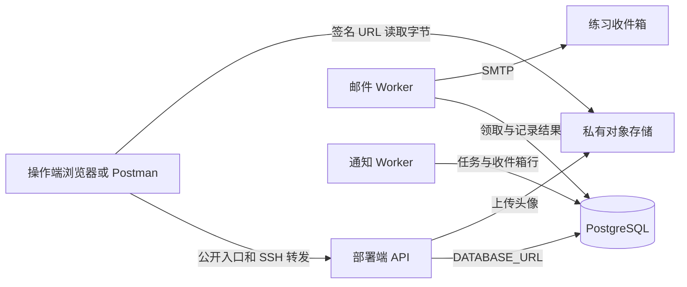
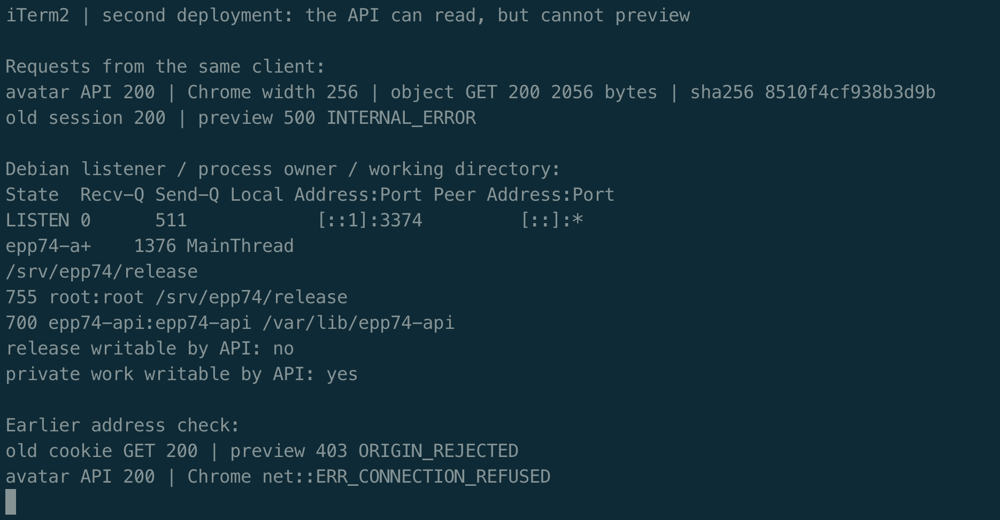
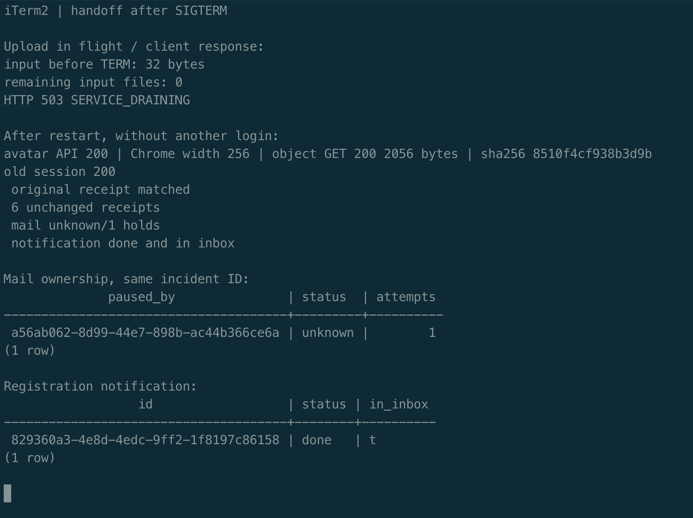

# 第 74 章　运行环境变了，怎样交付同一份服务

新机器上的 API 已经返回 200。接班人换回原来的客户端，仍能读到自己的资料，却发不了头像预览。有人建议重新登录，也有人建议给整个程序目录加写权限。在动这两处之前，先留住这个现场：同一个人，能读，不能写。接下来要分清，是来源检查挡住了请求，还是接收文件的进程没有地方落笔。

沿用[第 73 章的非空练习库、配对桶与清理任务](../chapter-73-maintenance-jobs/chapter.md)。准备原来能登录的账号、一张第 63 章留下的账号处置收据，以及另一套可以改变运行用户与目录的练习环境。下文以 Mac 作为操作端，第二套环境是独立 Debian 13。API、邮件、通知和账号 CLI 都运行原来的程序。分支 `part-09/chapter-74` 的 `examples/portable-release/README.md` 是可交给下一位部署者的启动说明。没有表结构变更，旧账号、头像指针、任务和收据继续使用。两套程序接到同一对隔离数据，先确认旧配置不会连回原业务库或原桶。

## 74.1 用原收据核对第二个部署目录

**先选一件拷空库也造不出来的事实。** 在旧环境的 Postman，用第 60 章集合的 05 登录已开通账号，20 读回本人，15 取当前会话的写令牌。保留这个客户端和原来的 baseUrl；稍后切换上游，不再登录。用 26 取当前头像，在有效期内另发 GET。记下 avatarId、字节数，保存响应图片后可在 Mac 用 `shasum -a 256 文件名` 留一个内容摘要。若账号还没有头像，先按第 60 章的 25 发布一张再留基线。响应里的 Cookie、写令牌、完整签名 URL 都留在私有客户端。

从原交接单找出暂停或恢复账号时记录的 userId 与 operationId，选一个能查到原收据的组合。用账号 CLI 的 receipt 模式读出 `requestedEnabled` 和 `recordedAt`。即便用户后来已经恢复，原暂停收据仍应记着当时的 false。单查当前的 true、数据库名或者迁移条数，都容易认错同名副本。[收据的产生与重放](../../part-08-maintenance/chapter-63-account-cli/chapter.md)

**哪些文件跟着这四个进程走？** 从配套根用 `nvm use` 选 Node 24.22.1，`npm ci` 按锁安装，`npm run ci:check` 产生并检查 dist。在构建机的 Bash 里，从配套根运行下面的打包命令。归档路径放在一个新的临时目录；tar 的实参逐项列出要带的输入。将归档传到已经核实身份的目标，例如用第 71 章的 SSH 别名 `epp-lab`。

```bash
stage=$(mktemp -d)
tar -czf "$stage/epp-release.tgz" dist package.json package-lock.json .npmrc \
  database/chapter-51/clean.mjs scripts/verify-database.mjs
tar -tzf "$stage/epp-release.tgz" | head -20
scp "$stage/epp-release.tgz" epp-lab:epp74-release.tgz
```

API 启动时按模块位置读 `dist/config/service.json`，所以要交付整个 dist。两个额外的 .mjs 文件供上一章定时任务使用，脚本的相对导入关系也要保留。读取旧收据只用 `dist/src/account-admin.js`。归档里不装个人 ~/.npmrc、业务配置、存储目录或数据库文件。项目自己的 .npmrc 随锁交付；在目标安装前可打开核对它确实是项目的安装选项。

在目标机登录用户的 Bash 中，把 `node_bin` 设为已装好的**目标平台** Node 所在目录。若沿用第 72 章，这里是 `/opt/epp72/node/bin`。选择一个还不存在的 release 路径；已有部署先换新名字并同步后文路径，避免把两版文件混在一起。

```bash
node_bin=/opt/epp72/node/bin
export PATH="$node_bin:$PATH"
node -p 'process.version+" "+process.platform+" "+process.arch'
build=$(mktemp -d)
tar -xzf "$HOME/epp74-release.tgz" -C "$build"
(cd "$build" && npm ci --omit=dev)
release=/srv/epp74/release
sudo install -d -m 0755 /srv/epp74
(set -e
 sudo mkdir -m 0755 "$release"
 sudo cp -a "$build/." "$release/"
 sudo chown -R root:root "$release"
 sudo chmod -R a+rX,go-w "$release"
 sudo chmod 0755 "$release")
```

从 Mac 移到 Debian，即使两头都是 arm64，sharp、argon2 所需的原生产物也与操作系统有关。上面的 Node 输出应与目标系统、架构匹配。这次目标报告 `v24.22.1 linux arm64`。安装在临时目录内完成，运行者最后只需能读 release、遍历目录和加载其中的模块。若创建 release 的命令提示已存在，在此停下选择新的空目录，再继续修改权限。

**宿主账号与数据库登录分开交接。** 这里为四个前台入口各指定一个目标机账号。下面在独立 Linux 练习机运行一次；若是接手已配好的账号，先用 `id epp74-api` 等逐项确认。沿用[第 72 章的角色隔离](../chapter-72-service-roles/chapter.md)，新宿主上的 API 用户仍使用原 API 数据库角色，两个 Worker 也各用自己那份授权。

```bash
for role in api mail notify receipt; do
  sudo useradd --system --user-group --no-create-home --shell /usr/sbin/nologin "epp74-$role"
done
sudo install -d -m 0755 /etc/epp74
sudo install -d -o epp74-api -g epp74-api -m 0700 /var/lib/epp74-api
```

本轮 CLI 只查历史。若没有可交给它的受限身份，在**本次隔离实例**由实例管理者建普通登录角色 `CREATE ROLE epp_receipt74 LOGIN;`，在 psql 用 `\password epp_receipt74` 设置口令。由所有者连目标库，先执行 `SELECT current_database();` 对照建库记录，再按下列范围授权。示例继续使用 `epp_ch73_handoff`，换成自己的实际库名。receipt 分支查询收据表，CLI 的启动检查只需建立连接。

```sql
GRANT CONNECT ON DATABASE epp_ch73_handoff TO epp_receipt74;
GRANT USAGE ON SCHEMA public TO epp_receipt74;
GRANT SELECT ON public.web_access_receipts TO epp_receipt74;
```

先建立目标进程到数据库的通路。若练习 PG 在操作端回环 55474，在操作端另开 iTerm2 页运行下列 SSH，保持它打开。它让部署机的 127.0.0.1:55474 到达操作端的同号端口。PG 若就在部署机上，直接沿用其监听端口。

```bash
ssh -N -o ExitOnForwardFailure=yes -R 127.0.0.1:55474:127.0.0.1:55474 epp-lab
```

在目标机的私有暂存目录准备 api.env、mail.env、notify.env 和 receipt.env。前三份从各自已经验证过的配置开始，连接**本轮**库；下面一节只改与地址有关的字段。给收据文件填写只读角色的 DATABASE_URL，可将 DB_POOL_MAX 设为 1。用 `umask 077` 创建暂存文件，编辑器输入凭据。以下从该暂存目录安装，各文件最终只有 root 和相应角色可读。将暂存的秘密按自己的保管方式移回私有配置处。

```bash
for role in api mail notify receipt; do
  sudo install -o root -g "epp74-$role" -m 0640 "$role.env" "/etc/epp74/$role.env"
done
```

先运行查询原收据的入口。在目标机把 `db`、`user_id`、`operation_id` 分别设为原交接单的库名与两个完整 UUID（例如 `db=epp_ch73_handoff`）；每个新开的 Bash 页都需重新设置所用变量。下面特意从 `/` 启动：如果程序依赖源码目录里的相对路径，这一步就会露出来。`env -i` 避免已导出的开发用 DATABASE_URL 抢在 Node 的 env 文件前生效。

```bash
(cd / && sudo -u epp74-receipt env -i /opt/epp72/node/bin/node \
  --env-file=/etc/epp74/receipt.env /srv/epp74/release/dist/src/account-admin.js \
  "$db" receipt "$user_id" "$operation_id")
```

输出外层 database 是本次实际连接经核对的库名，内层 dbActor 是**原操作**留下的数据库身份。对照原环境的整张收据，尤其是操作 ID、原请求值与记录时刻。从同一备份分出的两套库也可能含有这张收据；因此还要对照实际连接端点、最近的邮件占用和能读到原字节的配对桶。若找不到收据，先查连接、用户和操作 ID，保留当前资格，不用 apply 补一张。到这里，第二套产物和只读 CLI 可以独立验收，API 还没接流量。

## 74.2 分清谁在监听，谁要连到谁

画出一次“读旧头像”的两次请求。账号带 Cookie 向 API 要一个短时地址，随后客户端用返回的地址去取字节。两次连接可能落在不同机器上。再画出“申请注册”的后半程：HTTP 响应返回时，发送邮件的连接还没从 Worker 发出。



沿每支箭头念一次 `127.0.0.1`。操作端访问该地址，先到自己的机器。Worker 访问同样的数字，会到 Worker 所在机器。下面是一组可以在两端保持私有监听的接法。假定操作端运行练习版 PG（55474）、SeaweedFS（18633）与 Mailpit（SMTP 19775），目标机上的这几个转发端口尚未占用。若依赖已经在部署机上可达，直接用那台进程实际可达的地址和端口。

```bash
# 操作端新开 iTerm2 页，保持连接；epp-lab 使用第 71 章核对过的别名
ssh -N -o ExitOnForwardFailure=yes \
  -R 127.0.0.1:18633:127.0.0.1:18633 \
  -R '[::1]:19774:127.0.0.1:19775' epp-lab
```

-R 左半是**部署端**为进程开放的监听，右半是 **SSH 客户端所在机器**可以连接的目的地。前节的数据库转发保持打开。这里的第二个 -R 让 Worker 连接自己的 IPv6 回环 19774，到达操作端的 19775。先在收件端核对 Mailpit 自己确实占用了 SMTP 端口、网页能打开；转发成功只证明入口绑定成功。若虚拟机管理器也自动转发端口，比较两端的实际监听者。让 SMTP 的本地端口和来宾端口取不同值，端口占用更容易识别。

服务中有两处看起来相似的传参。`src/serve.ts` 调用 `await app.listen(config.port, config.listenHost)`，这个 IP 必须能绑定在 API 自己的机器上。`src/verification-delivery.ts` 将 `host: config.localSmtpHost, port: config.localSmtpPort` 交给 SMTP 客户端，地址属于它要拨往的接收方。换个工作目录并不会改变这两条连接的方向。按下表更新前节安装的配置。字段属于哪个进程，就只写入该进程的文件。

| 进程与字段 | 这次怎样填写 | 用什么结果辨认 |
| --- | --- | --- |
| API 的 LISTEN_HOST、PORT | `::1`、`3374`，分别是本机 IPv6 回环和端口；默认监听地址为 IPv4 回环 | 部署端 `ss -lnt 'sport = :3374'` 应看到 `[::1]:3374` |
| API 的 APP_ORIGIN | 沿用客户端实际访问的 `http://127.0.0.1:13374`，无尾斜杠；保留原 CURSOR_HMAC_KEY、NODE_ENV=production | 原客户端带该 Origin 和原写令牌能通过写入口；换会话会影响验证 |
| 各角色的 DATABASE_URL | 各自原角色连接部署端可达的 PG；本例主机端口 `127.0.0.1:55474`，保留原库名 | CLI 原收据、API 旧资料与两个 Worker 的业务行 |
| API 的 AVATAR_S3_ENDPOINT、桶与身份 | 两端均可通达 `http://127.0.0.1:18633`；API 侧经转发，操作端直达同一练习桶 | 26 返回 avatarId 与 URL，立即打开原 URL，验证同一张图 |
| 邮件的 LOCAL_SMTP_HOST、LOCAL_SMTP_PORT | 本例分别为 `::1`、`19774`；通知 Worker 只连库 | 对照本次练习地址、outbox 的消息与 Mailpit 的实收邮件 |

`LISTEN_HOST` 只选本机绑定的 IP，把它改为 `0.0.0.0` 会在所有 IPv4 接口等连接；它不会给浏览器生成可访问的域名。APP_ORIGIN 做来源校验，由协议、主机、端口组成。S3 端点还有一个约束：当前 API 用同一端点写对象和生成签名地址。客户端若只能解析另一个名称，收到地址后手改主机还会影响签名。API 和浏览器各自的回环只碰巧在本练习经转发通向同一桶。可以像本例一样在两边提供同名同端口入口，或使用两边都能解析、可验证证书的名称。应用只接受回环上的明文 HTTP 对象端点；下一章再建立 HTTPS 信任。[浏览器如何判断同源](https://developer.mozilla.org/en-US/docs/Web/Security/Defenses/Same-origin_policy)

**先交接邮件，给稍后的停发判定留一个已知样本。** 在本章独立副本停妥原邮件与通知消费者、上一章的清理调度，确认旧管理器不会重启它们。以观察身份执行下列 SQL。第一条须返回一行，paused_by 为空表示通道当前没有占用；第二条列出可能还会消费或正在办理的工作。若有积压，先逐笔查清收端和归属。若通道已指向一笔 unknown，记录其 ID 和次数，留到 74.4 核对；正常投递与造故障只在通道开放的练习副本做。

```sql
SELECT c.paused_by, o.status, o.attempts, o.lease_until
FROM public.verification_mail_control c
LEFT JOIN public.verification_outbox o ON o.id=c.paused_by WHERE c.id=1;

SELECT id,status,attempts,available_at FROM public.verification_outbox
WHERE status IN ('pending','attempting') ORDER BY available_at,id;
```

在目标机单独打开邮件终端，从 release 用新用户运行下面这条前台命令。它持续占住该终端。核对 worker.ready 后，从仍在线的旧 API 用 01 向**本轮练习地址 A**申请注册。到新 Mailpit 找收件人 A，用库里 A 的 outbox 行核对 accepted。保留这封邮件的令牌，先不确认。回到 Worker 终端用 Ctrl-C 停妥；若由宿主管理，用 TERM 并等 worker.closed。

```bash
cd /srv/epp74/release
sudo -u epp74-mail env -i /opt/epp72/node/bin/node --env-file=/etc/epp74/mail.env \
  dist/src/mail-worker.js "$db"
```

有了这封信，接下来可以在不重复投递 A 的情况下产生一份独立的通知。要演练交接一条未决投递，按[第 70 章的 SMTP 断连实验](../chapter-70-native-deployment/chapter.md)停原练习收端，在同一接收侧端口启动 `node database/chapter-45/smtp-lab.mjs drop 19775`（从配套根运行）。用另一个地址 B 发 01，再用相同前台命令启动邮件进程。故障端收完 DATA 断开，等故障端打印收完正文的提示、Worker 自行退出，在 Worker 终端立刻 `echo $?` 应得 2。**先等 B 的状态成为 unknown，再记录占用。** 只看到 paused_by 有值时，它也可能还在 attempting。用 02 确认 A 的注册，保存响应中的用户 ID，通知先留 pending。停故障端，留住 B 的占用；保存的交接单此刻有一张旧收据、一份旧会话、一笔未决邮件和一条可独立推进的通知。

## 74.3 从一次头像预览定位工作目录与写权限

现在切 API。先停旧 API 和它的自动拉起，等原端口释放。Postman 保留原会话和 baseUrl。若同时换域名或从 HTTP 升为 HTTPS，Cookie 的主机范围、Secure 属性甚至本项目的 Cookie 名都会改变。本次固定公开来源，才能用原会话单独检验服务迁移。若旧服务本来就在另一条本地转发后面，只需停旧的那条 -L，保留独立的数据库、存储转发。在操作端新开 SSH 页，让原入口接到目标机的新端口。下例的 `13374` 要换成**切换前客户端已经使用**的端口，别用一次新登录代替切换。

```bash
ssh -N -o ExitOnForwardFailure=yes -L '127.0.0.1:13374:[::1]:3374' epp-lab
```

让每次诊断只改变可以说清楚的启动条件。在部署端 Bash 定义下面的函数。它用系统级 `systemd-run` 临时注册一个服务，三个实参依次是本轮单元名、工作目录、配置文件名。运行的主进程就是 Node。`--service-type=exec` 会等到程序被执行，能识别缺少可执行文件等问题；继续看 app.ready 和真实请求才能知道应用已经就绪。`TimeoutStopSec=40s` 给应用留出排空时间。本次单元按名字手动启动、停止，彼此不同时占同一端口。

```bash
start_api() {
  sudo systemd-run --unit="$1" --service-type=exec \
    --property=User=epp74-api --property=Group=epp74-api \
    --property="WorkingDirectory=$2" --property=UMask=0077 \
    --property=TimeoutStopSec=40s \
    /opt/epp72/node/bin/node "--env-file=/etc/epp74/$3" \
    /srv/epp74/release/dist/src/server.js
}
```

**先诊断两条网络路径。** 用 `sudo install -o root -g epp74-api -m 0640 /etc/epp74/api.env /etc/epp74/bad.env` 复制练习配置，再用 `sudoedit /etc/epp74/bad.env` 编辑，只改两个练习值。把 APP_ORIGIN 设成后端端口 `http://127.0.0.1:3374`，把 AVATAR_S3_ENDPOINT 设成客户端确认没有监听的回环端口，如 `http://127.0.0.1:18674`。保留原 api.env。执行 `start_api epp74-network /var/lib/epp74-api bad.env`，在另一部署端终端运行 `sudo journalctl -u epp74-network -n 12 --no-pager -o cat` 找 app.ready。

在同一个 Postman 客户端，从下面三次操作分别定位故障。临时编辑 24 的 Headers 时显式设置 `Origin` 为**真实客户端来源**，保留原 Cookie、写令牌和 `X-EPP-Request: 1`；Postman 不一定会像浏览器那样自动附 Origin。24 的 binary 选择练习文件 harbor.png，Content-Type 为 image/png。

| 操作 | 这一轮得到什么 | 下一步看哪里 |
| --- | --- | --- |
| 原样发 20 | 200，同一 userId | 会话仍被这个 API 接受，保留该会话继续查 |
| 带真实 Origin 发 24 | 403，`ORIGIN_REJECTED` | 比较客户端来源和 APP_ORIGIN；请求在读取图片前已被拒绝 |
| 发 26，立即在 Chrome 打开返回的完整 URL | 26 返回 200 和原 avatarId，Chrome 报 `ERR_CONNECTION_REFUSED` | 签名可以在 API 本地完成，签发当时并没有从浏览器连接存储。查 URL 的主机、端口与客户端实际监听 |

停 `sudo systemctl stop epp74-network`。下一轮用正确的 api.env，**工作目录故意指向只读 release**：`start_api epp74-cwd /srv/epp74/release api.env`。再发 20、26 并在浏览器打开新签的地址。这次能读回原图。仍用同一令牌、同一 Origin、同一个文件发 24，这次得到 500 和 `INTERNAL_ERROR`。先抄下响应头 X-Request-Id，在该轮 journal 按它找 http.started、http.failed 与 http.completed。500 的公共错误码不会透露服务器文件路径。签名取旧图、读取资料都能成功，下一处应查这次**预览**才用到的资源。

从 `src/avatar-upload.ts` 看文件路径怎么来的。`resolve('.avatar-tmp')` 以进程当前工作目录为起点，和 `server.js` 放在哪里无关。程序创建或复用私有目录，检查属主与模式，再为本次请求单独开子目录。相反，`src/config.ts` 里的 `new URL('../config/service.json', import.meta.url)` 跟随编译后的模块。换 cwd 会改变前一个位置，移动整份 dist 才会改变后一个位置。

```ts
// src/avatar-upload.ts，privateDirectory 中
const root = resolve('.avatar-tmp');
await mkdir(root, { recursive: true, mode: 0o700 });
const stat = await lstat(root);
if (!stat.isDirectory() || (process.getuid &&
  (stat.uid !== process.getuid() || (stat.mode & 0o077) !== 0))) {
  throw new Error('Avatar temp root must be a private directory owned by the API');
}
return mkdtemp(join(root, 'upload-'));
```

在**部署端**查正处理请求的进程。MainPID 应是大于 1 的活进程，若为 0，先回到该 unit 的日志。下面的 /proc 是 Linux 接口。stat 打印八进制权限、属主、属组与路径；最后两条特意让服务自己的用户做权限判断。用管理员测试能写，回答不了 API 能不能写。

```bash
pid=$(systemctl show epp74-cwd -p MainPID --value)
ps -p "$pid" -o user=,pid=,comm=
sudo readlink "/proc/$pid/cwd"
stat -c '%a %U:%G %n' /srv/epp74/release /var/lib/epp74-api
sudo -u epp74-api test -w /srv/epp74/release && echo writable || echo read-only
sudo -u epp74-api test -w /var/lib/epp74-api && echo writable || echo read-only
```



**图 74-1**　iTerm2 中，服务已在 [::1]:3374 监听，旧头像可读且内容与基线一致。处理这次请求的进程却从 /srv/epp74/release 工作：root 拥有、模式 755，API 用户在这里建不了 .avatar-tmp。私有 work 已经存在、模式 700，只是进程没有从那里启动。图底的 403 与 Chrome 连接失败来自前一轮地址配置，可以和这一轮的 500 对照。

保持 release 的属主和模式，停 `sudo systemctl stop epp74-cwd`，再运行 `start_api epp74-api /var/lib/epp74-api api.env`。在 Postman **只重发 24**。同一请求现在得到 200，响应类型 image/webp，本轮 PNG 样本得到 2062 字节。用 `sudo stat -c '%a %U:%G %n' /var/lib/epp74-api/.avatar-tmp` 看临时根的实际属主；完成过的那次上传子目录应已移除。若 work 本身可写仍失败，检查早已有的 .avatar-tmp 是否属于上一个 UID、是否为目录、是否开放了组或其他用户权限。用新的私有 work 对照，保留原故障目录供核查。

**进程的输出归谁收？** API 的 app.ready、http.completed 等信息写到标准输出，`http.failed` 的错误级别事件写到标准错误；成功的收据 JSON 写 stdout，CLI 拒绝理由写 stderr。systemd 在此把两路送进 journal，用单元名、时间和请求 ID 找同一笔。可以用已经返回过收据的命令做一个无副作用的对照：将预期库参数单独改成一个不同的名字，配置仍指向本轮库，分别把 `>receipt.out 2>receipt.err` 放在**目标登录用户可写的私有目录**。紧接着 `echo $?` 是 2，stdout 无收据，stderr 为 `Database name mismatch`。改回正确预期名，退出 0，收据进 stdout。生产托管器需要收集两路输出；若把日志仅写入可替换的 release，下一次发布就会连同诊断线索一起替换。

## 74.4 用旧会话、原操作和邮件占用验收接手

新进程能处理第一笔请求以后，还差一次**带着工作停机**。继续保留 Postman 的旧会话。用[第 59 章的分块客户端](../../part-07-profiles/chapter-59-avatar/chapter.md)另开一次有独立标签的登录，只给预览接口送 32 字节，再停住请求。它的登录、写令牌和连接都属于这个辅助客户端。重启后的验收要回到刚才保留下来的 Postman。

在对外入口仍是回环 HTTP 的操作端，从有配套依赖的项目根运行以下 Bash。将 userId 换成练习账号，读取密码时不回显。**先准备好另一个部署端终端**：应用只给未读完的上传十秒，等人翻找 PID 常会错过窗口。

```bash
export AVATAR_BASE_URL=http://127.0.0.1:13374
export AVATAR_USER_ID=替换为本轮已开通账号UUID
read -rs -p '练习账号密码：' avatar_password
echo
printf '%s' "$avatar_password" | node examples/avatar-preview/upload.mjs hold
unset avatar_password
```

部署端用下面的循环等本次 input 真达到 32 字节再停服务。在独立练习机上确保只有这一笔上传；正常演练开始前，私有临时根里应没有旧 input。find 的 `-size 32c` 以字节计。find 的 -quit 取第一个匹配后即停止查找。若循环结束仍无路径，保留 API，重开一笔并确认 userId、会话和工作目录。

```bash
for i in $(seq 1 100); do
  input=$(sudo find /var/lib/epp74-api/.avatar-tmp -name input -size 32c -print -quit)
  if test -n "$input"; then sudo systemctl stop epp74-api; break; fi
  sleep 0.1
done
sudo journalctl -u epp74-api -n 14 --no-pager -o cat
sudo find /var/lib/epp74-api/.avatar-tmp -name input -print
ss -lnt 'sport = :3374'
```

systemd 将 SIGTERM 交给 Node。看本次请求的结果：客户端得到 503 `SERVICE_DRAINING`，服务记录 app.draining、app.stopped，input 消失、端口无监听。若得到 408 `UPLOAD_TIMEOUT`，说明请求先超时了；那次只能证明上传期限生效。若观察到断线，从服务日志和暂存文件判断停在何处，单凭客户端断线无法确定程序是否清理。默认 API 排空期限为 5 秒，可配置的 SHUTDOWN_TIMEOUT_MS 上限 30 秒；Worker 的退出处理另有 10 秒期限。宿主的停止宽限期若比应用更短，宿主可以先强杀，应用就可能留下一份未清理的临时文件。

重新 `start_api epp74-return /var/lib/epp74-api api.env`。现在用**原客户端**依次发 20、24、26，比较旧 userId、预览与原头像。再用 74.1 的 CLI 查相同的 userId、operationId，对照 requestedEnabled、dbActor 与 recordedAt。重启前如果有一笔 B 占用邮件通道，重跑 74.2 的通道 SQL，逐项比对 paused_by、状态与次数。API 成功服务不构成放行 B 的依据。练习中的接手决定是保持邮件停止，保留 B 的 unknown 和一次尝试；之后沿[第 53 章的未知投递处置](../../part-06-background/chapter-53-retries/chapter.md)核实最终应答。

通知领取和邮件发送各自一套进度。先在观察连接里检查积压，并按确认 A 的响应 userId 找到它的通知任务，记下该任务的完整 ID。若有其他 pending 任务，启动同一 Worker 也会处理它们，先确认这些确属本轮副本。第二条查询可在启动前后各执行一次，把占位符换成刚才保存的 ID。

```sql
SELECT id,user_id,kind,status FROM public.notification_jobs
WHERE status='pending' ORDER BY created_at,id;

SELECT j.id,j.status,(n.id IS NOT NULL) AS in_inbox
FROM public.notification_jobs j LEFT JOIN public.notifications n USING(id)
WHERE j.id='替换为本轮通知任务UUID'::uuid;
```

在部署端另开终端，从交接单重新设好 db，启动通知。它与邮件使用同一个 JS 文件，最后一个实参让应用走通知分支，使用通知自己的配置和数据库权限。

```bash
cd /srv/epp74/release
sudo -u epp74-notify env -i /opt/epp72/node/bin/node --env-file=/etc/epp74/notify.env \
  dist/src/mail-worker.js "$db" notifications
```

按任务 ID 重查，应从 pending、未入箱变为 done、已入箱。再查邮件占用仍指向 B，尝试次数没有增加。若原先接手的是开放通道，也应先记录开放、确认旧消费者已退出、明确收端和积压，再决定是否让新邮件 Worker 消费。



**图 74-2**　上传停在 32 字节时发出 TERM，本次 input 已清除，客户端收到 503。重启后原会话读回同一头像，旧收据逐项保持。下方两条 SQL 对准不同的业务 ID：邮件仍是 unknown、一次尝试，注册通知已经 done 且能找到同 ID 的收件箱行。下次交班应留下这两个 ID 及相应决定。

**把启动说明交给下一位。** 给每个角色写下目标平台与 Node 版本、脚本及参数、运行身份、工作目录、环境来源、依赖从哪一端可达、输出去向、停止信号、宽限期和重新启动条件。配套 `examples/portable-release/README.md` 给出了四个入口与这次的验收顺序。把示例值换成核对过的实际值，交付配置的受限位置即可。会话、收据与通道占用保存在数据库中，签名密钥来自独立配置。第 73 章的清理计时器最后单独交接，按原库和配对桶复查到期量，明确由哪个宿主恢复排期。

如果下一位用镜像，先问一句：每次替换实例时，哪些东西要重新提供？release 可以重建，私有 work 可以重新分配；库、桶、配置和签名密钥需要从替换后仍可用的位置提供。API 的入口仍是前台 Node 加同一份 `dist/src/server.js`，通知仍须多传 `notifications`。镜像提供匹配平台的生产依赖，运行时提供用户、可写 work、依赖地址与配置。直接用参数数组执行 Node，若必需包装脚本，以 `exec` 交出进程位置，停止信号才能到达实际服务。把镜像中的工作目录改为只读，再挂上一个归错 UID 的卷，正会重现 74.3 的问题。换托管器以后仍可用同一组业务读数验收。[Docker 的执行形式入口](https://docs.docker.com/reference/dockerfile/#entrypoint)

练习结束，分别停本轮 API、通知和临时 SMTP 接收端，再关闭本轮转发。保留供下一章使用的数据、配置和交接单。下一章开始让操作端用服务名称而非回环地址访问，并验证对端证书。

## 附录：本章必要技术点速查

| 接班人看到的现象 | 第一处要查的证据 |
| --- | --- |
| 新 CLI 能连库，查不到原操作 | 预期库名及原 userId、operationId；比较历史收据中的字段，确认目标副本 |
| GET 本人资料成功，写请求 `ORIGIN_REJECTED` | 比较浏览器真实 Origin 与 APP_ORIGIN，核对请求从哪个入口送达 |
| 26 返回地址，浏览器取不到图 | 从浏览器所在机器原样打开新签的 URL，分别看连接失败、签名过期、对象缺失 |
| 预览 500，旧图可读 | 活进程的 UID、cwd、.avatar-tmp 的属主和权限；按本次请求 ID 查两路日志 |
| 停机后进程消失 | 客户端结果、app.stopped、端口及本次 input 的去向 |
| API 接手，邮件仍占用 | 用原消息 ID 查状态、次数与 paused_by；通知按自己的任务 ID 独立判断 |

按四个入口、地址与权限对照实验和两幅现场图估计，阅读约 35～45 分钟。已有两套运行环境、旧账号与配对副本时，打包、切换、故障定位与接手验收另加 60～90 分钟。首次安装虚拟机与复制业务数据另计。

[配套起点 · 第 70 章](https://github.com/SamChowRock/epp-public/tree/part-09/chapter-70) · [上一章 · 定时维护漏跑或同时启动两次以后怎么办](../chapter-73-maintenance-jobs/chapter.md) · [下一章 · 客户端怎样确认访问的是自己的 HTTPS 服务](../chapter-75-tls-trust/chapter.md) · [本篇导读](../README.md) · [全书目录](../../README.md)
