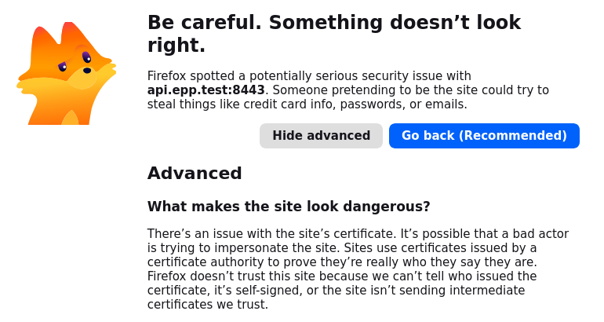
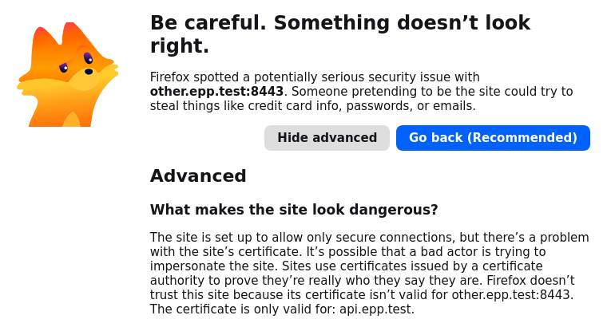
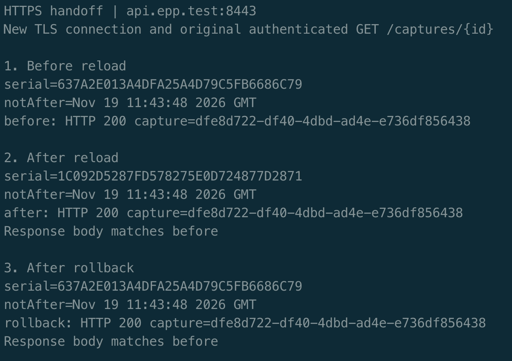

# 第 75 章　客户端怎样确认访问的是自己的 HTTPS 服务

[第 74 章](../chapter-74-portable-release/chapter.md)里，我们用 Postman 读本人资料，又把 API 签出的头像地址交给 Chrome 打开。接班人知道请求该送往哪个端口，也能用旧账号认出自己的数据。这次交接单上写的是一个带名字的地址，`https://api.epp.test:8443/profile/me`。发出会话 Cookie 之前，客户端凭什么相信接住连接的确实是这个服务？

同一轮实测里，两个请求用了相同的 URL，一个连 HTTP 状态都没拿到，另一个却读到 EPP 的 `401 AUTH_REQUIRED`。先保留这两条记录。一个没有登录的请求为什么反而能帮忙排错，到 75.3 再对照。

动手时沿用原部署、账号和已经核过主机指纹的 SSH 别名 `epp-lab`。操作端的 Bash 会话一直保留，后面要复用它保存的证书路径和请求参数。配套分支 `part-09/chapter-75` 的 `examples/tls-trust/README.md` 有分两端执行的连续命令。

## 75.1 先让客户端按名字找到目标

先回到入口还没启动的时候。部署端有一条第 74 章就会做的检查，直接读 `http://[::1]:3374/profile/me`。API 回了 401，正文是熟悉的 AUTH_REQUIRED。手头没有 Cookie，这个结果正合预期。现在换到操作端，也不带 Cookie，想知道能否读到同一份响应。

部署端的 3374 只接受本机连接。上一章用 SSH 本地转发解决了这个问题，客户端连的是自己机器上的 127.0.0.1。这次如果在地址栏也写 127.0.0.1，就丢掉了交接单上的服务名。怎么既走这条通路，又保留原来的问题？curl 可以临时把**一个名字的一个端口**指到选定的 IP。URL 保留 `api.epp.test`，只有“这次去哪里拨号”的答案发生了变化。

<details>
<summary>从第 74 章的停机副本起步，取得部署端基线</summary>

沿用数据库和存储通路；若另起隔离副本，先确认新连接能查到旧收据。停掉仍占用 3374 的实验 API。部署端复制一份专用配置，在编辑器里把 APP_ORIGIN 改为 `https://api.epp.test:8443`，保留 LISTEN_HOST=::1 和 PORT=3374。用[第 74.2 节的 start_api](../chapter-74-portable-release/chapter.md#742-分清谁在监听谁要连到谁)在原工作目录启动，等 app.ready。

```bash
sudo install -o root -g epp74-api -m 0640 /etc/epp74/api.env /etc/epp74/api75.env
sudoedit /etc/epp74/api75.env
# APP_ORIGIN=https://api.epp.test:8443，保留 LISTEN_HOST=::1 与 PORT=3374
start_api epp75-api /var/lib/epp74-api api75.env
ss -lnt 'sport = :3374'
curl -q -g --noproxy '*' -sS -w '\nHTTP %{http_code}\n' 'http://[::1]:3374/profile/me'
```

ss 查部署机的监听者，curl 查它能不能回答本人资料请求。APP_ORIGIN 是浏览器稍后访问的来源，API 用它判断写请求、设置 Cookie；入口的 TLS 由另一进程接手。

</details>

在操作端，趁新转发尚未开启，向空闲的 8443 发一次请求。--noproxy 让请求直达指定目标，-q 放在首位以免个人 curl 配置改变结果。

```bash
site=https://api.epp.test:8443
probe=(curl -q --noproxy '*' --max-time 8 -sS -w '\nHTTP %{http_code}\n')
"${probe[@]}" --resolve api.epp.test:8443:127.0.0.1 "$site/profile/me"
echo "curl=$?"
```

本轮是 `curl=7` 和 `HTTP 000`。7 表示没连上，000 是“没收到 HTTP 状态”的占位值。这里甚至没有对端送来证书。若机器上已有人监听，可用 `lsof -nP -iTCP:8443 -sTCP:LISTEN` 查出是谁；若是 SSH 在监听，继续看 SSH 会话能否接通**部署端**的 8443。本端有人接连接，还不能证明远端有人提供 HTTPS。

现在考虑把转发接到哪里。部署端 3374 上的 Node 程序等的是 HTTP 请求，HTTPS 客户端连上来先要进行 TLS 握手，请对端出示证书。SSH 会原样转发这些字节。就算把 APP_ORIGIN 写成 https，把转发直接接到 3374，两端说的协议仍对不上。

一种做法是让 Node 自己加载证书和私钥，接收 HTTPS。这意味着要改上一章交付的启动入口，还得决定应用何时重新加载证书。我们想单独换证，并观察同一个运行中的 API 能否继续服务。于是把接待 HTTPS 客户端的工作交给另一个进程：它完成握手，读出请求，再通过同机 HTTP 把请求送给 3374。这就是这个部署里**反向代理**做的事。

本章选 **nginx** 担任这个角色。部署机首次使用时，按环境配置准备可执行文件并核对 SSL 模块。[第 75 章环境配置](../../environment-setup.md#第-75-章给独立-https-入口签发与更换证书)

给它指定一对证书和私钥，就能在重载它的配置时单独换证。代价是多了一个要管理的进程和一个可能接错的端口。读下面这条路径时，可以先找出谁要向客户端出示证书，再看谁会查询登录会话。两个 127.0.0.1 分属两台机器。

```text
操作端 curl → 本机 127.0.0.1:8443 ── SSH 转发 ──→ 部署端 127.0.0.1:8443 的 nginx
                                                              ↓ HTTP
                                                     同机 [::1]:3374 的 API
```

浏览器还没送出 `GET /profile/me`，nginx 就得先选一张证书。同一 IP 可以接待多个名字，所以客户端在 TLS 握手时会先报出想找的名字（SNI）。nginx 依此挑证书，客户端再拿地址栏里的名字核对证书。选证书和检查证书是两项独立动作。此时 HTTP 的 Host 头还没发出去，在 IP 形式的 URL 上补这个头，赶不上身份检查。SSH 主机指纹能帮操作者辨认部署机，浏览器仍然需要它自己能验证的服务身份。[HTTPS 名称与证书的匹配规则](https://www.rfc-editor.org/rfc/rfc9525.html)

## 75.2 签一张带正确名称的练习证书

假设运维把 api.epp.test 的证书从 nginx 上复制下来发给你。任何能连接这台服务的人也能拿到同一份文件。另一台机器若把它原样展示给浏览器，凭什么不能冒充你的服务？

证书把一个名字和一把**公钥**放在了一起。在本例的完整握手里，nginx 用配对的**私钥**给本次握手的数据签名，浏览器用证书中的公钥验签。每次握手有新的随机数据，上一次的签名也不能直接搬过来。拷走公开证书的人做不到这一点。但他可以自己造一对新密钥，在新证书里也写 api.epp.test，并用自己的私钥完成证明。这里少了一个判断依据：**谁有权说这把公钥可以代表这个名字？**

如果只有你一台客户端，经独立渠道核实一张自签证书并直接信任它，就能开工。下周服务换密钥时，你得再去每台这样配置过的客户端交接新证书。本次希望接班人只换入口，原来已经信任服务的客户端都继续工作。为此，可以提前把一个签发机构（CA）的公钥证书交给客户端，此后由这个签发者确认新服务公钥的归属。这份事先接受的证书就是这里的**信任根**。把它从待验证的网站临时下载下来就直接信任，会让冒充者连“该信谁”也一起决定。

根 CA 也可以直接签服务证书。练习多留一级，是为了让根私钥只在授权签发者时使用，平时发七天期服务证书只用中间 CA 的私钥。客户端因此多需要一份证据。沿着本例的三份证书从服务端往回看，每份各回答一句话：

```text
叶证书       中间 CA 签名：这把服务公钥可以代表 api.epp.test。
中间证书     根 CA 签名：这个中间 CA 的公钥可以用来验证它签发的证书。
根证书       客户端事先核过指纹，已决定信任这份根。
```

这就决定了文件归属。叶私钥在 nginx 所在机器生成，部署端把公钥装进签名请求（CSR）交给签发端。CSR 上的签名只能证明生成请求时有人持有对应私钥。签发端还要通过已核实的 SSH 通道确认申请来自负责该名字的部署，并自己决定准许哪个名称。配套 `issue-leaf.sh` 把它写为 `subjectAltName=DNS:api.epp.test`。这一字段简称 SAN，客户端稍后就在这里找地址栏中的名字。签发成功后 nginx 拿回叶证书和中间证书，两把 CA 私钥都留在签发端。[OpenSSL 证书扩展](https://docs.openssl.org/3.0/man5/x509v3_config/)

<details>
<summary>动手签发 A，并把签发结果送回提出申请的部署机</summary>

操作端在配套根目录执行。umask 077 限制新文件权限，mktemp -d 为本轮单独建目录。make-ca.sh 创建 90 天的根与 30 天的中间 CA，中间 CA 的 pathlen 为 0，仅用于签叶证书。记下根的完整 SHA-256 指纹供第二个客户端核对。遇到已存在的部署目录先核实归属，另一次练习不要往旧目录混放文件。

```bash
umask 077
src="$PWD/examples/tls-trust"
lab=$(mktemp -d)
sh "$src/make-ca.sh" "$lab/ca"
openssl x509 -in "$lab/ca/root.crt" -noout -fingerprint -sha256
ssh epp-lab 'umask 077; mkdir "$HOME/epp75-edge"' &&
  scp "$src/nginx.conf" epp-lab:epp75-edge/nginx.conf
```

部署端在另一个 Bash 生成 A 的私钥和 CSR，私钥保存在私有目录。tls.conf 把同一套链与私钥放在一起。若 nginx 未进 PATH，给 nginx_bin 填实际绝对路径。

```bash
edge="$HOME/epp75-edge"
cd "$edge"
nginx_bin=$(command -v nginx)
umask 077
new_key() (
  set -eu
  slot=$1
  mkdir "$slot"
  openssl req -new -newkey ec -pkeyopt ec_paramgen_curve:P-256 -noenc \
    -subj /CN=api.epp.test -keyout "$slot/leaf.key" -out "$slot/leaf.csr"
  printf 'ssl_certificate %s/fullchain.pem;\nssl_certificate_key %s/leaf.key;\n' \
    "$slot" "$slot" > "$slot/tls.conf"
)
new_key slot-a
```

操作端取 CSR，检查来源后签发并返回公开的链。issue-leaf.sh 用 openssl x509 -req 校验 CSR 签名并签发，指定服务用途和随机序列号，验证通过再拼成 fullchain.pem。保留两个函数供换证时使用。

```bash
issue() (
  set -eu
  slot=$1
  scp "epp-lab:epp75-edge/$slot/leaf.csr" "$lab/$slot.csr"
  sh "$src/issue-leaf.sh" "$lab/ca" "$lab/$slot.csr" "$lab/$slot-issued"
  scp "$lab/$slot-issued/fullchain.pem" "epp-lab:epp75-edge/$slot/fullchain.pem"
)
issue slot-a
```

</details>

怎样知道中间这一级真的派上了用场？操作端此刻拥有三张证书，可以让验证器只看其中两张，再把第三张还给它。下面两条 verify 都按同一个名称、同一种服务用途校验。第一条只给根和叶，第二条再给中间证书。`-untrusted` 把中间证书交给验证器当作候选材料，它自己的签名仍要被检查。

```bash
leaf="$lab/slot-a-issued/leaf.crt"
openssl x509 -in "$leaf" -noout -serial -dates -ext subjectAltName
openssl verify -purpose sslserver -verify_hostname api.epp.test -CAfile "$lab/ca/root.crt" "$leaf"
openssl verify -CAfile "$lab/ca/root.crt" -untrusted "$lab/ca/issuer.crt" \
  -purpose sslserver -verify_hostname api.epp.test "$leaf"
```

第一条 verify 在叶处找不到签发者，第二条返回 OK。要是入口只把叶发给用户，一台手里只有根的新客户端就会遇到第一次的情形。这解释了 `examples/tls-trust/issue-leaf.sh` 最后一行的来历，`cat "$out/leaf.crt" "$ca/issuer.crt" > "$out/fullchain.pem"`。nginx 先送叶，再送中间证书；客户端沿签名关系走回自己信任的根。即便对端把根也送来，最后那个信任决定仍由客户端作出。[nginx 证书链配置](https://nginx.org/en/docs/http/configuring_https_servers.html)

<details>
<summary>启用 A，让操作端与浏览器能观察同一入口</summary>

部署端在私有前缀下启用 A。-t 检查配置是否能加载，-p 和 -c 选定本练习的配置、日志和 PID。这个 nginx 在部署机的回环 8443 接 TLS，再用同机 HTTP 请求 3374。若未来上游跨机器，需重新考虑最后一段的加密与认证。到[第 81 章](../../README.md#第-81-章-从域名到服务-dns-https-与反向代理)，会用 Caddy 把静态页面和 API 接到同一入口，届时本章练习用的 nginx 可以退出。

```bash
ln -s slot-a/tls.conf active.conf
"$nginx_bin" -t -p "$edge/" -c nginx.conf && "$nginx_bin" -p "$edge/" -c nginx.conf
```

操作端新开标签页建立 SSH 转发，保持它运行。转发左右两端都是回环 8443。浏览器若运行在部署端，直接访问部署机自己的回环即可。

```bash
ssh -N -o ExitOnForwardFailure=yes -L 127.0.0.1:8443:127.0.0.1:8443 epp-lab
```

</details>

## 75.3 用两个客户端复现名称和信任差异

回到开头的两个请求。拿到 401 的 curl 命令多了 `--cacert "$lab/ca/root.crt"`，这次调用就有了签发端核过的根。要验证这处差异够不够解释报障，可以用同一个 curl、同一个 URL，分别用默认信任和指定的根各发一次。这样连客户端软件都不用换。

但接班人还要回答一个实际问题：自己的终端已经能访问，另一个人的浏览器为什么仍然拒绝？curl 的参数只管这次命令。要看到浏览器凭什么作决定，得看它自己信任的证书。下面的现场选用 **Firefox**，因为可以在 Debian 练习机上新建一份配置，只往那份配置导入练习根，再把它撤掉。上一章的 Chrome 仍用来打开业务页面。本章的 curl 操作足以完成名称校验、换证和原会话验收；想亲手重现浏览器的信任变化时，再展开本节的 Firefox 步骤。



**图 75-1**　新建的 Firefox 配置打开正确名称时，Advanced 的末句同时提到未知签发者和服务端可能缺少中间证书。光凭这一页，还无法决定去改哪个进程或哪台客户端。

下面两轮实验的第一条 curl 记录相同，都是 `60 / HTTP 000 / unable to get local issuer certificate`。手上各有一份当时签发端交接的根证书。如果只能在客户端重试一次，你会保留哪些条件，改变哪一个？什么结果会让你转去查 nginx？

<details>
<summary>看操作端对甲、乙的请求记录</summary>

两轮都保留原 URL、端口和目标 IP。新开的 curl 显式使用各自签发端的根，未带 Cookie。

| 同样的重试 | 握手之后收到了什么 |
| --- | --- |
| 甲 | HTTP 401，EPP 回 AUTH_REQUIRED |
| 乙 | curl 60，HTTP 000，仍找不到签发者 |

</details>

<details>
<summary>看入口在握手中实际交给客户端的文件</summary>

在操作端用 URL 里的名字向当前入口发起新握手。下面列出两个现场各自留下的结果，可以和自己的输出对照。-showcerts 列出对端送来的证书。筛出 Certificate chain 中每份证书的主体 s 和签发者 i。这个命令只检查对方出示了什么，随后仍须用带根的 curl 验证。

```bash
openssl s_client -connect 127.0.0.1:8443 -servername api.epp.test -showcerts </dev/null 2>/dev/null |
  awk '/Certificate chain/,/Server certificate/ {if (/^ *[0-9]+ s:/ || /^ *i:/) print}'
```

甲有序号 0 和 1，叶的签发者是 EPP Practice Issuing CA，序号 1 的签发者是 EPP Practice Root。乙只见序号 0，主体是 api.epp.test。这份清单来自线上连接；服务器磁盘上即使存着两张，进程也可能只装载其中一张。

</details>

<details>
<summary>看客户端使用的根及部署端的预检记录</summary>

甲的 Firefox 专用配置刚创建，信任列表里查不到练习根。操作端从签发端拿来的根与交接单指纹一致。乙的 curl 同样显式指定本轮签发端的根，指纹也吻合。两处部署的 nginx -t 都通过。

</details>

<details>
<summary>对照你给甲、乙选的修复位置</summary>

甲已经有人用完整校验读到了业务响应，先保留这个工作的入口。给那个 Firefox 配置导入经核实的根，它也读到了 401。乙的对照 curl 手里有根，却缺少连接叶与根的中间证书。只让 nginx 重新提供 fullchain.pem，原 curl 命令就从 60 变为 401。只看错误字符串就让两处用户都装根，会在乙白忙一场。

</details>

如果信任列表里已经有一个叫 EPP Practice Root 的条目呢？用同一个脚本另建一套 CA，两张根都显示 EPP Practice Root；把第二套根拿来验第一套签的链，仍报找不到签发者。两份根的 SHA-256 指纹不同，第二把公钥验不过原来的签名。实际交接要通过已知的签发端核对完整指纹。

<details>
<summary>在自己的入口复现甲，再换一个名字试同一 IP</summary>

回到原操作端 Bash。第一条用默认信任，第二条只为本次调用指定根，均不带 Cookie。观察 curl 退出码和 HTTP 状态；此处没有 --fail，故收到 HTTP 401 时命令成功退出。若收到 502，握手已通过，回部署端检查 3374 和本次 nginx 的 error.log。

```bash
map=api.epp.test:8443:127.0.0.1
"${probe[@]}" --resolve "$map" "$site/profile/me"
echo "curl=$?"
client=(curl -q --noproxy '*' --max-time 12 -sS --resolve "$map" --cacert "$lab/ca/root.crt")
"${client[@]}" -w '\nHTTP %{http_code}\n' "$site/profile/me"
echo "curl=$?"
```

接下来目标地址和根保持原样，只有 URL 中的名字改为 other.epp.test。练习入口是这个套接字的 default_server，所以对两个 SNI 都出示 A。

```bash
"${probe[@]}" --cacert "$lab/ca/root.crt" --resolve other.epp.test:8443:127.0.0.1 \
  https://other.epp.test:8443/profile/me
echo "curl=$?"
```

</details>

同一地址现在分别称作 api.epp.test 和 other.epp.test，入口对两个名字都送来同一张证书。已信任的根可以验过它的签名。用第二个名字访问，仍然过不去。这一次 curl 的退出码也为 60，详细原因变成了名称不匹配。Firefox 的详情更直观，能在一句话里看见请求的名字与证书列出的名字。



**图 75-2**　沿用图 75-1 的浏览器配置，导入练习根后访问 other.epp.test。读末句 *The certificate is only valid for: api.epp.test.*，再看地址中的 other.epp.test。

这时修哪一处取决于一件运维工具无法替你决定的事：对外交付的名字究竟是哪一个？若交接单只承诺 api.epp.test，改正客户端地址即可。若 other.epp.test 确实也是服务承诺的入口，就要核实这个名字的归属，为两个名字签发含相应 SAN 的证书，并从两个 URL 各作一次新握手。签发者可信，只说明它签的内容可以相信；这张证书实际写了哪个名字，仍须逐个核对。[curl 的客户端验证](https://curl.se/docs/sslcerts.html)

<details>
<summary>选做：在独立 Firefox 配置中重现两张图</summary>

在 Debian 练习机的图形会话中操作。首次使用时，先按[第 75 章环境配置](../../environment-setup.md#第-75-章给独立-https-入口签发与更换证书)安装 Firefox ESR 和 libnss3-tools。操作端先执行 `scp "$lab/ca/root.crt" epp-lab:epp75-edge/root.crt`。两端分别对自己这份文件执行 `openssl x509 -in 文件名 -noout -fingerprint -sha256`，与签发时记下的值核对。部署端新建配置，使这两个名字只在本次浏览器映到回环，禁用该配置的代理与加密 DNS。若从第三台机器打开，先给那台机器建立到入口的本地转发。

```bash
profile=$(mktemp -d)
certutil -N --empty-password -d "sql:$profile"
cat > "$profile/user.js" <<'PREF'
user_pref("network.dns.localDomains", "api.epp.test,other.epp.test");
user_pref("network.trr.mode", 5);
user_pref("network.proxy.type", 0);
PREF
firefox-esr --no-remote --profile "$profile" 'https://api.epp.test:8443/profile/me'
```

在错误页展开 Advanced 保留第一次读数。退出这一个 Firefox 后再编辑它的证书库。certutil 的 -d 选中刚才的配置，C,, 允许这个根签发 TLS 服务证书。

```bash
certutil -A -d "sql:$profile" -n EPP75-Practice-Root -t 'C,,' -i "$HOME/epp75-edge/root.crt"
certutil -L -d "sql:$profile"
firefox-esr --no-remote --profile "$profile" 'https://api.epp.test:8443/profile/me'
```

打开正确名称，看 EPP 的 JSON。再把同一地址栏改为 `https://other.epp.test:8443/profile/me`，观察图 75-2 的两处名称。保留配置目录，收尾时还要从它撤掉信任。

</details>

一旦正确名称返回 AUTH_REQUIRED，请求已经交给 API。这里换一次登录有实际理由：上一章的 Cookie 属于原 HTTP 主机，本项目在 HTTPS 来源使用带 Secure 属性、限当前主机的 `__Host-epp_session`。用已有账号在新名字下登录一次，趁入口仍用 A 写入一条只有这个账号能读到的素材。有了这次读数，下一节才能检验换证会不会影响这个已经在用的人。

<details>
<summary>保存换证前的会话、素材 ID 和响应，分清两种 403</summary>

在原操作端 Bash 运行。先执行上方 curl 对照，保留 client 数组和 site。登录密码隐藏输入，通过标准输入送给 Node，Cookie 和写令牌只存进本轮私有目录。

```bash
umask 077
read -r -p '练习账号 userId: ' uid75
read -r -s -p '练习账号密码: ' pass75
printf '\n'
printf '%s' "$pass75" | node -e '
  const fs = require("node:fs");
  process.stdout.write(JSON.stringify({userId:process.argv[1],password:fs.readFileSync(0,"utf8")}));
' "$uid75" | "${client[@]}" -c "$lab/cookies" -H "Origin: $site" -H 'X-EPP-Request: 1' \
  -H 'Content-Type: application/json' --data-binary @- -o "$lab/login.json" -w 'login %{http_code}\n' "$site/auth/login"
unset pass75
```

登录 200 后，用这份 Cookie 取写令牌。三次写入分别改变一个条件，看服务给出的业务码。

```bash
(
  set -o pipefail
  "${client[@]}" -f -b "$lab/cookies" "$site/auth/csrf" |
    node -e 'const t=JSON.parse(require("node:fs").readFileSync(0)).csrfToken;
      if(!/^[0-9a-f]{64}$/.test(t)) process.exit(1);
      console.log("X-CSRF-Token: "+t)' > "$lab/write-header"
)
printf '%s\n' '{"originalText":"check HTTPS before replacing the leaf","chineseIntent":"练习签发与换证"}' > "$lab/input.json"
write_capture() {
  "${client[@]}" -b "$lab/cookies" -H "Origin: $1" -H "$2" -H 'X-EPP-Request: 1' \
    -H 'Content-Type: application/json' --data-binary @"$lab/input.json" \
    -o "$lab/$3.json" -w '%{http_code}\n' "$site/captures"
}
write_capture 'http://127.0.0.1:3374' "@$lab/write-header" wrong-origin
write_capture "$site" 'X-CSRF-Token: invalid' bad-csrf
write_capture "$site" "@$lab/write-header" saved
```

第一笔请求的 Origin 填成了上游 HTTP 地址，即使 Cookie 和令牌都有效，也因 ORIGIN_REJECTED 得 403；第二笔来源正确，但该会话的写令牌错了，报 CSRF_REJECTED；第三笔才返回 201。带项目错误码的 403 已经过了 TLS。若 HTTPS 页面内另有被浏览器标为 mixed content 的 HTTP 资源，应去开发者工具看发起页面和资源地址；这与 nginx 在部署机内部访问 HTTP 上游分属两段。

```bash
id=$(node -pe 'JSON.parse(require("node:fs").readFileSync(0)).id' < "$lab/saved.json")
read_capture() {
  "${client[@]}" -f -b "$lab/cookies" -o "$lab/$1.json" -w '%{http_code}\n' "$site/captures/$id"
}
read_capture before
```

确认读取返回 200，留下 before.json、同一素材 id 和 cookies 文件。下面各轮均不再登录。

</details>

## 75.4 换证后回到原业务请求

到了换证窗口。刚签出的 B 和正在用的 A 都写着 api.epp.test，都是同一个中间 CA 签的。更麻烦的是，本次两张证书同一秒签发，连到期时刻都相同。假如你把 B 复制到机器却漏了重载，用户刷新后还能读到原素材吗？在 A 仍有效、API 和数据都没变的情况下，这次刷新仍会得到 200。

接班人给你三样东西：B 的证书文件、原来那条素材的地址、一个还登录着的客户端。你会留哪几项换证前的读数？可以先拟一句交接回执，试着用“B 已复制但 A 仍在服务”推翻它。再换一种情形：B 确实上线了，API 却接到一份空库。你的回执还能分辨吗？

<details>
<summary>取换证前后的证据，并演练可回退的切换</summary>

在 A 仍服务时，操作端带原 Cookie 保存的 before.json 能认出原业务。还需要一项能认出实际证书的读数。同一签发者用不同序列号标识这两次签发；可在操作端执行 served。每次新起 s_client 触发新握手。-servername 是报给入口的名字，-verify_hostname 是客户端要验证的名字，-verify_return_error 让验证失败时退出。x509 输出实际收到的叶的序列号、起止时刻和 SAN，pipefail 保留前段错误。

```bash
served() (
  set -o pipefail
  openssl s_client -connect 127.0.0.1:8443 -servername api.epp.test \
    -CAfile "$lab/ca/root.crt" -verify_hostname api.epp.test -verify_return_error </dev/null |
    openssl x509 -noout -serial -dates -ext subjectAltName
)
served
```

部署端 `new_key slot-b`，操作端 `issue slot-b`。用 `openssl x509 -in "$lab/slot-b-issued/leaf.crt" -noout -serial -dates -ext subjectAltName` 记下预期 B。部署目录如果逐个覆盖文件，会短暂出现“A 的证书、B 的私钥”。在部署端把这个组合写进一份只供预检的配置，当前入口继续使用 A。

```bash
cd "$edge"
sed 's@include active.conf;@ssl_certificate slot-a/fullchain.pem; ssl_certificate_key slot-b/leaf.key;@' \
  nginx.conf > bad.conf
"$nginx_bin" -t -p "$edge/" -c bad.conf
```

预检报 key values mismatch。这时新建连接仍拿到 A。把成对的文件先放好，再一次切换指向整套文件的 active.conf，就能够避开这个中间状态。部署端下列函数先用候选配置做 -t 检查，再在同一目录创建临时链接，用 GNU mv -Tf 替换现行链接。一次由一位操作者执行；若上次留下 active.next，先核对当前指向和线上序列号。

```bash
activate() (
  set -eu
  slot=$1
  case "$slot" in slot-a|slot-b) ;; *) exit 2 ;; esac
  cd "$edge"
  sed "s@include active.conf;@include $slot/tls.conf;@" nginx.conf > candidate.conf
  "$nginx_bin" -t -p "$edge/" -c candidate.conf
  ln -s "$slot/tls.conf" active.next
  mv -Tf active.next active.conf
  "$nginx_bin" -s reload -p "$edge/" -c nginx.conf
)
activate slot-b
```

reload 把重新加载配置的请求交给本前缀的 nginx 主进程。旧 worker 可以继续处理原有连接。操作端另起连接核对线上序列号，与刚签出的 B 对照；再用保留下来的 Cookie 取同一素材。cmp 退出 0 表示两份响应逐字节相同。若短暂见到 A，再开新连接；持续是 A 时查本次前缀中的 nginx.pid、error.log 以及客户端实际接到的地址。[nginx 的重载行为](https://nginx.org/en/docs/control.html)

```bash
served
read_capture after && cmp "$lab/before.json" "$lab/after.json"
```

回退演练仅适用于 A 仍有效且私钥仍可信的情形。在部署端 `activate slot-a`，操作端再执行 `served` 和 `read_capture rollback && cmp "$lab/before.json" "$lab/rollback.json"`。泄露的私钥不能靠切回旧目录恢复可信。

</details>



**图 75-3**　三组的 notAfter 完全一样。沿 serial 向下读，尾段依次为 6C79、2871、6C79。再沿 HTTP 行读，同一素材三次返回 200。换证后和回退后保存的正文分别与 before 逐字节一致。

**旧的 TLS 连接**已经完成握手，沿它再发一次 HTTP 请求，入口未必需要出示证书。**旧的应用会话**靠 Cookie 识别，同一用户可以带着它走一条全新的 TLS 连接。验收时恰好要新建前者、保留后者。如果换证后看到 B，却只能重新登录才能取到素材，入口更新已得到证明，用户接手仍有问题；应追这次请求有没有带原 Cookie、API 查的是哪份会话数据。若原素材照常返回，所有新握手却一直收到 A，则该回到 nginx 和实际流量去向。这两种交接需要的后续动作不同。

做过 Firefox 对照的读者，还可以趁入口在线验证撤去信任的效果。退出练习 Firefox，执行 `certutil -D -d "sql:$profile" -n EPP75-Practice-Root`，用 `certutil -L -d "sql:$profile"` 确认练习根已移除。用同一配置重新打开正确 URL。本轮它又回到图 75-1 的拒绝页。若先停 nginx，这个实验就只能得到连接失败，区分不了是谁撤回了信任。

若创建过练习浏览器配置，此时退出并清理它和名称覆盖。部署端用 `"$nginx_bin" -s quit -p "$edge/" -c nginx.conf` 关闭独立入口，核回 8443 监听消失，再关闭本地转发和临时 epp75-api。回到上一章的 HTTP 部署时用原 api.env、工作目录和转发，从原地址读本人资料。核对目录归属后清理此次签发私钥、叶私钥和客户端会话文件。下一章轮换数据库凭据时，也会碰到“旧连接还能用”的现象，届时要安排重连的是 API 和各个后台进程。

## 附录：本章必要技术点速查

| 客户端看到什么 | 下一步从哪里取证 |
| --- | --- |
| 000，curl 7 | 检查客户端实际连接的 IP、端口和监听者；若有 SSH 转发，分别检查两端 |
| 000，curl 60，找不到签发者 | 拿同一根与叶在本地补入中间证书验证；再比对入口所送证书链与客户端信任根 |
| 000，curl 60，名称不匹配 | 对照原 URL 主机名与叶证书 SAN；核对 SNI 会命中哪个入口 |
| 正确名称在 curl 成功，在浏览器失败 | 查浏览器自己的名称解析、代理、配置文件内的根指纹与时钟 |
| EPP 的 401 或带错误码的 403 | 握手已经通过。依次查会话、实际 Origin 和该会话的写令牌 |
| 磁盘上是 B，用户仍报告 A | 用相同地址和 SNI 新建连接，看线上序列号，并查 nginx 的重载日志 |
| 新握手收到 B，同一素材仍可读取 | 保留两端序列号、同一素材 ID 与响应比对结果，作为此次交接证据 |

按现场记录、三图及展开的操作说明估计，阅读约 25～35 分钟。已有上一章部署、账号与工具时，两端签发、两种客户端诊断和换证回退另加 50～75 分钟。首次安装浏览器及准备隔离环境另计。

[配套起点 · 第 70 章](https://github.com/SamChowRock/epp-public/tree/part-09/chapter-70) · [上一章 · 运行环境变了，怎样交付同一份服务](../chapter-74-portable-release/chapter.md) · [下一章 · 让 API 和后台进程更换凭据与签名密钥](../chapter-76-rotate-credentials/chapter.md) · [本篇导读](../README.md) · [全书目录](../../README.md)
