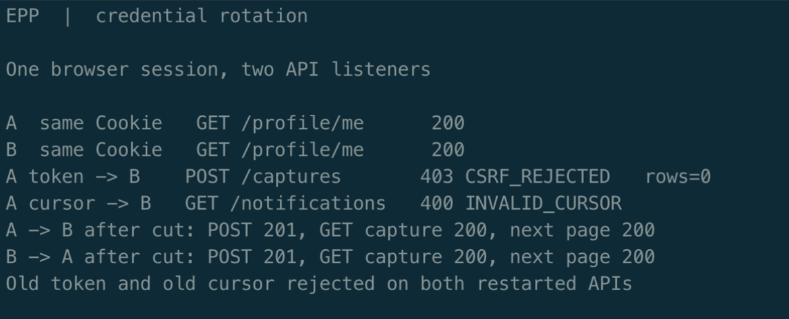
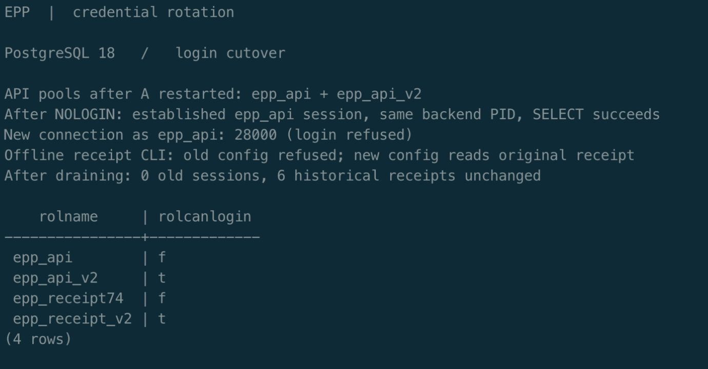

# 第 76 章　让 API 和后台进程更换凭据与签名密钥

上一章换完 HTTPS 证书，我们让客户端重新握手，再拿原 Cookie 读回自己创建的素材。现在运维交接单上换了两样东西：PostgreSQL 给运行进程使用的登录凭据，以及 API 用来签名的密钥。假设换完以后，你仍能读自己的资料。这次的 200 能验收哪一样？

保留[第 75 章的配套起点](https://github.com/SamChowRock/epp-public/tree/part-09/chapter-75)和这个请求。第 76 章新增的是授权 SQL 与定向请求脚本，运行的仍是上一章的应用。本章要使它先后遇到两种情况：一次，数据库已经禁止旧身份登录，它仍然能成功；另一次，两台 API 都能读资料，用户翻到下一页却报错。想决定何时可以撤掉旧秘密，就得查清每个请求究竟用到了什么。

## 76.1 盘点哪些进程还会以旧身份重连

从第 75 章末尾恢复的 HTTP 环境开始。用旧账号登录，读回原素材，按原用户 ID 和操作 ID 取回第 74 章那张收据。如果一直保留了 HTTPS 环境，先按上一章末尾恢复原回环入口，在这个来源登录一次。下面从头到尾保留**这次登录**。公开来源和协议要固定，否则换 Cookie 名或改 Origin 也会制造貌似相同的故障。

在部署机的服务定义里找出 `ExecStart`，沿着 `--env-file` 找到配置文件；在 Mac 上托管时查看对应 launchd 任务。只记录启动用户、路径、数据库登录名和目标，别把连接串贴上交接单。你会数到两份同样执行 `mail-worker.js` 的命令，其中只有带 `notifications` 参数的那份写站内收件箱。还容易漏掉三条平时看不到进程的命令：

| 什么时候运行 | 从哪份配置取数据库身份 | 在业务里留下什么证据 |
| --- | --- | --- |
| API 收到请求 | API 配置，原登录 `epp_api` | 原会话读本人资料；一条有唯一标记的素材写入并读回 |
| 邮件循环或人工单笔寄信 | 邮件配置，`epp_mail` | 消息 ID、发送状态与次数；收件端有没有这封邮件 |
| 通知循环 | 通知配置，`epp_notify` | 同一个 ID 从待办进入用户收件箱 |
| 管理员查旧收据 | 只读 CLI 配置，`epp_receipt74` | 原操作 ID 对应的整张收据 |
| 计时器唤起头像清理 | 清理配置，`epp_cleanup` | 本轮目标库、桶、对象 ID 和领取结果 |

在 DBeaver 用独立观察连接打开[会话查询](https://github.com/SamChowRock/epp-public/blob/part-09/chapter-76/examples/credential-rotation/activity.sql)，先看 `usename` 和 `backend_start`。前者是这条数据库连接用谁的名字登录，后者是连接建立的时间。`application_name` 中的 `epp-api`、`epp-worker`、`epp-notifications` 来自程序。同名的两个 API 都叫 `epp-api`。保留自动提交，每次查看重新执行查询；短命 CLI 退出后这一页就看不到它，不应据此删掉交接单上的那一行。

为什么不直接改 `epp_api` 的密码？PostgreSQL 在建立连接时核验身份。API 可以继续复用池里已经登录的连接；池空闲一段时间回收连接，或者进程重启，才会用启动时读到的口令再连。直接改密码也能做计划维护，但先改数据库或先重启应用都会有一边暂时拿错口令。这里希望先让 A 真正试用新登录，同时让 B 继续处理请求，因而需要一小段新旧登录都有效的时间。

第 72 章已经把邮件、通知、API 的权限分开，可以沿用这份劳动。以 API 为例，保留原角色上的对象权限，另建登录角色，让它继承那些权限：

```sql
CREATE ROLE epp_api_v2 LOGIN;
GRANT epp_api TO epp_api_v2 WITH INHERIT TRUE, SET FALSE;
```

`epp_api_v2` 用自己的口令连接，执行查询时可以使用授给 `epp_api` 的表和列权限。`SET FALSE` 关闭这条成员关系的主动身份切换。以后即使原角色被设为 `NOLOGIN`，它仍可作为这些权限的来源。若原角色是对象所有者、管理员，或还继承了其他角色，成员关系可能给得过多；先查前章的授权清单和实际角色，再决定哪些权限值得继承。

<details>
<summary>准备两个实例、独立登录和一套可重复使用的请求</summary>

沿用 Node 24.22.1、PostgreSQL 18、DBeaver、Bash、curl 和私有 Mailpit。用第 75 章停机集群的独立副本，保留原账号、非空库和配对桶。角色在整个 PostgreSQL 集群共享，只在日常实例新建一个数据库仍会改到日常身份。记录实例地址、端口和库名，另留一个已验证的管理员入口。配置位置与两台机器的归属见[实践环境](../../environment-setup.md#让两个实例接到同一份练习数据)。

在配套代码检出 `part-09/chapter-76`。首次准备按[配套说明](https://github.com/SamChowRock/epp-public/blob/part-09/chapter-76/examples/credential-rotation/README.md)执行一次 `identities.sql`（已包含上面的示例），用交互式 `\password` 给五个登录分别设置新口令。运行角色通过 TCP 密码认证；本机管理员可以用独立的本地连接观察。在每个角色的原配置旁准备一份新版，仅改数据库登录信息，保留限制性文件权限、预期库名和其他依赖地址。通知角色有意留下一项缺权，稍后用一笔业务找出它。

给两个 API 分配独立、属于各自运行用户的可写工作目录和回环监听端口，示例为 A 的 3376、B 的 3377。两者使用同一 release、同一库和 `APP_ORIGIN=http://127.0.0.1:13376`。数据库试切时，两者先使用原签名密钥。远程操作时沿用原数据库转发、SMTP 通路；另开操作端 SSH 页把本地 13386、13387 分别转到部署端的 3376、3377。同机直接访问两个监听即可。沿用第 74 章的前台启动方式，例如在部署端先用 `sudo install -d -o epp74-api -g epp74-api -m 0700 /var/lib/epp76-a /var/lib/epp76-b` 给两者准备目录。以 root 为配置属主、服务组只读安装配置文件，再启动 A：

```bash
sudo -u epp74-api env -i /bin/sh -c '
  cd /var/lib/epp76-a || exit 1
  exec /opt/epp72/node/bin/node --env-file=/etc/epp74/a.env /srv/epp74/release/dist/src/server.js
'
```

B 的命令换工作目录与配置文件。两端应各出现一次 `app.ready`。本章同时开两个 API 是为了定向探测，它们的进程内登录限额也各自计数；练习入口只在回环提供。

在操作端 Bash 进入配套根目录，按配套说明设置 `site`、`port_a`、`port_b` 和私有临时目录 `lab`，载入 `client.sh`。后面的 `hit A` 或 `hit B` 使用 curl 的 `--connect-to` 改变实际连接目标，URL、Host 和公开来源都保持一致。用第 55 章的账号准备至少两条尚未清除的站内通知，确保 `GET /notifications?limit=1` 给出非空 `nextCursor`。若需要重置密码来产生第二条通知，先完成重置与投递，再用新密码登录。若旧邮件仍占用通道，配套说明另有在隔离库创建通知分页样本的做法，可保留邮件现场。按配套说明把本次登录的 Cookie 仅存入私有文件；随后执行 `save_proofs B old` 保存一份原 CSRF 令牌与未过期的游标。

</details>

还要找出第二个秘密的使用者。沿 `src/config.ts` 读 `cursorKey` 的去向：列表用它给页边界和查询范围做 HMAC；`src/browser-security.ts` 用同一把密钥给“用途前缀 + 会话 ID”做 HMAC，生成 CSRF 令牌。Cookie 中的会话令牌另由数据库摘要匹配。由此可以先写下一个预测：只换 HMAC，旧登录应继续成立，但客户端上一次取回的两种签名值都可能失效。下面用可以指定由 A 或 B 接收的请求来检验。

## 76.2 先切一个进程并迫使它新建连接

先只换 A 的数据库登录。让 B 承接读取，在 A 的前台终端正常停止进程（托管时停止对应服务），等到 `app.stopped`。用受限的新配置重新启动 A，等 `app.ready`，立即让 A、B 各处理一次原来的 `GET /profile/me`。两端都是 200。此时刷新会话查询：本轮两个 `epp-api` 下同时出现了 `epp_api_v2` 与 `epp_api`。A 的连接建立在重启后，B 的登录尚旧。如果只有一个角色出现，再分别发一次请求立即查询，避免把已回收的空闲连接或另一进程的连接当作证据。

现在让 A 再多走一步，在它的配置中换签名密钥，而 B 保留旧值。先将这两个监听隔离在练习通路，正常流量不参与故障实验。新值在操作端执行一次下列命令生成；沿已核对身份的 SSH 通路将文件送入部署管理员的私有目录，或在同机直接使用。把同一行内容写入这一代各份 API 配置的 `CURSOR_HMAC_KEY`。各自生成一次会制造两把不同的密钥。不要把值写入截图、启动参数或工单。

```bash
(umask 077; openssl rand -hex 32 > "$lab/hmac-v2")
```

重启 A，保持 B 原样。用原 Cookie 向两端分别读本人资料。假如你仅看到两次 200，接下来会用哪一个请求检验自己的预测？先保留失败的响应，尤其是业务码。客户端这次可以控制**谁签发、谁验证**，不用猜负载均衡把它送去了哪一台。

```bash
hit A /profile/me me-a.json -b "$lab/cookies"
hit B /profile/me me-b.json -b "$lab/cookies"
save_proofs A candidate
write_capture B candidate failed-write.json
next_page B candidate failed-page.json
next_page A candidate control-page.json
```

`save_proofs` 向 A 取 CSRF，又取只有一条通知的第一页。`write_capture` 使用同一个 Cookie、正确 Origin、`X-EPP-Request: 1` 和刚取得的 CSRF 头，发送私有 `capture.json` 中带本轮标记的素材。`next_page` 始终保持原账号、资源和 `limit=1`。在本地打开两份失败响应，别把含游标或会话标识的成功响应贴到共享日志里。在 DBeaver 选本轮副本查这笔写入：

```sql
SELECT count(*) FROM public.captures
WHERE user_id = '换成本轮账号 UUID'::uuid
  AND original_text = '换成这次失败请求的唯一标记';
```



图 76-1　先看前四行。B 能识别原会话；写入回了 `403 CSRF_REJECTED`，标记计数为零。相同游标在签发它的 A 能续页，在 B 回了 `400 INVALID_CURSOR`。后两组成功的交叉请求来自修复之后。

两种报错能否只用“密钥不一致”解释？单看 403，也可能是 Origin 或显式请求头填错；这里业务码已走到 CSRF 校验。单看 400，换筛选条件、改页大小或原游标超过 30 分钟都会被拒。即时将同一游标送回 A 可以翻页，又在 B 用旧游标成功，才把范围缩到两个实例的验证条件。两边的数据库登录名也不同；让同一个 B 在修复时只改签名密钥、保留 B 当时的数据库登录，如果这两条路一起恢复，就能把两项变化区分开。多次点击首页或重新登录，都没有改变 B 加载的密钥。

## 76.3 轮流排空其余角色

数据库凭据可以让新旧登录短时并存。签名协议目前每个进程只认一把钥匙，把少量正常流量发给新实例会重现图 76-1。计划换钥时先生成并分发同一代受限配置，暂停公开接入，给正在处理的请求留出退出期限。让旧 API 全部排空，再逐台启动新配置；仍在试验中的 A、B 只接受定向探针。已打开的长连接、上传和普通短请求应按[第 74 章的排空过程](../chapter-74-portable-release/chapter.md)观察各自结局。一台仍留在可达的旧地址，即使正常入口已切走，也还会认可旧签名。

排空也能拿一笔请求来量。本轮在隔离库的观察事务内锁住素材表，让 A 的一笔创建停在 INSERT；先从 `pg_blocking_pids` 看见它确实在等，再给 A 发 TERM。A 已记录 `app.draining` 时，B 仍用原 Cookie 读回资料 200。立即在观察端 ROLLBACK 释放锁，A 完成原请求并返回 201，随后记录 `app.stopped`、退出 0。这里读写落在不同的表。若 B 也写这张素材表，两台 API 都会等同一个锁，多开一台进程不能消除数据库的阻塞。复现时用第 66 章的两个独立 SQL 会话观察等待，事先准备释放操作，应用 SQL 超时后该笔请求就无法完成这组对照。

在隔离探针里，先只把 B 切到与 A 相同的新密钥，沿用 B 已经读写成功的数据库登录。用 A 的令牌和游标在 B 验证 201 和 200。然后只改 B 的数据库配置、重新启动，在会话查询中确认 B 也以新身份接入。正式恢复流量前，先用 `old` 在 A、B 各重放一次写入和续页，预期分别是 403、400。原 Cookie 无需重新登录。运行 `save_proofs A anew` 和 `save_proofs B bnew`，从 A 取的值交给 B，反向再做一次：

```bash
write_capture B anew created-on-b.json
next_page B anew page-on-b.json
# 在私有 capture.json 中换一个本轮标记，再做相反方向
write_capture A bnew created-on-a.json
next_page A bnew page-on-a.json
```

两个写请求应各得 201，两个续页各得 200。取两份创建响应的 `id`，将其中一笔带到另一端做 `GET /captures/实际ID`，应读回同一标记。此时才恢复面向用户的入口。旧页面遇到 CSRF 拒绝可以先重新获取令牌；旧游标须从第一页重新取得。若写请求的结果根本没收到，先按业务标识查明是否落库，再决定重发。本章计数为零的证据只属于那次明确被拒绝的请求。

**邮件先看通道，再动进程。** 切换 API 不会替邮件 Worker 重新连接。让原邮件与通知进程正常结束，停妥可能拉起它们的管理器；确认没有其他发件者。在 DBeaver 留下本轮的占用和待办：

```sql
SELECT c.paused_by, o.status, o.attempts
FROM verification_mail_control c LEFT JOIN verification_outbox o ON o.id=c.paused_by
WHERE c.id=1;
SELECT id, status, attempts FROM verification_outbox
WHERE status IN ('pending','attempting','unknown') ORDER BY id;
```

上一章留下的邮件是 `unknown`，已经尝试一次且占用通道。通过 API 向新的练习邮箱申请注册，保存新消息 ID。新邮件 Worker 以新身份启动，碰到旧占用后退出 2；新消息仍待办。这说明它已连到能读见旧现场的库。换数据库密码没有提供 SMTP 当时是否接收的证据。

若交接的通道应继续暂停，就保持这一状态。在**隔离练习副本**完成新投递对照时，先停止所有发送者，记录旧 ID、未知结果和“不自动重发”的处置，再按[第 53 章的定向人工放行 SQL](https://github.com/SamChowRock/epp-public/blob/part-09/chapter-76/database/chapter-45/03-review.sql)填本轮库名与该消息完整 ID。检查恰好返回那一行；旧消息本身继续是 unknown。确认 SMTP 只通向本次 Mailpit，才启动使用新配置的邮件 Worker。按新的收件人查到一封，核对新消息 ID 已 accepted，原 ID 的尝试次数仍为一。沿用第 55 章的注册请求和确认请求：在 Mailpit 打开这封信，取令牌传给 `POST /auth/register/confirm`（字段 `token` 和 `newPassword`）。用响应的用户 ID 查其新建的通知任务，保留任务 ID。

**通知进程报告 ready 后退出了。** 先别造第二个注册。看新进程能否连接、新任务还在不在、同 ID 是否已进箱。在 DBeaver 的独立观察连接执行下面的查询，把 UUID 换为刚才注册产生的 job ID（可用该用户的 `user_id` 在 `notification_jobs` 找到）：

```sql
SELECT j.id, j.status, n.id IS NOT NULL AS in_inbox
FROM notification_jobs j LEFT JOIN notifications n USING (id)
WHERE j.id = '换成本轮通知任务 UUID'::uuid;
SELECT has_column_privilege('epp_notify_v2','public.notifications','id','INSERT')
       AS can_insert_notification_id;
```

在本轮的缺权候选配置中，读数为 `pending / false`，列权限也为 false。PG 服务端记录了 `permission denied for table notifications`。登录和启动探针都通过，直到实际投递才需要向收件箱插入。插入和完成标记在同一事务中，失败回滚使原任务仍可消费。此时可以退回原通知登录处理这笔工作；本次选择按第 72 章既有权限修复新角色。管理员在预期库执行[通知授权修复](https://github.com/SamChowRock/epp-public/blob/part-09/chapter-76/examples/credential-rotation/repair-notify.sql)，给新登录继承原通知角色的权限并收回临时直接授权。重新启动同一 Worker，重新跑相同 ID 的查询，现在应为 `done / true`。

<details>
<summary>运行两个后台入口，以及两条不会在常驻进程表里等你的命令</summary>

在部署端的 Bash 把 `db` 设为交接单上的库名，以下举例沿用第 74 章的 Linux 用户和 release 路径。各 `*-v2.env` 均按本角色设置组权限。分开终端，按上述先后顺序运行；对常驻 Worker 发送 TERM 后，等 `worker.closed` 再启动后继。若原任务由 systemd 托管，也要更新它下一次启动实际读取的文件，手动验证成功后再恢复调度。

```bash
release=/srv/epp74/release
node_bin=/opt/epp72/node/bin/node
db=epp_ch73_handoff
sudo -u epp74-mail env -i "$node_bin" --env-file=/etc/epp74/mail-v2.env \
  "$release/dist/src/mail-worker.js" "$db"
# 在通知专用的终端恢复以上三个变量
sudo -u epp74-notify env -i "$node_bin" --env-file=/etc/epp74/notify-v2.env \
  "$release/dist/src/mail-worker.js" "$db" notifications
```

邮件循环停妥后，以同一邮件用户、配置和预期库运行 `dist/src/send-one.js "$db" "$message_id"`，最后一项取本次已 accepted 的消息 ID。通道开放时应得到 `empty`，次数保持一次。另按[第 73 章单笔清理命令](https://github.com/SamChowRock/epp-public/blob/part-09/chapter-76/examples/maintenance/README.md)，将清理 unit 下一次启动读取的配置换为新登录。先停 timer 并等 service 结束，选一个**仍在使用**的头像 ID，以原来的预期库、端点和桶手工运行同一入口。结果应为领取零笔且无失败。这个对照检验新数据库身份能运行筛选；这个 ID 必须取自 `users.avatar_id`，不能随手挑一条已到期的历史键。若还需验实际对象删除，按第 73 章另选已到期的练习对象，并用独立观察身份读回当前头像。恢复 timer 时核对实际 unit 和下一次触发时刻。

</details>

## 76.4 撤掉旧登录后验证故障边界

还剩一条停着的收据查询命令。先用它的**旧配置**查回原收据，保存结果。另开一个终端，在数据库可达的一端执行 `psql -X -h 127.0.0.1 -p 55476 -U epp_api -d epp_ch73_handoff -W`，把端点和库名换为应用实际访问的练习副本，交互输入旧口令。执行下列两条并保留窗口。记下数据库 PID，这条连接专供下面辨认。

```sql
SET application_name = 'epp76-held';
SELECT session_user, pg_backend_pid(), count(*) FROM public.captures;
```

现在可以做一个区分原因的实验。如果禁止旧登录就会踢掉在线连接，上面的窗口下次查询应失败；如果只在登录时拦截，那么原窗口与刚打开的窗口会有不同结果。先在管理员窗口重新执行会话查询，核对**整个练习集群**中的使用者。确认工作进程均已换好，保留这一个已知对照连接，再在这个隔离集群执行：

```sql
BEGIN;
ALTER ROLE epp_api NOLOGIN;
ALTER ROLE epp_mail NOLOGIN;
ALTER ROLE epp_notify NOLOGIN;
ALTER ROLE epp_cleanup NOLOGIN;
ALTER ROLE epp_receipt74 NOLOGIN;
COMMIT;
```

回原窗口重跑 SELECT。再用同一地址、库名、旧 API 用户及口令**新开连接**。本轮前者仍能读表，PID 不变；后者连第一条业务 SQL 都没执行就被拒绝，PG 报 SQLSTATE `28000`。若你关掉旧窗口再开两次，就观察不到这个差别。再运行刚才的收据命令：旧配置失败且没有业务输出，换成新收据配置就读回原值。在部署端沿用交接单的三个变量，切换的只是下面的配置文件：

```bash
sudo -u epp74-receipt env -i /opt/epp72/node/bin/node \
  --env-file=/etc/epp74/receipt-v2.env /srv/epp74/release/dist/src/account-admin.js \
  "$db" receipt "$user_id" "$operation_id"
```

收据内部的 `dbActor` 记录当年操作时的身份，可以一直是旧值；当前登录另用实际新连接核实。



图 76-2　下半部两对角色的 `rolcanlogin` 分别为 f 和 t。上半部的同 PID 查询发生在撤销登录之后，零条旧连接则是在关闭最后的对照连接之后。二者之间还差一次排空。

正常维护时让已知客户端关闭旧连接，再刷新会话查询。如果演练的是密码泄露，旧身份被禁后还要查清并终止仍可能受控的连接，包括别的数据库中的会话。先按登录名、库、启动时刻定位，辨认 PID。下面只处置自己保留的那条练习连接：在管理员 psql 中将 `held_pid` 设为刚才的数字，例如输入 `\set held_pid 12345`，换成实际值。

```sql
SELECT pg_terminate_backend(pid, 3000) AS stopped
FROM pg_stat_activity
WHERE pid = :held_pid AND usename = 'epp_api'
  AND datname = current_database() AND application_name = 'epp76-held';
```

零行说明读数或目标已变，重新观察；返回 true 表示在指定等待内终止。原窗口的连接随即不再可用。重新运行会话查询，确认五种旧登录均无连接，再逐一用新配置建立连接。用第 74 章的预期库、用户 ID 与原操作 ID 执行 `account-admin.js "$db" receipt "$user_id" "$operation_id"`，把输出与撤销前保存的那一份做 `cmp`。本轮五组旧登录逐一新连均被拒；五个新登录均能查到预期库名，仍都无权 DELETE 用户表。六张旧收据逐值一致。不要删除用来承载权限的原角色，否则也会影响依赖它的新成员。

最后把回退条件写给下一班。计划轮换在旧身份仍被允许时，可以先把故障进程退回原登录配置；撤销后，同一份旧配置已无法重连。需要回退程序时，应把已验证的新凭据交给回退版本。如果因泄露换签名密钥，立即隔离所有仍接受旧签名的入口，换为新值，只在新入口恢复服务，回退程序也不能重新接纳旧钥匙。数据库密码泄露和浏览器会话令牌泄露是两起不同事件：若连 Cookie 也可能被取得，还要按会话撤销流程撤掉受影响的登录，仅换 HMAC 不会让那份 Cookie 失效。

## 附录：本章必要技术点速查

| 现场问题 | 看哪里 | 能作什么判断 |
| --- | --- | --- |
| 新身份从哪里取得原有对象权限 | 角色成员关系中的 INHERIT、SET 选项 | 新登录可继承原授权；核对所属角色及对象所有权。[PostgreSQL 18 角色成员关系](https://www.postgresql.org/docs/18/role-membership.html) |
| 如何知道进程确实重连 | `pg_stat_activity.usename / pid / backend_start / application_name` | 对齐启动时刻与实际业务，另验离线命令。[PostgreSQL 18 活动视图](https://www.postgresql.org/docs/18/monitoring-stats.html#MONITORING-PG-STAT-ACTIVITY-VIEW) |
| 如何用同一来源点名实例 | curl 的 `--connect-to` | 固定请求 URL、Cookie 与 Origin，只改变实际拨号目标。[curl 选项](https://curl.se/docs/manpage.html#--connect-to) |
| 原会话 200，写入 403 或续页 400 | 固定账号、请求头、查询范围及时间，交叉签发和验证 | 区分来源错误、过期与密钥不一致；换钥后重新取 CSRF、从首页取新游标 |
| 撤销旧登录后谁还能工作 | `ALTER ROLE … NOLOGIN`、旧连接与新连接对照 | 禁止再登录；需要结束现有会话时先核对目标。[角色属性](https://www.postgresql.org/docs/18/sql-alterrole.html) · [终止后端](https://www.postgresql.org/docs/18/functions-admin.html#FUNCTIONS-ADMIN-SIGNAL) |

阅读约 30～40 分钟。已有非空练习副本、角色与原账号时，准备两个实例、交叉请求、后台切换和撤销对照另加 65～95 分钟。首次复制环境及准备账号数据另计。

[配套代码 · 第 76 章](https://github.com/SamChowRock/epp-public/tree/part-09/chapter-76) · [上一章 · 客户端怎样确认访问的是自己的 HTTPS 服务](../chapter-75-tls-trust/chapter.md) · [核心路线 · 第 81 章](../../README.md#第-81-章-从域名到服务-dns-https-与反向代理) · [选读 · 第 77 章 Docker 基础](../../README.md#第-77-章-docker-基础从本地进程到容器) · [本篇导读](../README.md) · [全书目录](../../README.md)
