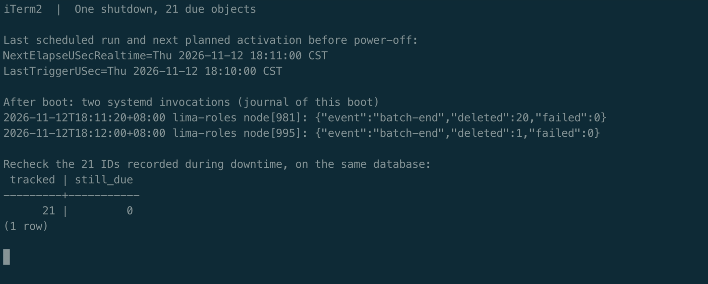
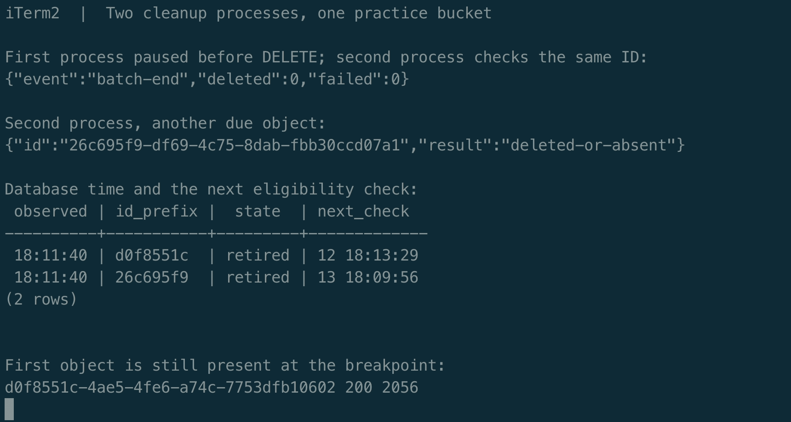
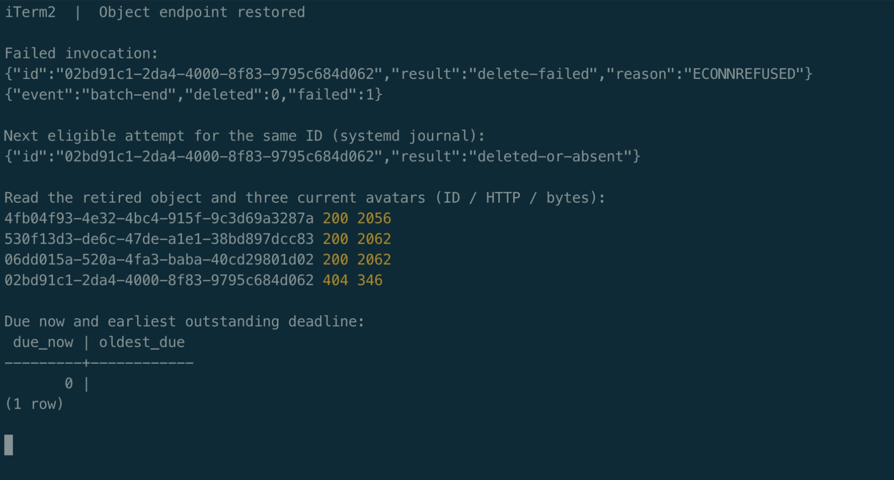

# 第 76 章　定时维护漏跑或同时启动两次以后怎么办

第 75 章能按进程、时间和业务 ID 查到一次失败。假如到了预定时间连一条启动日志都没有，怎样判断漏了多少工作？[支线 51A](../../part-06-background/chapter-51-worker/side-01-scheduling.md)把常驻巡视与按时唤起的短任务做过对照。这里沿用短任务，让数据库回答应当做哪几笔。

一位用户连续换了两次头像。新图已经出现在个人资料里，旧图仍在桶中。[第 60 章](../../part-07-profiles/chapter-60-avatar-storage/chapter.md)留下了一条清理命令。假设把它设为每分钟运行一次，18:11 恰好关机了。接班人需要补敲一次命令，还是先去数一数库里还有多少旧图？如果另一位同事也开始清理，两个人会碰到同一个对象吗？

沿用[第 71 章的 Linux 练习机与服务身份](../../part-09-deployment/chapter-71-service-runtime/chapter.md)，按[部署端准备](../../environment-setup.md#准备-debian-13-部署端)确认当前的 Linux 主机与 systemd，再准备一份可改动的非空练习库、与它**成对复制**的私有桶，以及能在这个副本登录的旧账号。仅复制库、仍连着原桶，清理会删到原服务正在使用的字节。[第 62 章的交接实验](../../part-07-profiles/chapter-62-review/chapter.md)可以回查这个故障。下面的库名 `epp_ch73_handoff`、端点 `http://127.0.0.1:18633` 和桶名 `avatars` 是一组练习值，按自己的建库、端口转发和建桶记录替换。API、观察连接、调试进程和计时器都要到达这一对副本。从部署交接单取回原表、旧账号和请求集合，本章没有迁移。

沿第 74 章接管后的 Compose 服务继续时，保留该服务，把本轮演练放在独立的库和桶副本上。下面仍用部署端 Debian 的 timer 唤起清理命令；宿主可按下文解开同平台验收过的整包，无需重装线上 API。为宿主清理身份准备能到达副本的地址：PG 可以只发布到宿主回环，S3 可以沿用副本的受信 HTTPS 入口。若它用练习根，给宿主清理进程设置 NODE_EXTRA_CA_CERTS，核对清理用户能读取该公开证书。容器内部的服务名通常不能在宿主解析，容器的 127.0.0.1 也与宿主不同。按实际通路替换清理配置和命令中独立核对的三个目标，先验当前头像领取零笔、观察身份仍能取到同一键，再接上排期。

## 76.1 把到期头像清理接入宿主调度

先取得两个可以认出来的对象。让副本上的 API 使用自己的工作目录、私有桶和数据库连接，用 Postman 的请求 05 登录，20 核对本人，15 取得本次会话的写令牌。在第 60 章集合的 25 选择 binary 文件 `harbor.png`、类型 `image/png`，发送并记下响应的 avatarId 为 P。再选 `harbor.jpg`，把 Content-Type 改成 `image/jpeg`，发送并记下 Q。两次均应返回 200。26 取得当前 Q 的短期地址，立刻另发 GET 读图。刚刚签发的链接过期时回到 26 重新签发。读到 Q 说明发布成功，还不能据此删 P。

在连接本轮库的 psql 中，将下列第一行的值换成 P 的完整 UUID。下面是配套 `examples/maintenance/preview.sql` 的只读查询，也可以在 DBeaver 的 SQL 编辑器把 `:'attempt_id'` 换成带单引号的 UUID 执行。把 ID 换成 Q，再查一遍。

```sql
\set attempt_id '替换为本轮的旧头像UUID'
SELECT w.id, w.state, w.check_after, (u.avatar_id IS NOT DISTINCT FROM w.id) AS current_avatar,
       (w.state IN ('writing','retired') AND w.check_after <= clock_timestamp()
        AND u.avatar_id IS DISTINCT FROM w.id) AS due
FROM public.avatar_writes w JOIN public.users u ON u.id=w.user_id
WHERE w.id=:'attempt_id'::uuid;
```

Q 一行应是 `live / current_avatar=t / due=f`。P 已经 `retired`，但刚被替换时 `due=f`。发布事务给已经签出去的旧地址留了 30 秒；在同一连接等过 P 的 check_after，重新执行查询，这次 P 才是 `due=t`。零行表示这个库里没有该写入 ID。先核对库与响应，别扩大筛选范围。读数只说明查询这一刻的资格，执行者领取时还要重查。

**让一次启动留下可以对账的结果。** 配套快照是 `part-10/chapter-76`。已有入口 `database/chapter-51/clean.mjs` 先比对独立传入的预期端点和桶，再连库执行 `SELECT current_database()`。这两项核对能挡住连错名字或拿错配置；在另一台机器上完全可以有同名库、同名桶，还要用旧账号、原收据和当前 Q 的实际字节核对副本身份。最后一个可选参数是具体的写入 ID，省去它时每轮最多认领 20 个。第 75 章的服务日志能找到进程，旧命令的汇总却不能回答“失败的是不是 P”。在 `src/avatar-cleanup.ts` 给原函数加一个可选的逐项回报，在原有两个分支产生结果。删除成功后先保存下次复查时刻，再报告成功。旧调用者仍能取得 `{ deleted, failed }`。

```ts
type ItemResult = { id: string; result: 'deleted-or-absent' }
  | { id: string; result: 'delete-failed'; reason: string };

// cleanAvatarBatch 在 attemptId 后增加 report?: (item: ItemResult) => void。
// 下面在原有的 for (const { id } of due.rows) 循环中。
try { await objects.remove(id); }
catch (error) {
  failed++;
  report?.({ id, result: 'delete-failed', reason: failureReason(error) });
  continue;
}
await client.query(`UPDATE public.avatar_writes SET check_after=clock_timestamp()+interval '1 day'
  WHERE id=$1 AND state='retired'`, [id]);
deleted++;
report?.({ id, result: 'deleted-or-absent' });
```

`failureReason` 只输出认识的错误类别。比如连接被拒时记 `ECONNREFUSED`，存储拒绝时记 `AccessDenied`，其他错误归入 `object-error`。原始 SDK 异常可能带有请求细节，排查一笔故障只需先知道 ID、失败在哪一步、该向谁取证。下面是这个函数。随后在 `clean.mjs` 的数据库核对回调里接上回报。

```ts
function failureReason(error: unknown): string {
  if (!(error instanceof Error)) return 'object-error';
  const code = 'code' in error ? error.code : error.name;
  if (typeof code === 'string' && [
    'ECONNREFUSED', 'ECONNRESET', 'ENOTFOUND', 'ETIMEDOUT', 'TimeoutError',
    'AbortError', 'AccessDenied', 'NoSuchBucket', 'InvalidAccessKeyId', 'SignatureDoesNotMatch',
  ].includes(code)) return code;
  return 'object-error';
}
```

```js
const report = item => console.log(JSON.stringify(item));
report({ event: 'batch-start', database });
const { deleted, failed } = await cleanAvatarBatch(client, objects, attemptId, report);
report({ event: 'batch-end', deleted, failed });
// 保留原有汇总及退出状态
console.log('Deleted or already absent:', deleted, 'Failed:', failed);
if (failed) process.exitCode = 1;
```

这次清理程序加了逐项日志，上次归档的摘要不会标识这份新程序。按[第 65 章的制品验收与晋级](../../part-08-maintenance/chapter-65-artifact-promotion/outline.md)，在与目标相容的构建环境运行 `nvm use`、`npm ci`、`npm run ci:check`，确认 TS 已进入 dist。封包前把同一版的 `database/chapter-51/clean.mjs` 及其导入的 `scripts/verify-database.mjs` 按这两个相对路径放进待打包目录，一同交付 dist、清单、锁文件、.npmrc 和本平台生产依赖。只交付 dist 会找不到清理脚本。等下文的受限身份备好，先从新解开的验收副本选仍当前的 Q 跑单笔命令，预期领取零行，Q 仍可读。验好后记录该包摘要。在目标机新建 root 管理的 `/opt/epp73/release`，核摘要、解包，以[第 71 章的受限身份](../../part-09-deployment/chapter-71-service-runtime/chapter.md#712-把运行身份目录和配置交给系统)运行。生产 Node 可沿用 `/opt/epp72/node/bin/node`。

**用哪个账号删除？** 清理 SQL 需要读当前头像指针、锁住写入记录、修改两列。它不需要登录用户、读邮箱、改当前指针或在数据库中删除记录。在隔离实例上用管理员建立新的普通角色 `CREATE ROLE epp_cleanup LOGIN;`，用 psql 的 `\password epp_cleanup` 隐藏输入独立口令。连接本轮库，以有权授权的所有者执行下列 SQL。配套 `examples/maintenance/grants.sql` 先对照 `\set expected_db epp_ch73_handoff` 和实际库名，匹配后才在同一事务发放这些权限。

```sql
GRANT CONNECT ON DATABASE epp_ch73_handoff TO epp_cleanup;
GRANT USAGE ON SCHEMA public TO epp_cleanup;
GRANT SELECT (id,avatar_id) ON public.users TO epp_cleanup;
GRANT SELECT (id,user_id,state,check_after), UPDATE (state,check_after)
  ON public.avatar_writes TO epp_cleanup;
```

在 Linux 另建系统用户 `epp-cleanup`（`sudo useradd --system --user-group --no-create-home --shell /usr/sbin/nologin epp-cleanup`）。创建 `/etc/epp73`，用第 71 章的受限文件安装方式保存 `cleanup.env`，属主 root、组 epp-cleanup、模式 0640。文件只包含 `DATABASE_URL`、`AVATAR_S3_ENDPOINT`、`AVATAR_S3_BUCKET`、`AVATAR_S3_ACCESS_KEY`、`AVATAR_S3_SECRET_KEY`。库连接使用新角色。对象身份单独签发：在第 60 章练习存储的私有 `s3.json` 的 identities 中追加与原身份格式相同的一项，保留原有凭据，使用新生成的 accessKey、secretKey 和 `["Write:avatars"]`；按原配置重启该**副本**，把新凭据写入 cleanup.env。这个练习存储的 Write 同时允许写入，若目标支持细分策略，只授予对应头像键前缀的 DeleteObject。用于核对对象是否存在的读凭据留在观察端。

先在验收机的解包目录，以自己的练习库、端点、桶和当前 Q 测试单笔入口；以下命令中的路径和 ID 按该机替换。验好、晋级相同归档以后，在目标机手动处置已预演的 P。把下面最后一个实参替换成实际 UUID；`env -i` 清掉 SSH 登录环境，`--env-file` 让 Node 只取这份配置。独立传入的三个目的地来自交接单。保留这一行命令，后面单笔排查还会用到。

```bash
cd /opt/epp73/release
sudo -u epp-cleanup env -i /opt/epp72/node/bin/node --env-file=/etc/epp73/cleanup.env \
  database/chapter-51/clean.mjs epp_ch73_handoff http://127.0.0.1:18633 avatars 本轮P的UUID
```

输出中找到 P 的 `deleted-or-absent` 和 `batch-end` 的 `deleted=1, failed=0`。在能访问**本轮桶**的配套目录，用原有的只读或 API 存储配置对 P、Q 分别运行 `node --env-file=.chapter51-store/app.env database/chapter-51/head-avatar.mjs 本轮UUID`。该练习桶对 P 返回 Not found，对 Q 返回 Present、类型和字节数。桶或身份错了也可能得到拒绝，403 不能当作对象已清走。再查 P 的数据库记录，它还在，check_after 移到了次日。第 60 章演示过一个已经在途的 PUT 可以晚于 DELETE 抵达；保留这行才能日后再扫。

**把手动命令交给宿主。** 在 `examples/maintenance/epp-avatar-clean.service` 写入如下内容。去掉末尾 P，宿主每次启动同一入口处理一批。TimeoutStartSec 限制整次启动，已有 S3 客户端另给每一笔 DELETE 最多 15 秒。一批有许多慢请求时，120 秒可能在最后一笔前就用完；届时以逐项记录和库内期限接班。

```ini
[Unit]
Description=Scan one batch of retired or abandoned EPP avatars

[Service]
Type=oneshot
User=epp-cleanup
Group=epp-cleanup
WorkingDirectory=/opt/epp73/release
EnvironmentFile=/etc/epp73/cleanup.env
ExecStart=/opt/epp72/node/bin/node database/chapter-51/clean.mjs epp_ch73_handoff http://127.0.0.1:18633 avatars
TimeoutStartSec=120s
NoNewPrivileges=yes
ProtectSystem=strict
ProtectHome=yes
```

`Type=oneshot` 让 systemd 等命令退出并记下结果。正常结束后 service 回到 inactive，下次才有新的启动机会。这里不开失败即重启。另一份同名 `epp-avatar-clean.timer` 决定何时再来；每分钟一次方便在练习机上观察整轮。

```ini
[Unit]
Description=Check EPP avatar cleanup every minute

[Timer]
OnCalendar=*-*-* *:*:00
AccuracySec=1s
Persistent=true

[Install]
WantedBy=timers.target
```

在部署端存放这两个文件的目录执行下列命令。核对 unit 中绝对路径与预期库、端点、桶之后再安装。`verify` 检查定义和可执行文件；`daemon-reload` 让管理器重读磁盘。先人工 start service 验证一次，与自动排期分开。

```bash
sudo install -m 0644 epp-avatar-clean.service epp-avatar-clean.timer /etc/systemd/system/
sudo systemd-analyze verify /etc/systemd/system/epp-avatar-clean.{service,timer}
sudo systemctl daemon-reload
sudo systemctl start epp-avatar-clean.service
systemctl show epp-avatar-clean.service -p ExecMainStartTimestamp -p ExecMainExitTimestamp -p Result -p ExecMainStatus
sudo journalctl -u epp-avatar-clean.service -n 35 --no-pager -o short-iso
sudo systemctl start epp-avatar-clean.timer
systemctl list-timers --all epp-avatar-clean.timer
```

`NEXT` 是下一次计划，`LAST` 是上一次计时器触发，手动 start service 不算作一次 timer 触发。等 LAST 出现，再对照 service 的开始、结束与该次日志。短命 service 退出且被管理器卸载后，show 的两个时间字段可能为空、Result 也可能回到默认值。按 journal 中同轮的 Starting、逐项输出和 Finished 或 Failed 找回实际起止时间。`AccuracySec=1s` 给宿主一个合并唤醒的窗口，依赖变慢还会影响真正完成的时间。若 service 启动就失败，从 journal 的第一处错误查运行用户、配置路径、数据库身份或端点；只有 `batch-start` 而缺 `batch-end` 时查看超时和进程退出原因。此时可以停下，留下 P、Q 和本次运行时间。

## 76.2 让主机错过一个触发时刻

先在操作端记下已经触发过的 LAST 与下一次 NEXT。在目标机用 `sudo systemctl stop epp-avatar-clean.timer` 停排期，然后查看 `systemctl is-active epp-avatar-clean.service`。若上一轮仍在执行，等它结束再留基线。保持 API 可用，连续两次发送请求 25，新版本替换旧版本，记下两个 ID。跨过刚才记下的 NEXT 和旧图的保护期，查 76.1 的单笔预演。即使没有清理进程，数据库时钟照走，旧图已经 `due=t`。

**现在还欠多少？** 在独立观察连接执行配套 `examples/maintenance/backlog.sql`。同一条语句使用同一个观察时点。`oldest_due` 是当前最早该检查的时刻，`due_now=0` 时它为空。把这一对值和刚才的单笔 ID 一起保存。如果已有历史淘汰项到期，读数可能比本轮新增数大。

```sql
SELECT count(*) AS due_now, min(w.check_after) AS oldest_due
FROM public.avatar_writes w
WHERE w.state IN ('writing','retired') AND w.check_after<=statement_timestamp()
  AND NOT EXISTS (SELECT FROM public.users u WHERE u.id=w.user_id AND u.avatar_id=w.id);
```

重新 `sudo systemctl start epp-avatar-clean.timer`。日历计时器开了 `Persistent=true`，并已有触发记录；停用期间只要错过至少一次，它重新激活时会安排一次补跑。用 `sudo journalctl -u epp-avatar-clean.service --since '10 minutes ago' -o short-iso` 对照恢复时刻，核对日志中该 ID 的结果，再查到期量。一次最多 20 笔，若有 21 笔，第一轮成功后还欠一笔。下一轮重新查当前状态，没有页码或 OFFSET；已处理的行因复查时间在未来而让出位置。如果连续几轮都处理了 20 笔，而最老到期项越来越老，说明现有节奏跟不上新增与复查的总量。先看每轮耗时、失败 ID 和剩余量，再决定缩短间隔或增加执行者。



**图 76-1**　同一轮 iTerm2 交接记录。调度主机关机前预计 18:11:00 再运行；关机时，独立的库和桶里准备了 21 个到期对象。开机接回依赖，18:11:20 激活计时器，第一批处理 20 个，18:12:00 的第二批处理 1 个。最下面用停机期间保存的 21 个 UUID 回查，剩余到期数为 0。按上面的停 timer 做法也能观察停用窗口。若要在独立练习机验证关机，先留存上次与下次时刻，把库、桶留在另一台可达的练习机；或在关机前准备好将在关机期间到期的旧版本。开机后先接好依赖再手动启动 timer。本章练习只 start；需要随系统开机自动激活时，对 timer 执行 `sudo systemctl enable --now epp-avatar-clean.timer`。

换一个要求试试。财务要求按上海业务日每天留一份报表。周五关机、周一恢复，一次补唤醒怎么知道还欠周六和周日？头像任务可以从当前行重新算出该做什么。日报需要保存“哪一天已经交付”的事实：以业务时区切出应交付且已结束的日期，与按 `(report_type, business_date)` 唯一记录的已完成日期求差。周一早晨应处理差集中的周六、周日；周五是否在差集中取决于其报表是否已交付。每个日期使用相同的交付键重试，产物可确认、记录可补登；若邮件发送已发生却没记账，还须核实发送结果。只记最新一次成功的时间，中间缺的一天就可能永远看不出来。

## 76.3 两个执行者同时工作时认出谁已占用

如果同一个 service 正在运行，timer 再次到点，systemd 会让这一次继续执行。可还有第二种入口：同事在另一个终端直接运行 Node，或者另一台主机也接到了同一套库和桶。两个独立进程都能来到 SQL 这一行。只在宿主上查一个 PID，无法判断另一端是否正在动 P。

回看 `src/avatar-cleanup.ts` 的第一条语句。先找出行锁什么时候释放，再看下一位会用哪一列判断资格。

```sql
WITH due AS (
  SELECT w.id FROM public.avatar_writes w WHERE w.state IN ('writing','retired')
    AND ($1::uuid IS NULL OR w.id=$1::uuid)
    AND w.check_after<=clock_timestamp()
    AND NOT EXISTS (SELECT FROM public.users u WHERE u.id=w.user_id AND u.avatar_id=w.id)
  ORDER BY w.check_after,w.id LIMIT 20 FOR UPDATE OF w SKIP LOCKED
) UPDATE public.avatar_writes w SET state='retired',check_after=clock_timestamp()+interval '5 minutes'
  FROM due WHERE w.id=due.id RETURNING w.id;
```

两人同时选到同一行时，先取得行锁的人可以更新它，`SKIP LOCKED` 让另一人绕过尚未释放的锁去挑别的候选。正式入口使用自动提交连接，这条语句一结束，行锁就释放了。之后即使第一个人停在发 DELETE 之前，第二个人仍会跳过这行，因为已提交的 check_after 在五分钟以后。把 writing 改为 retired 还撤销了旧上传的发布资格。不能把这里包进一个覆盖整轮 S3 请求的大事务：另一连接看不到已经生效的资格变化，而且数据库回滚也收不回一个已经发出的 DELETE。

先停 timer，等已有 service 退出。用同一练习账号再发三次 25，分别记作 A、B、C。C 当前可读；A、B 被替换，等到单笔预演都显示到期。**第一人只指定 A**，否则他可能一口气领走 A 和 B，第二人就没有另一笔可做。下面在目标机的三个 iTerm2 SSH 页操作。第一、二页连接同一主机，练习调试端口只监听该机回环。先在第一页进入交付目录，看编译后删除调用在哪一行，再用与手动处置相同的环境启动进程。

```bash
cd /opt/epp73/release
grep -n 'await objects.remove(id)' dist/src/avatar-cleanup.js
sudo -u epp-cleanup env -i /opt/epp72/node/bin/node --inspect-brk=127.0.0.1:19273 \
  --env-file=/etc/epp73/cleanup.env database/chapter-51/clean.mjs \
  epp_ch73_handoff http://127.0.0.1:18633 avatars 本轮A的UUID
```

`--inspect-brk` 使进程在开始时等待调试器。第二页运行 `/opt/epp72/node/bin/node inspect 127.0.0.1:19273`。在 `debug>` 输入 `sb('dist/src/avatar-cleanup.js', 27)`，把 27 换成上一条 grep 输出的实际行号。文件若还没加载，调试器会先提示未加载。输入 `cont`，等箭头真正指到 `await objects.remove(id)` 才停手。此时数据库已经提交领取，S3 调用尚未发出。若进程直接结束，先检查选中的 A 是否已经被其他调度领取、是否真的到期，以及断点是否设在这次构建的 JS 文件中。

第三页用 76.1 的正式单笔命令再传 A，预期 `deleted=0, failed=0`；再传 B，预期 B 被处置一笔。用观察身份在配套目录分别做 HEAD：A 还在，B 已经不可见，C 仍可读。SQL 中 A 的 check_after 距领取约五分钟，B 的新时刻在次日，C 始终是 live。在下面这次停顿中，第二个执行者先查 A，随后由 service 开一轮批处理找到 B，按同一对 ID 核对即可。表本身没有保存执行者编号；仅看未来的 check_after，不能断言某个特定进程仍在工作。



**图 76-2**　A 的 ID 以 `d0f8551c` 开头。第二次查 A 时领取数为零，另一个到期对象 B 已返回成功。库里 A 的下次检查是当天 18:13:29，B 的是次日。最后一行用独立的读身份实际取得 A 的 2056 字节。看到 A 的状态已经是 retired，并不能据此报告“对象已经消失”。

保持第一页暂停，等过 A 的 check_after，第三页重新查到 `due=t`，再用正式命令单独处置 A。它这次得到 1，实际 HEAD 应显示 A 不在了。回到第二页输入 `cont` 恢复第一人，结束后若目标在等待调试器断开，输入 `.exit` 或按 Ctrl-D 离开调试器。第一人仍可能也报 `deleted-or-absent`：他没有被收回发送请求的能力，两个 DELETE 对准的是同一个不可复用的版本键。在本练习的无版本桶，最终 A 不存在、C 可读是正确结果。把两份成功日志相加推算“删除了两个文件”，会多算一份。较晚的更新还会重设次日的检查时间。若改成版本化桶，按键删除可能留下 delete marker；若改成扣款或发送邮件，还要有对端的幂等键或第 53 章的未知结果处置，短期占用本身做不到一次生效。

**换成整轮只能有一个执行者。** 假设任务改为用同一个临时文件名重建索引，不同批次也不能同时写。此时可以先在一条专用 PostgreSQL 连接取得会话级咨询锁，约定同一数据库里的所有入口使用同一个键。取不到就记录“已有执行者”并结束该轮。下面用两个独立 psql 连接到同一练习库，亲手验证接手条件。

```sql
-- 连接一，保持连接打开
SELECT pg_try_advisory_lock(73,1);
-- 连接二，在连接一仍打开时执行一次
SELECT pg_try_advisory_lock(73,1);
```

第一人得到 t，第二人得到 f。在第一页 psql 输入 `\q` 关闭连接，再在第二页执行同一句，得到 t，最后 `SELECT pg_advisory_unlock(73,1);`。键里的两个整数是本系统为该任务保留的约定；不同任务要协调分配。会话锁跨越单条 SQL 的提交，锁连接应由任务独占并活到末尾，勿加锁就还给连接池。如果连接丢失，旧执行者必须停止后续工作；已经发出去的外部请求仍需靠幂等或目标端拒绝过期执行者来兜住。头像的键可以分别处理，主线保留逐项领取。

## 76.4 根据业务进度恢复调度

第三种接班记录更容易误判。对象端点刚恢复，值班者立刻启动清理，退出码是 0，到期计数也是 0。他现在能关闭故障吗？先追那笔失败的 ID。

1. 保持 timer 停用。按 76.1 再发布两版头像，记旧版为 F，新版为 G。等 F 的单笔预演为 `due=t`，用观察身份做 HEAD，记录 F、G 都在。若要归因到单笔，先查 backlog，记下其他到期项；批处理可能同时处理它们。
2. 只让清理进程到对象端点的连接失败，保持 PostgreSQL 在线。若用第 70 章的独立 S3 转发，关闭**只承载 S3** 的那条连接。若用直接运行的专用 SeaweedFS 副本，在启动它的终端按 Ctrl-C 并等进程退出；记下原启动目录和配置。此时不要再发布，保持 G 的指针不动。
3. 在 Linux 运行 `sudo systemctl start epp-avatar-clean.service`。这次 start 失败。执行下列两条命令，先从 `Result` 与 `ExecMainStatus` 看完成方式，再从日志找 F 和失败原因。先留这轮记录再启动下一次，show 展示的状态会随下一次启动改变。用 76.1 的预演重新查 F，check_after 已前移约五分钟，暂时 `due=f`。本轮若只领 F，汇总是 `deleted=0, failed=1`；查到期量却可以是零。
4. 从原目录启动同一份存储或恢复原转发，核对桶身份。在五分钟内再手动 start 一次，F 还不在扫描范围。让观察者重新 HEAD：若刚才的连接确实在发出 DELETE 前即被拒，F 此刻仍在。若失败属于请求发出后的连接中断，结果可能未知，先按 ID 实读。不要为得到绿色日志手工提前改期限。
5. 重新 `sudo systemctl start epp-avatar-clean.timer`，让下一次到期后的排期处理它，或等到 F 再次 `due=t` 后手动 start service。找**同一个 F**的新成功条目，再从独立读端核对 F 不可见、G 仍可读、库里当前指针仍是 G，F 已排到次日。只有这时，才有这笔欠账已处置的证据。

```bash
systemctl show epp-avatar-clean.service -p Result -p ExecMainStatus -p ExecMainExitTimestamp
sudo journalctl -u epp-avatar-clean.service --since '20 minutes ago' --no-pager -o short-iso
```



**图 76-3**　失败轮的 F 以 `02bd91c1` 开头，原因是连接被拒，汇总 failed=1。恢复端点、等到该行可领取后，同一 ID 出现在成功轮。四次实际 GET 中，三个当前头像返回 200，F 返回 404；最后的查询才读到到期量为零。404 后面的字节数是存储的错误响应体长度。

**交接要留下什么？** 把最后一次完整成功的结束时间、当前到期数和最老到期时刻、最近失败的时间／ID／原因放在一起。用下面两条读取命令留存最近的完成与失败线索。第一条取末条零失败汇总，第二条取末条对象错误；若日志已经轮转，扩大保留窗口或查交接记录。按时间和进程号回看同一轮的退出结果，再看最后一次有逐项成功的记录。发生中途超时，可能只留开头和部分 ID，此时从管理器取 `Result=timeout` 并回库逐笔查。对象不断失败时，每次刚把 check_after 推后，最老到期项就可能暂时为空。对每笔曾失败的 ID 保留待核实状态，直到找到同一 ID 的成功处置；同时观察错误是否反复出现。库中 check_after 同时表达保护期、短期占用和次日复查，无法单独还原完整的运行历史。

```bash
sudo journalctl -u epp-avatar-clean.service -o short-iso --no-pager --grep='"event":"batch-end".*"failed":0' -n 1
sudo journalctl -u epp-avatar-clean.service -o short-iso --no-pager --grep='"result":"delete-failed"' -n 1
```

图 76-1 的交班可以写“错过 18:11 分的排期，21 个已知到期 ID 分两批接回，当前剩 0”。图 76-2 的交班应写“同一 ID 在占用期过后被再次处置，按对象键复查”，保留两个进程各自的开始、结束和结果。若 journal 只保存在内存里，重启前先把这段脱敏运行记录留到交接处，或接入有保留期的持久日志；timer 的磁盘时间戳只够回答它有没有被唤醒。后面换容器外部调度器，这两种交班仍然要说清。

练习结束，在专用目标上执行 `sudo systemctl stop epp-avatar-clean.timer`，若启用过开机激活，用 `sudo systemctl disable --now epp-avatar-clean.timer`。确认 service 已退出，并保存旧对象、当前指针与这次的运行记录。下一章要换掉清理程序连库的身份。把这份 service 下次会读取的配置路径也记下来，即使此刻没有进程，它仍是旧凭据的一个使用者。

## 76.5 让宿主调度一次性维护容器

第 74 章已经把三个常驻角色交给 Compose。清理任务仍按日历唤醒、处理一批后退出；把它放进镜像，是为了复用同一运行库和交付版本，调度、领取与重复删除的规则并没有改变。Compose 本身不提供 cron 日历，本节继续使用宿主 systemd timer。

在本章配套源码根目录，Dockerfile 的 runtime 阶段在 USER 之前增加两条交付语句：

```dockerfile
COPY database/chapter-51/clean.mjs ./database/chapter-51/clean.mjs
COPY scripts/verify-database.mjs ./scripts/verify-database.mjs
```

原 `.dockerignore` 还须追加 `!database/`、`!database/chapter-51/`、`!database/chapter-51/clean.mjs`，只放行这一个维护入口。否则文件虽在源码中，构建上下文仍看不到它。第 73 章镜像不含这个入口，需要重新构建本章版本。在本章源码目录执行：

```bash
sudo docker build -t epp:chapter-76 .
sudo docker image inspect --format '{{.Id}} {{.Os}}/{{.Architecture}}' epp:chapter-76
sudo docker run --rm epp:chapter-76 -e   'for(const p of ["/opt/epp/database/chapter-51/clean.mjs","/opt/epp/scripts/verify-database.mjs"])require("node:fs").accessSync(p,4)'
```

按第 73 章继续核对 Node、原生模块和目标平台，保存此次镜像 ID。将本章 `examples/container-deployment/compose.yaml` 更新到 `/opt/epp74/compose.yaml`，保留自己的网段调整；在 compose.env 将 EPP_IMAGE 换为新 ID，并新增下面所需的期望对象端点和桶。先完成这些值再运行 config，因为即使只选 API，整个定义的插值也会检查清理参数。现有常驻容器不会因为编辑文件自动替换，这次先只验一次性清理角色。

本章镜像除应用产物外，还携带 `/opt/epp/database/chapter-51/clean.mjs` 与 `/opt/epp/scripts/verify-database.mjs`。Compose 的 `cleanup` 服务放在 maintenance profile，普通 up 不会顺带运行它；显式 run cleanup 会选择该服务。它使用同一镜像、UID 10001，工作目录保持 `/work`，以绝对路径运行清理入口；它需要独立 `cleanup.env`、清理角色的对象权限和公开 CA，不能借用 API 凭据。在 compose.env 中填写 cleanup 命令使用的 EPP_DATABASE、EPP_S3_ENDPOINT 和 EPP_S3_BUCKET，核对期望库、S3 端点和桶仍为本轮实际目标，读权只证明能载入配置，实际授权还须用当前头像取零和到期样本删除验证。

用 `sudo install -o root -g 10001 -m 0640 /etc/epp73/cleanup.env /opt/epp74/secrets/cleanup.env` 从本章原生配置复制清理文件，再用 sudoedit 修改它，将数据库地址改为第 74 章的 `epp-data.internal`，对象地址改为同一带名 HTTPS 端点；保留清理登录、桶与最小对象权限。第 74 章 pg_hba.conf 的精确规则只列三个常驻登录，须由管理员为本轮库和 `epp_cleanup` 补同网段的 SCRAM 规则，再在该实例执行 `SELECT pg_reload_conf();`。同时核对宿主防火墙。网络放行与表授权是两项不同检查。

系统级调度不能依赖登录用户的可变工作目录。部署管理员将第 74 章整套定义及相对路径所指的 secrets、trust 放到 `/opt/epp-container`，保持秘密仅 root 与容器所需组可读，目录和 Compose 定义由 root 管理。先核对 `command -v docker`；下面采用 Debian 的 `/usr/bin/docker`，其他位置须同步修改。管理 Docker 控制面需要管理身份，不要因此把宿主 `epp-cleanup` 用户加入 docker 组：能控制引擎接近获得宿主管理能力，容器内部 UID 10001 的最小权限仍要独立保持。

从本轮已加入 cleanup 的部署目录迁入，包含 `compose.yaml`、`compose.env`、secrets 与 trust。以下在 Debian 登录终端执行；`test` 若失败，先核对现有目录用途，不执行后续复制：

```bash
(
  set -eu
  test ! -e /opt/epp-container
  sudo cp -a /opt/epp74 /opt/epp-container
  sudo chown -R root:root /opt/epp-container
  sudo find /opt/epp-container/secrets -type f -name '*.env' -exec chown root:10001 {} +
  sudo find /opt/epp-container/secrets -type f -name '*.env' -exec chmod 0640 {} +
)
```

`cp -a` 保留原相对布局，后两条只给秘密配置恢复容器组读权，不能给整个目录递归放开权限。配套 compose.yaml 已写 `name: epp74`，迁入后保留该值，不另设会覆盖它的 COMPOSE_PROJECT_NAME。用 `sudo docker compose ls` 的 Name 与 ConfigFiles 核对原项目，并确认镜像仍在 root 所连接的同一引擎；目录改名不能成为创建第二套消费者的理由。此后 `/opt/epp-container` 是唯一维护来源，旧 `/opt/epp74` 只作归档，不能两边交替修改。

先停旧 `epp-avatar-clean.timer`，等原 service 完成；确认没有另一台主机或终端仍在调度。在 `/etc/systemd/system/epp-container-clean.service` 写入：

```ini
[Unit]
Description=Run one EPP cleanup container
Requires=docker.service
After=docker.service

[Service]
Type=oneshot
User=root
WorkingDirectory=/opt/epp-container
ExecStart=/usr/bin/docker compose --project-directory /opt/epp-container --env-file /opt/epp-container/compose.env -f /opt/epp-container/compose.yaml run --rm --no-deps cleanup
TimeoutStartSec=infinity
```

`--project-directory` 固定配置解析目录，`--env-file` 指定唯一插值文件 compose.env，`-f` 固定定义；`run` 前台等待这一轮结束，`--rm` 结束后删除一次性容器，`--no-deps` 不顺带启动其他服务。默认 stdout/stderr 留在该单元的 journal，退出码供 systemd 判断结果。本节取消宿主启动超时，避免只杀 Compose 客户端却留下执行中的容器；若运行异常拖长，应先查引擎中真实的一次性容器及数据库工作，再定向停止并逐键核查，不能立即再启一轮。

建立同名 `epp-container-clean.timer`，沿用 76.1 的 OnCalendar、AccuracySec 与 Persistent；同名 timer 会启动这份新 service。安装后验证并先人工运行：

```bash
sudo systemd-analyze verify /etc/systemd/system/epp-container-clean.service /etc/systemd/system/epp-container-clean.timer
sudo systemctl daemon-reload
sudo systemctl start epp-container-clean.service
systemctl show epp-container-clean.service -p Result -p ExecMainStatus
sudo journalctl -u epp-container-clean.service --since '10 minutes ago' --no-pager
```

在管理身份下用 `sudo docker context show` 再核对引擎，不能默认 root 与登录用户选择了同一 context。镜像若只在别的引擎中存在，本次运行会失败，应交付到目标引擎后重新核验。确认实际镜像、汇总、原到期 ID 与当前头像后，执行 `sudo systemctl enable --now epp-container-clean.timer`，再查看其 NEXT。用 `sudo systemctl disable --now epp-avatar-clean.timer` 保证旧 timer 重启后也不恢复；同一个 oneshot 不会因每次时钟触发而并行启动，但手工 Compose、其他主机和旧调度仍可能重叠。数据库领取及无版本桶重复删除继续承担一致性，新的容器 ID 不是互斥锁。[Compose 一次性运行](https://docs.docker.com/reference/cli/docker/compose/run/)与[引擎控制面权限](https://docs.docker.com/engine/security/)分别说明这两层边界。重做一次端点断开与恢复，对照同一失败 ID；容器退出 0 或扫到零笔仍不能证明该对象已经删除。

## 附录：本章必要技术点速查

| 手上的读数 | 能据此作出的判断 |
| --- | --- |
| timer 的 NEXT、LAST | 可查计划与触发；实际运行结果要回到同名 service 的日志与退出状态 |
| 指定 ID 的 due | 这行在观察时刻能否领取；下一位执行者会在数据库里重查 |
| 一轮成功 20 笔 | 已达到该轮批量上限；查到期量、最老到期时刻及下一轮 |
| 同一键两份 deleted-or-absent | 对无版本练习桶回查这个键，再核对当前引用；成功次数不能换算成原先存在的对象数 |
| 失败后立即扫到零笔 | 先查失败 ID 的 check_after，过了该时刻再取证 |
| 一次性容器与宿主 timer | 镜像固定运行环境；timer 决定唤醒，journal 与退出码保存本轮结果 |
| 会话咨询锁 | 同库、同键、合作入口、专用连接持有期间互斥；断开会释放锁 |

计时与补跑语义见 [Debian 13 的 systemd.timer(5)](https://manpages.debian.org/trixie/systemd/systemd.timer.5.en.html)。行锁与会话级咨询锁见 [PostgreSQL 18 锁文档](https://www.postgresql.org/docs/18/explicit-locking.html)。按键删除随桶版本配置变化的行为见 [S3 DeleteObject](https://docs.aws.amazon.com/AmazonS3/latest/API/API_DeleteObject.html)。

按五节 SQL、原生与容器调度定义、三幅运行现场估计，阅读约 36～48 分钟。已有 Linux 练习机、可登录的副本和配对桶时，原生配置、断点、五分钟等待与恢复另加 50～75 分钟，容器调度接手与失败复查另加 20～30 分钟；首次复制环境和可选的整机关机演练另计。

配套检出命令 `git switch part-10/chapter-76` · [上一章 · 运行观测](../chapter-75-observability/chapter.md) · [下一章 · 更换凭据与签名密钥](../chapter-77-rotate-credentials/chapter.md) · [本篇导读](../README.md) · [全书目录](../../README.md)
